# USER GUIDE MOBILE APP
## Panduan Pengguna & Petunjuk Operasional Lengkap Aplikasi Tamu Livirooms (Flutter)
**Berkas Sumber:** `flutter/` (Aplikasi Seluler Android & iOS)  
**Versi Aplikasi:** v2.4.0  
**Target Pengguna:** Tamu Penyewa Apartemen, Konsumen Reservasi Hotel, Traveler, dan Pengguna Umum  

---

## DAFTAR ISI PANDUAN

1. [Tentang Aplikasi Mobile Livirooms](#1-tentang-aplikasi-mobile-livirooms)
2. [BAB 1: Pendaftaran Akun, Masuk & Verifikasi](#bab-1-pendaftaran-akun-masuk--verifikasi)
   - 1.1 Layar Selamat Datang & Pilihan Masuk/Daftar
   - 1.2 Formulir Registrasi Akun Baru
   - 1.3 Formulir Masuk (Login) & Pemulihan Kata Sandi
   - 1.4 Verifikasi Keamanan OTP Email
   - 1.5 Verifikasi Identitas (KYC) & Peningkatan Akun
3. [BAB 2: Eksplorasi, Pencarian & Filter Akomodasi](#bab-2-eksplorasi-pencarian--filter-akomodasi)
   - 2.1 Memahami Menu Navigasi Bawah (Bottom Navigation)
   - 2.2 Menjelajahi Beranda Utama (Kategori, Promo & Kota)
   - 2.3 Pencarian & Filter Kamar Hotel
   - 2.4 Hasil Pencarian Hotel & Rekomendasi
   - 2.5 Pencarian & Filter Villa / Apartemen
   - 2.6 Hasil Pencarian Villa & Apartemen
4. [BAB 3: Membaca & Memilih Detail Properti / Hotel](#bab-3-membaca--memilih-detail-properti--hotel)
   - 3.1 Detail Ringkasan & Pemilihan Kamar Hotel
   - 3.2 Membaca Ulasan Terverifikasi & FAQ Hotel
   - 3.3 Memeriksa Kebijakan Akomodasi, Deposit & Pembatalan
   - 3.4 Melihat Galeri Foto & Rating Villa Mewah
   - 3.5 Detail Properti Apartemen & Sewa Fleksibel
   - 3.6 Memeriksa Fasilitas Kamar & Perabot Tidur
   - 3.7 Memeriksa Peta Lokasi & Akses Sekitar Unit
   - 3.8 Memeriksa Kebijakan Check-in Mandiri & Deposit Unit
5. [BAB 4: Alur Pemesanan (Booking Flow)](#bab-4-alur-pemesanan-booking-flow)
   - 4.1 Rincian Paket Sewa Harian Apartemen & Diskon Menginap
   - 4.2 Formulir Checkout & Pengisian Data Identitas Tamu
6. [BAB 5: Pembayaran & Konfirmasi Instan (Checkout)](#bab-5-pembayaran--konfirmasi-instan-checkout)
   - 5.1 Memilih Saluran Pembayaran Berlisensi (Midtrans Snap)
   - 5.2 Pembayaran via Virtual Account Bank (BCA, Mandiri, BNI, BRI)
   - 5.3 Pembayaran via QRIS & Dompet Digital (GoPay, ShopeePay)
   - 5.4 Pembayaran via Kartu Kredit / Debit Online (3D Secure)
   - 5.5 Konfirmasi Pembayaran Instan & Deep Link Otomatis
7. [BAB 6: Mengelola Perjalanan di Menu "Pesanan"](#bab-6-mengelola-perjalanan-di-menu-pesanan)
   - 6.1 Membuka Daftar Pesanan Aktif, Selesai & Dibatalkan
   - 6.2 Membaca E-Voucher Digital, Kode Booking & Kebijakan Akomodasi
   - 6.3 Prosedur Pembatalan Pesanan Mandiri
8. [BAB 7: Komunikasi Chat & Kotak Masuk Pesan](#bab-7-komunikasi-chat--kotak-masuk-pesan)
   - 7.1 Tampilan Tab Pesan saat Tamu Belum Masuk Akun
   - 7.2 Memahami Tab Kategori Kotak Masuk (Chat, Pemesanan, Promosi, Aktivitas)
   - 7.3 Daftar Percakapan Terkait Nomor Reservasi
   - 7.4 Berinteraksi Langsung di Ruang Chat dengan Host Properti
9. [BAB 8: Promo Kupon & Notifikasi Sistem](#bab-8-promo-kupon--notifikasi-sistem)
   - 8.1 Membuka Halaman Promo Saya & Mengklaim Kode Kupon
   - 8.2 Memeriksa Riwayat Notifikasi Aplikasi
10. [BAB 9: Profil Pengguna & Manajemen Traveler / Kontak](#bab-9-profil-pengguna--manajemen-traveler--kontak)
    - 9.1 Halaman Profil Pengguna Belum Masuk Akun
    - 9.2 Halaman Profil Pengguna Member Terdaftar
    - 9.3 Menu Manajemen Traveler & Kontak Tersimpan
    - 9.4 Buku Kontak Pemesanan & Alamat Pengiriman
    - 9.5 Menambahkan Kontak Baru (Identitas & Alamat Lengkap)
    - 9.6 Memilih Negara Asal & Kode Telepon Internasional
    - 9.7 Mengubah Data Kontak Tersimpan & Menghapus Traveler

---

# 1. TENTANG APLIKASI MOBILE LIVIROOMS

Aplikasi seluler **Livirooms** adalah platform terpadu untuk menyewa apartemen harian, sewa hunian bulanan/tahunan, serta reservasi kamar hotel di berbagai kota di Indonesia. Dibuat menggunakan framework **Flutter** berstandar modern, aplikasi ini mengutamakan kecepatan navigasi, kejelasan informasi biaya transparan, serta keamanan pembayaran instan tanpa biaya siluman.

Seluruh panduan di bawah ini menyajikan tangkapan layar asli (*actual mobile screenshot*) dari aplikasi rilis produksi beserta penjelasan elemen fungsionalnya.

---

# BAB 1: PENDAFTARAN AKUN, MASUK & VERIFIKASI

### 1.1 Layar Selamat Datang & Pilihan Masuk/Daftar

Saat pertama kali Anda mengunduh dan membuka aplikasi Livirooms, Anda akan disambut oleh layar antarmuka *Welcome / Auth Choice Screen*.

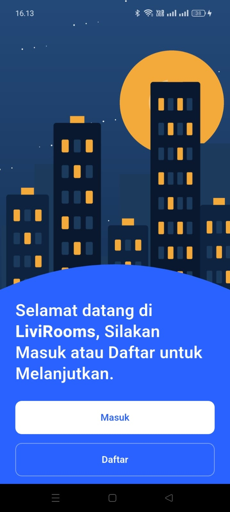
*Gambar 1.1: Layar Selamat Datang & Pemilihan Masuk atau Daftar Akun*

#### Penjelasan Elemen Antarmuka:
- **Header Visual Kota Malam:** Ilustrasi gedung bertingkat modern di bawah rembulan yang melambangkan hunian nyaman dan aman.
- **Teks Sambutan:** Memberikan petunjuk jelas: *"Selamat datang di LiviRooms, Silakan Masuk atau Daftar untuk Melanjutkan."*
- **Tombol "Masuk":** Tombol berlatar belakang putih untuk pengguna yang telah memiliki akun sebelumnya.
- **Tombol "Daftar":** Tombol berbingkai biru untuk pengguna baru yang ingin membuat akun personal.

#### Petunjuk Pengoperasian:
1. Jika Anda sudah pernah mendaftar, ketuk tombol **Masuk** untuk menuju formulir login.
2. Jika Anda adalah tamu baru, ketuk tombol **Daftar** untuk melengkapi data registrasi akun.

---

### 1.2 Formulir Registrasi Akun Baru

Jika Anda memilih tombol Daftar, aplikasi menyajikan formulir pendaftaran yang bersih dan mudah diisi.

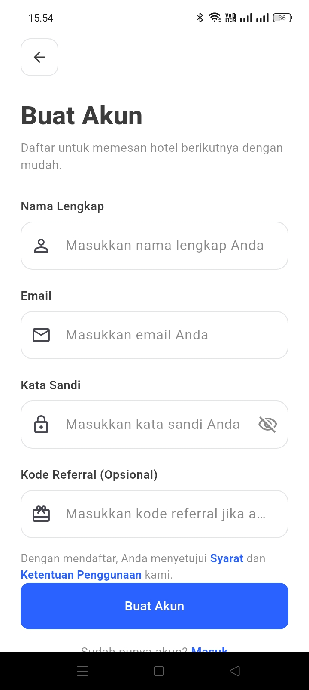
*Gambar 1.2: Formulir Buat Akun Baru Livirooms*

#### Penjelasan Elemen Antarmuka:
- **Tombol Panah Kembali (`<`):** Terletak di pojok kiri atas untuk kembali ke layar sambutan sebelumnya.
- **Kolom "Nama Lengkap":** Kolom input teks berikon pengguna (`person`) untuk mencatat nama lengkap sesuai kartu identitas (KTP / Paspor).
- **Kolom "Email":** Kolom berikon amplop surat untuk menerima invoice, tiket elektronik, dan kode verifikasi keamanan.
- **Kolom "Kata Sandi":** Kolom berikon gembok disertai ikon mata (*eye toggle*) untuk menampilkan atau menyembunyikan karakter sandi. Sandi wajib minimal 8 karakter demi keamanan akun.
- **Kolom "Kode Referral (Opsional)":** Kolom berikon kado untuk memasukkan kode ajakan dari rekan guna mendapatkan voucher cashback sewa.
- **Pernyataan Persetujuan:** Tautan aktif menuju *Syarat dan Ketentuan Penggunaan* aplikasi.
- **Tombol Biru "Buat Akun":** Tombol konfirmasi utama untuk mendaftarkan akun ke sistem Livirooms.
- **Tautan Alternatif:** Teks *"Sudah punya akun? Masuk"* untuk berpindah cepat ke halaman login jika Anda salah memilih menu.

---

### 1.3 Formulir Masuk (Login) & Pemulihan Kata Sandi

Bagi pengguna yang telah memiliki akun, halaman login menyediakan akses instan.

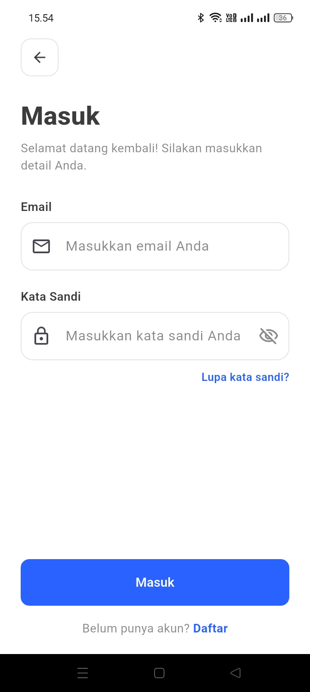
*Gambar 1.3: Formulir Masuk (Login) Pengguna Terdaftar*

#### Penjelasan Elemen Antarmuka:
- **Judul "Masuk":** Disertai teks pengantar *"Selamat datang kembali! Silakan masukkan detail Anda."*
- **Kolom Email:** Masukkan alamat surel yang Anda daftarkan saat registrasi.
- **Kolom Kata Sandi:** Masukkan kombinasi kata sandi rahasia Anda.
- **Tautan "Lupa kata sandi?":** Tautan bantuan di bawah kolom sandi untuk mengatur ulang kata sandi melalui tautan reset yang dikirimkan ke kotak masuk email.
- **Tombol Biru "Masuk":** Mengirimkan kredensial login terenkripsi ke backend Sanctum Laravel.
- **Tautan Registrasi Cepat:** Teks *"Belum punya akun? Daftar"* di bagian paling bawah.

---

### 1.4 Verifikasi Keamanan OTP Email

Untuk menjaga akun Anda dari akses pihak ketiga yang tidak bertanggung jawab, Livirooms mengimplementasikan *Multi-Factor Authentication* melalui verifikasi kode OTP (*One-Time Password*).

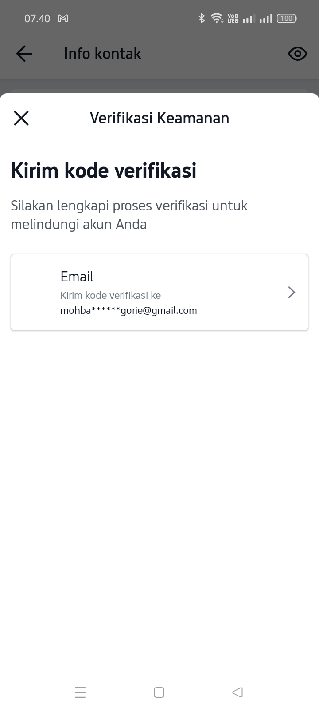
*Gambar 1.4: Layar Permintaan Kode Verifikasi Keamanan (OTP)*

#### Penjelasan Elemen Antarmuka:
- **Header "Info Kontak":** Memastikan Anda berada di modul verifikasi keamanan profil.
- **Dialog "Verifikasi Keamanan":** Teks instruksi: *"Silakan lengkapi proses verifikasi untuk melindungi akun Anda."*
- **Tujuan Pengiriman:** Menampilkan alamat email yang dituju (misal: `mohba***@gmail.com`).
- **Aksi Kirim Kode:** Ketuk kartu email untuk meminta sistem mengirimkan 6 digit angka kode rahasia ke kotak masuk surel Anda.

#### Petunjuk Pengoperasian:
1. Ketuk kartu verifikasi email yang tertera di layar.
2. Buka aplikasi email di ponsel Anda dan periksa pesan masuk dari **Livirooms Security**.
3. Masukkan 6 angka yang diterima ke kolom verifikasi aplikasi.

---

### 1.5 Verifikasi Identitas (KYC) & Peningkatan Akun

Bagi pengguna yang ingin menyewa unit jangka panjang (bulanan/tahunan) atau mengajukan permohonan menjadi *Mitra Host*, sistem mewajibkan pengisian identitas resmi sesuai KTP.

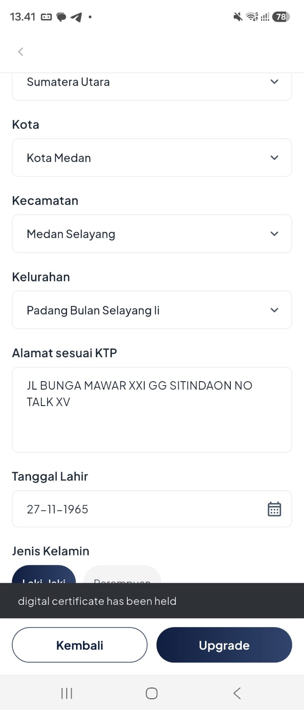
*Gambar 1.5: Formulir Pemadanan Data Identitas KTP untuk Upgrade Akun*

#### Penjelasan Elemen Antarmuka:
- **Pilihan Wilayah Berjenjang:** Dropdown Provinsi (*Sumatera Utara*), Kota (*Kota Medan*), Kecamatan (*Medan Selayang*), dan Kelurahan (*Padang Bulan Selayang II*).
- **Kolom "Alamat sesuai KTP":** Masukkan nama jalan, nomor rumah, RT/RW persis sesuai dokumen negara.
- **Pemilih "Tanggal Lahir":** Kolom bertanggal berikon kalender untuk memilih hari, bulan, dan tahun kelahiran.
- **Pemilih "Jenis Kelamin":** Pilihan radio tombol (*Laki-laki* atau *Perempuan*).
- **Notifikasi Sistem:** Status sertifikat digital terikat (*digital certificate has been held*).
- **Tombol "Kembali":** Tombol berbingkai untuk kembali ke menu sebelumnya.
- **Tombol "Upgrade":** Tombol solid gelap untuk mengirimkan berkas identitas ke tim operasional agar akun Anda mendapatkan lencana verifikasi centang biru.

---

# BAB 2: EKSPLORASI, PENCARIAN & FILTER AKOMODASI

### 2.1 Memahami Menu Navigasi Bawah (Bottom Navigation)

Pada bagian bawah seluruh layar utama aplikasi Livirooms, terdapat bilah navigasi utama dengan 4 menu:

| No | Menu Navigasi | Ikon | Fungsi Utama & Akses Fitur |
| :---: | :--- | :---: | :--- |
| **1** | **Beranda** | 🏠 | Menemukan promo banner, kategori Hotel, Pesawat, Villa & Apt, serta shortcut kota favorit. |
| **2** | **Pesanan** | 📄 | Memantau reservasi aktif ("Sedang Menginap"), lembar e-voucher digital QR, dan riwayat pesanan. |
| **3** | **Pesan** | 💬 | Ruang obrolan langsung (chat) dengan host properti, staf administrasi, dan riwayat notifikasi. |
| **4** | **Profil** | 👤 | Pengelolaan akun member, buku kontak traveler, koleksi wishlist tersimpan, dan bantuan 24 jam. |

Detail operasional masing-masing menu navigasi:
1. **Beranda:** Menemukan promo terkini, kategori akomodasi (Hotel, Pesawat, Villa & Apt), dan pilihan kota tujuan.
2. **Pesanan:** Memantau pesanan aktif yang sedang menginap, jadwal perjalanan mendatang, dan e-voucher tiket digital.
3. **Pesan:** Jalur percakapan interaktif langsung dengan host/admin properti serta notifikasi pembaruan sistem.
4. **Profil:** Mengelola data akun keanggotaan, buku kontak traveler tersimpan, kupon promo diskon, dan pusat bantuan.

---

### 2.2 Menjelajahi Beranda Utama (Kategori, Promo & Kota)

Layar Beranda dirancang intuitif untuk mempercepat proses pencarian hunian idaman Anda.

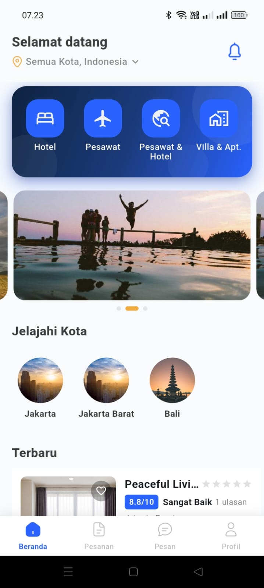
*Gambar 2.1: Layar Beranda Utama (Home Screen) Aplikasi Livirooms*

#### Penjelasan Elemen Antarmuka:
- **Salam Pengguna & Pemilih Kota:** Header *"Selamat datang"* disertai tombol dropdown *"Semua Kota, Indonesia"* untuk memfilter properti berdasarkan lokasi geografis.
- **Ikon Lonceng Notifikasi:** Terletak di pojok kanan atas untuk membuka pesan pembaruan penting.
- **Kartu Kategori Utama (Grid Biru):**
  - **Hotel:** Untuk pemesanan kamar hotel bintang 3 hingga bintang 5.
  - **Pesawat:** Navigasi pemesanan tiket penerbangan.
  - **Pesawat & Hotel:** Paket gabungan perjalanan hemat.
  - **Villa & Apt.:** Khusus sewa apartemen studio, apartemen keluarga, dan vila liburan.
- **Banner Carousel Promo:** Geser ke samping untuk melihat diskon menginap dan paket liburan menarik.
- **Bagian "Jelajahi Kota":** Pintasan thumbnail foto kota favorit seperti Jakarta, Jakarta Barat, dan Bali.
- **Bagian "Terbaru":** Kartu properti rekomendasi terbaru lengkap dengan rating skor dan tombol simpan favorit (ikon hati).

---

### 2.3 Pencarian & Filter Kamar Hotel

Saat Anda mengetuk ikon kategori **Hotel**, layar dialog parameter reservasi akan muncul.

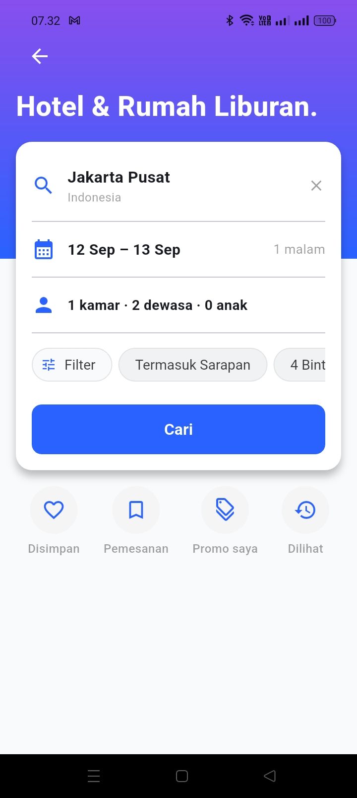
*Gambar 2.2: Dialog Pemilihan Parameter Pencarian Hotel & Rumah Liburan*

#### Penjelasan Elemen Antarmuka:
- **Tujuan Lokasi:** Menampilkan kota target (*Jakarta Pusat, Indonesia*).
- **Rentang Tanggal:** Kalender pemilih tanggal check-in (*12 Sep*) hingga check-out (*13 Sep*) dengan durasi menginap (*1 malam*).
- **Kapasitas Tamu & Kamar:** Pengaturan jumlah kamar (*1 kamar*), tamu dewasa (*2 dewasa*), dan anak-anak (*0 anak*).
- **Filter Cepat:** Opsi centang kriteria populer seperti *"Termasuk Sarapan"* dan *"Bintang 4"*.
- **Tombol Biru "Cari":** Menjalankan pencarian inventaris kamar secara realtime.
- **Pintasan Riwayat:** Tombol cepat *"Disimpan"*, *"Pemesanan"*, *"Promo saya"*, dan *"Dilihat"* untuk membuka catatan pencarian sebelumnya.

---

### 2.4 Hasil Pencarian Hotel & Rekomendasi

Setelah menekan tombol Cari, sistem menyajikan daftar lengkap hotel yang tersedia.

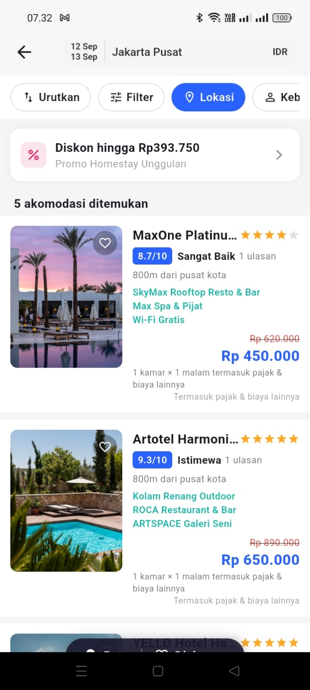
*Gambar 2.3: Halaman Hasil Pencarian Hotel di Wilayah Jakarta Pusat*

#### Penjelasan Elemen Antarmuka:
- **Header Parameter Ringkas:** Menampilkan tanggal menginap (*12 Sep - 13 Sep*) dan tombol **Urutkan**, **Filter**, dan **Lokasi**.
- **Banner Promosi Homestay:** Pemberitahuan potongan harga eksklusif (misal: *Diskon hingga Rp 393.750*).
- **Informasi Jumlah Temuan:** Teks status *"5 akomodasi ditemukan"*.
- **Kartu Properti MaxOne Platinum:**
  - Skor ulasan: *Sangat Baik (8.7/10)* dari ulasan tamu.
  - Jarak strategis: *800m dari pusat kota*.
  - Fasilitas unggulan: *SkyMax Rooftop Resto & Bar*, *Max Spa & Pijat*, *Wi-Fi Gratis*.
  - Transparansi harga: *Rp 450.000 / kamar / malam (Termasuk pajak & biaya lainnya)*.
- **Kartu Properti Artotel Harmoni:** Menampilkan opsi hotel alternatif bintang tinggi dengan kolam renang outdoor dan galeri seni ARTSPACE (*Rp 650.000 / malam*).

---

### 2.5 Pencarian & Filter Villa / Apartemen

Jika Anda memerlukan hunian privat atau apartemen keluarga, pilih kategori **Villa & Apt.**

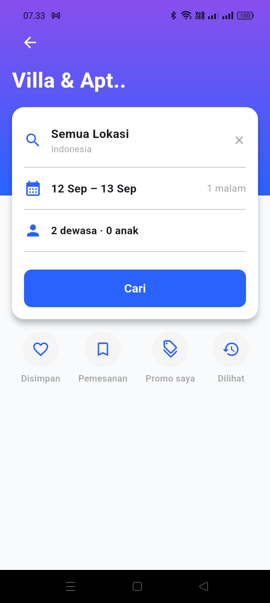
*Gambar 2.4: Form Parameter Pencarian Villa & Apartemen*

#### Penjelasan Elemen Antarmuka:
- **Filter Wilayah:** Mencakup seluruh wilayah Indonesia (*Semua Lokasi, Indonesia*).
- **Pemilih Tanggal Fleksibel:** Menentukan hari masuk dan hari keluar hunian.
- **Komposisi Tamu:** Memilih jumlah orang dewasa dan anak yang akan menempati unit.

---

### 2.6 Hasil Pencarian Villa & Apartemen

Sistem akan memfilter seluruh basis data inventaris unit apartemen dan vila yang berstatus siap sewa.

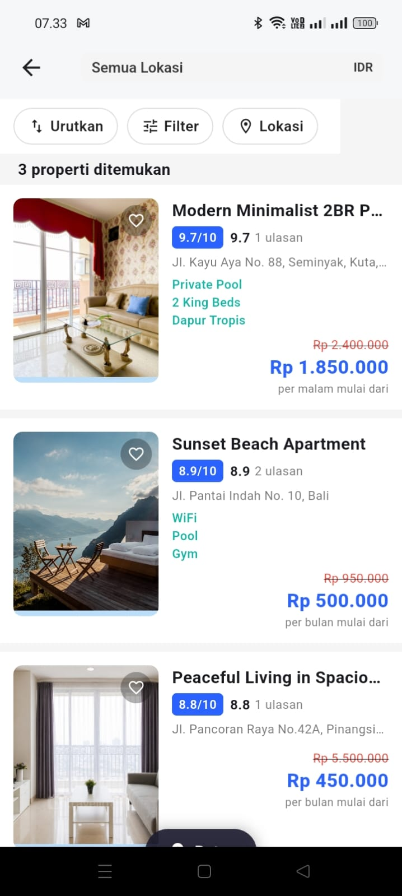
*Gambar 2.5: Katalog Hasil Pencarian Villa Mewah dan Apartemen Bulanan*

#### Penjelasan Elemen Antarmuka:
- **Jumlah Hasil Ditemukan:** *"3 properti ditemukan"*.
- **Kartu Villa Seminyak (Modern Minimalist 2BR Private Pool Villa):**
  - Rating super: *9.7 / 10 Istimewa*.
  - Alamat: *Jl. Kayu Aya No. 88, Seminyak, Kuta, Bali*.
  - Fasilitas kunci: *Private Pool*, *2 King Beds*, *Dapur Tropis*.
  - Harga per malam: *Rp 1.850.000*.
- **Kartu Sunset Beach Apartment:**
  - Rating: *8.9 / 10*.
  - Fasilitas: *WiFi, Pool, Gym*.
  - Skema sewa: *Rp 500.000 per bulan mulai dari*.
- **Kartu Peaceful Living Apartment:** Pilihan apartemen budget strategis di Jakarta Barat (*Rp 450.000 / bulan*).

---

# BAB 3: MEMBACA & MEMILIH DETAIL PROPERTI / HOTEL

### 3.1 Detail Ringkasan & Pemilihan Kamar Hotel

Mengetuk salah satu kartu hotel akan membawa Anda ke halaman profil properti terperinci.

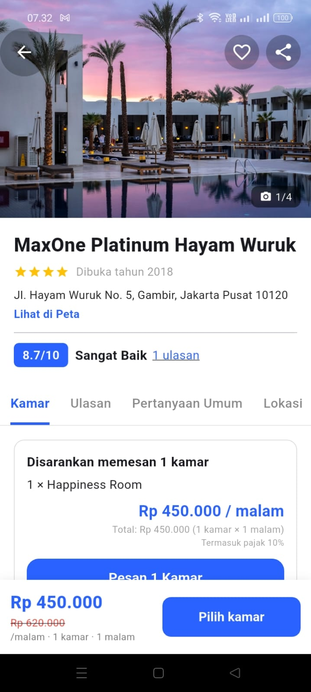
*Gambar 3.1: Halaman Detail Hotel MaxOne Platinum Hayam Wuruk*

#### Penjelasan Elemen Antarmuka:
- **Galeri Carousel Foto:** Indikator foto resolusi tinggi (*1/4*) dengan ikon bagikan dan simpan favorit.
- **Informasi Gedung:** Tahun peresmian (*Dibuka tahun 2018*) dan alamat lengkap (*Jl. Hayam Wuruk No. 5, Gambir, Jakarta Pusat*).
- **Tautan Peta:** Teks interaktif *"Lihat di Peta"* untuk memeriksa rute langsung.
- **Tab Navigasi Halaman:** Terdiri atas tab **Kamar**, **Ulasan**, **Pertanyaan Umum**, dan **Lokasi**.
- **Kamar Rekomendasi:** Penawaran *1 x Happiness Room* seharga *Rp 450.000 / malam (Termasuk pajak 10%)*.
- **Bottom Action Bar:** Menampilkan ringkasan durasi menginap serta tombol biru **"Pilih kamar"**.

---

### 3.2 Membaca Ulasan Terverifikasi & FAQ Hotel

Untuk memastikan kenyamanan menginap, Anda dapat membaca umpan balik nyata dari tamu sebelumnya dan mengajukan pertanyaan kepada pengelola.

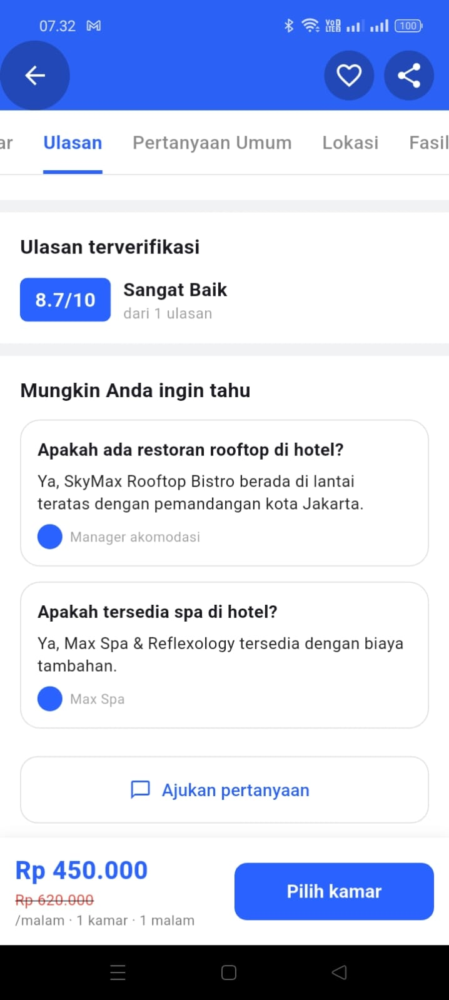
*Gambar 3.2: Tab Ulasan Terverifikasi dan Tanya Jawab (FAQ) Pengelola Hotel*

#### Penjelasan Elemen Antarmuka:
- **Skor Ulasan Terverifikasi:** Nilai kepuasan tamu (*Sangat Baik 8.7/10*).
- **Kutipan Tanya Jawab Populer (*Mungkin Anda Ingin Tahu*):**
  - Pertanyaan ketersediaan restoran: Dijawab resmi oleh *Manager Akomodasi* perihal *SkyMax Rooftop Bistro*.
  - Pertanyaan layanan spa: Dijawab oleh pengelola perihal jam operasional *Max Spa & Reflexology*.
- **Tombol "Ajukan Pertanyaan":** Memungkinkan calon tamu mengirimkan pertanyaan spesifik langsung kepada manajemen hotel sebelum memesan.

---

### 3.3 Memeriksa Kebijakan Akomodasi, Deposit & Pembatalan

Ketahui aturan main dan batasan sebelum mengonfirmasi transaksi.

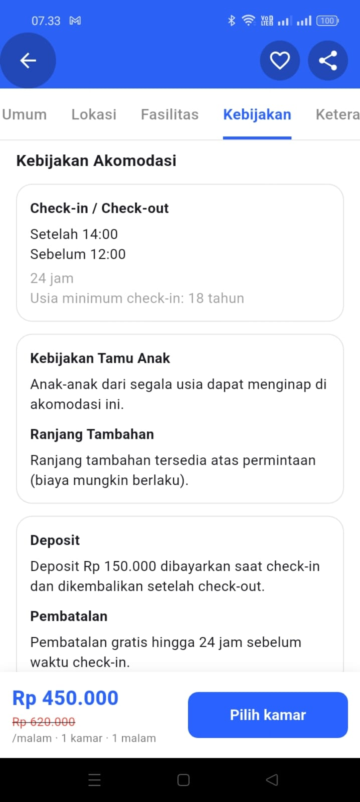
*Gambar 3.3: Kebijakan Check-in, Batas Usia, Ketentuan Anak, Deposit, dan Pembatalan*

#### Penjelasan Elemen Antarmuka:
- **Jam Check-in & Check-out:** Waktu check-in setelah pukul *14:00*, check-out sebelum pukul *12:00* (Layanan resepsionis *24 jam*).
- **Batas Usia Minimum:** Wajib berusia minimal *18 tahun* untuk mendaftar check-in mandiri.
- **Kebijakan Anak & Ranjang Tambahan:** Anak dari segala usia diperbolehkan menginap; ranjang ekstra tersedia dengan konfirmasi sebelumnya.
- **Ketentuan Deposit Jaminan:** Wajib menyerahkan deposit tunai/kartu sebesar *Rp 150.000* saat check-in yang akan dikembalikan penuh saat checkout jika tidak terjadi kerusakan.
- **Kebijakan Pembatalan:** Jaminan *Pembatalan gratis hingga 24 jam* sebelum waktu menginap.

---

### 3.4 Melihat Galeri Foto & Rating Villa Mewah

Aplikasi Livirooms juga memfasilitasi penjelajahan vila eksklusif dengan tata letak visual imersif.

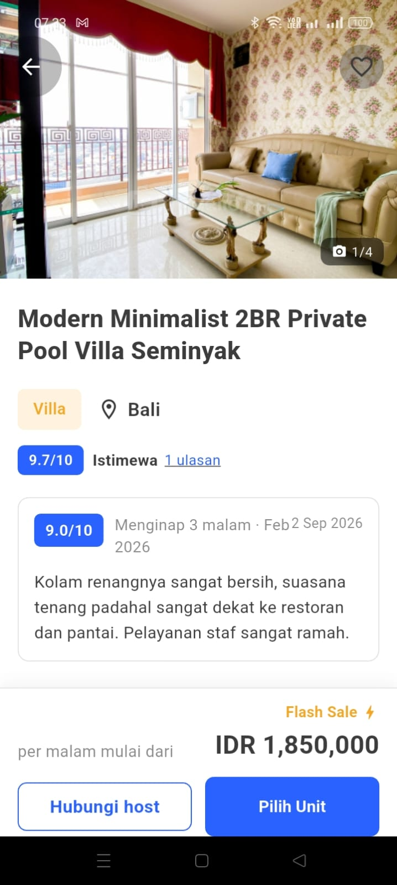
*Gambar 3.4: Tampilan Galeri Foto dan Rating Villa Tropis Seminyak*

#### Penjelasan Elemen Antarmuka:
- **Skor Istimewa 9.7/10:** Menampilkan kepuasan tamu terhadap kebersihan kolam renang pribadi dan ketenangan lingkungan vila.
- **Kutipan Ulasan Nyata:** Testimoni mengenai keramahan staf serta akses yang sangat dekat menuju pantai.
- **Tombol "Hubungi Host":** Menghubungkan Anda langsung ke pemilik vila untuk negosiasi atau permohonan khusus.
- **Tombol "Pilih Unit":** Melanjutkan ke pemilihan tanggal sewa.

---

### 3.5 Detail Properti Apartemen & Sewa Fleksibel

Untuk kebutuhan tempat tinggal praktis, profil apartemen menyajikan pilihan skema bulanan dan harian yang transparan.

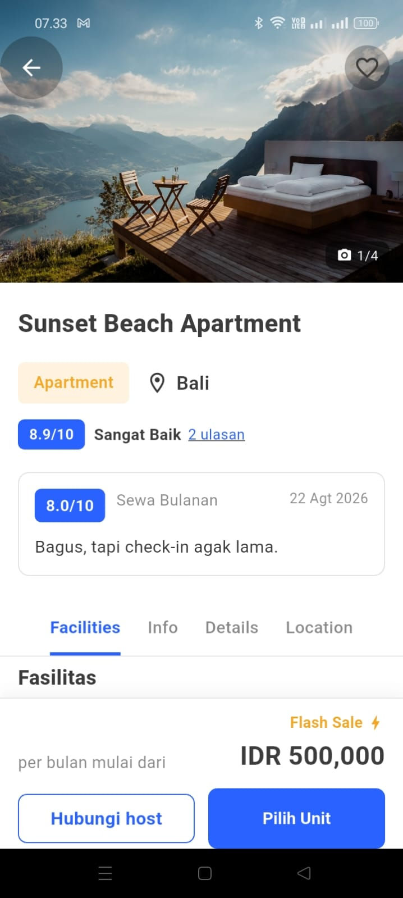
*Gambar 3.5: Detail Unit Apartemen Sunset Beach*

#### Penjelasan Elemen Antarmuka:
- **Label Kategori:** Indikator jenis properti (*Apartment Bali*).
- **Ulasan Tamu:** Menampilkan kritik konstruktif dan waktu penilaian (*22 Agt 2026*).
- **Tab Konten:** Tab cepat untuk memeriksa **Facilities**, **Info Details**, dan **Location**.
- **Harga Promo Mulai Dari:** Penawaran paket sewa bulanan mulai dari *Rp 500.000*.

---

### 3.6 Memeriksa Fasilitas Kamar & Perabot Tidur

Pastikan jumlah kasur dan tata ruang kamar sesuai kebutuhan Anda dan keluarga.

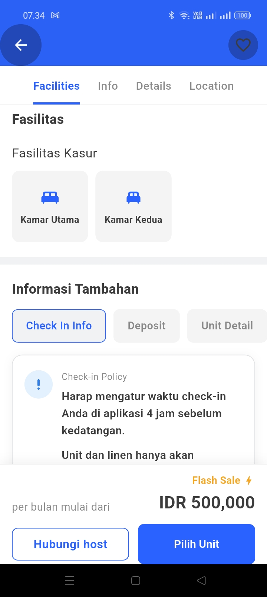
*Gambar 3.6: Rincian Fasilitas Kamar Tidur Utama dan Kamar Tidur Kedua*

#### Penjelasan Elemen Antarmuka:
- **Fasilitas Kamar Utama:** Kasur empuk berukuran besar (*King/Queen*), pendingin ruangan AC, lemari pakaian, dan nakas.
- **Fasilitas Kamar Kedua:** Kasur tipe *single bed* untuk anak atau rekan menginap tambahan.
- **Kebutuhan Linen:** Informasi ketersediaan sprei bersih, bantal, dan selimut sanitasi.

---

### 3.7 Memeriksa Peta Lokasi & Akses Sekitar Unit

Menghindari salah arah dengan panduan lokasi akurat yang tersemat pada aplikasi.

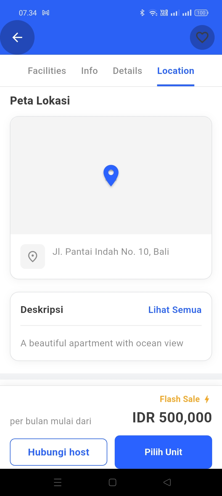
*Gambar 3.7: Peta Lokasi Interaktif dan Alamat Lengkap Unit*

#### Penjelasan Elemen Antarmuka:
- **Peta Lokasi Terintegrasi:** Menampilkan titik koordinat gedung apartemen terhadap jalan utama dan bibir pantai.
- **Alamat Resmi:** *Jl. Pantai Indah No. 10, Bali*.
- **Deskripsi Properti:** *"A beautiful apartment with ocean view"* lengkap dengan opsi tombol *"Lihat Semua"* untuk membaca panduan lingkungan sekitar gedung.

---

### 3.8 Memeriksa Kebijakan Check-in Mandiri & Deposit Unit

Apartemen modern di Livirooms menerapkan panduan mandiri (*self check-in*) yang terstruktur.

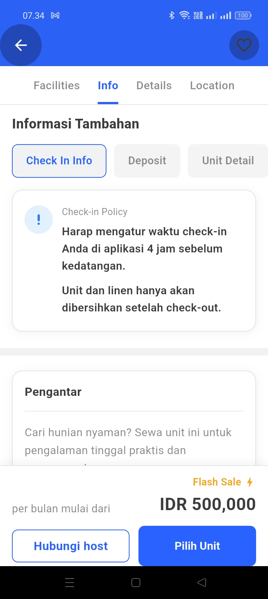
*Gambar 3.8: Kebijakan Check-In Mandiri, Pembersihan Linen, dan Deposit Apartemen*

#### Penjelasan Elemen Antarmuka:
- **Aturan Pengaturan Waktu Check-In:** Tamu diwajibkan mengatur konfirmasi kedatangan di aplikasi setidaknya *4 jam sebelum tiba di lokasi*.
- **Kebijakan Pembersihan Unit:** Standar operasional pembersihan unit dan pergantian sprei/linen dilakukan menyeluruh setelah jadwal check-out tamu berakhir.
- **Ketentuan Deposit:** Besaran dana jaminan kunci akses gedung dan kartu fasilitas lift.

---

# BAB 4: ALUR PEMESANAN (BOOKING FLOW)

### 4.1 Rincian Paket Sewa Harian Apartemen & Diskon Menginap

Saat Anda siap memesan unit apartemen, aplikasi menyajikan lembar konfirmasi transparan berisi apa saja yang termasuk dan tidak termasuk dalam biaya sewa.

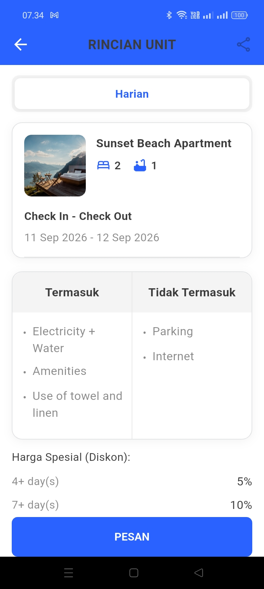
*Gambar 4.1: Lembar Rincian Unit Sewa Harian dan Penawaran Diskon Durasi Menginap*

#### Penjelasan Elemen Antarmuka:
- **Header Skema Sewa:** Menampilkan opsi sewa terpilih (*Harian*).
- **Informasi Unit & Kapasitas:** *Sunset Beach Apartment* dengan spesifikasi *2 Tempat Tidur, 1 Kamar Mandi*.
- **Jadwal Check-in s/d Check-out:** *11 Sep 2026 - 12 Sep 2026*.
- **Kolom "Termasuk" (*Included*):**
  - Listrik & Air (*Electricity + Water*)
  - Perlengkapan Mandi (*Amenities*)
  - Handuk & Sprei Bersih (*Use of towel and linen*)
- **Kolom "Tidak Termasuk" (*Excluded*):** Biaya parkir kendaraan khusus dan biaya paket internet pribadi.
- **Tabel Diskon Durasi Menginap (*Special Discount*):**
  - Menginap 4 hari atau lebih: Diskon otomatis **5%**.
  - Menginap 7 hari atau lebih: Diskon otomatis **10%**.
- **Tombol Biru "PESAN":** Tombol konfirmasi untuk langsung melanjutkan ke formulir identitas tamu.

---

### 4.2 Formulir Checkout & Pengisian Data Identitas Tamu

Pada pemesanan hotel, layar checkout meminta rincian data tamu yang akan menginap di kamar.

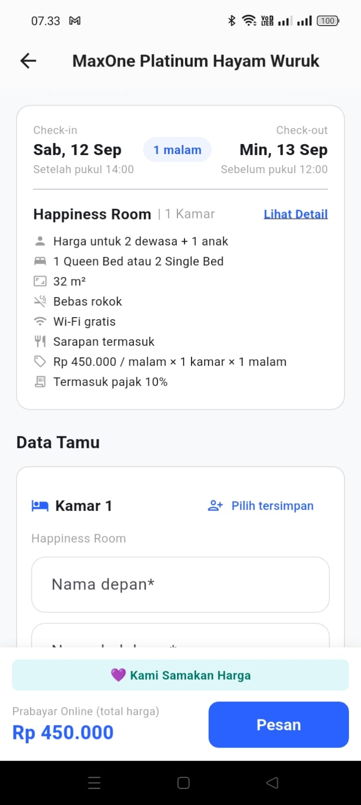
*Gambar 4.2: Formulir Checkout Kamar Hotel MaxOne Hayam Wuruk*

#### Penjelasan Elemen Antarmuka:
- **Ringkasan Jadwal Menginap:**
  - Check-in: *Sabtu, 12 Sep (setelah 14:00)*.
  - Check-out: *Minggu, 13 Sep (sebelum 12:00)*.
  - Durasi: *1 malam*.
- **Rincian Kamar:** *Happiness Room (1 Kamar)*, kapasitas *2 dewasa + 1 anak*, tempat tidur *1 Queen Bed atau 2 Single Bed*, luas ruangan *32 m²*, *Bebas rokok*, *Wi-Fi gratis*, *Sarapan termasuk*.
- **Struktur Harga:** *Rp 450.000 / malam x 1 kamar x 1 malam (Termasuk pajak 10%)*.
- **Formulir Data Tamu Kamar 1:** Kolom input *Nama depan*, *Nama belakang*, disertai tombol pintasan *"Pilih tersimpan"* untuk mengambil data kontak traveler secara instan tanpa mengetik ulang.
- **Badge Jaminan:** Lencana *"Kami Samakan Harga"* yang menjamin tarif terbaik.
- **Bottom Bar:** Menampilkan status *Prabayar Online Rp 450.000* dan tombol konfirmasi **"Pesan"**.

---

# BAB 5: PEMBAYARAN & KONFIRMASI INSTAN (CHECKOUT)

### 5.1 Memilih Saluran Pembayaran Berlisensi (Midtrans Snap)

Setelah menekan tombol **Pesan**, aplikasi Livirooms secara aman membuka gerbang pembayaran terenkripsi **Midtrans Snap SDK** dengan waktu jatuh tempo 24 jam:

| Saluran Pembayaran | Metode | Waktu Verifikasi | Biaya Admin |
| :--- | :--- | :--- | :--- |
| **Virtual Account BCA** | Nomor VA Otomatis | Instan (< 5 detik) | Gratis |
| **Mandiri Bill Payment** | Kode Perusahaan + VA | Instan (< 5 detik) | Gratis |
| **Virtual Account BNI / BRI**| Nomor VA Bank | Instan (< 5 detik) | Gratis |
| **QRIS Dinamis** | Scan via BCA Mobile, Livin, GoPay, OVO, Dana | Instan (< 5 detik) | Gratis |
| **GoPay & ShopeePay** | App-to-App Redirection | Instan (< 3 detik) | Gratis |
| **Kartu Kredit / Debit** | Visa, MasterCard, JCB dengan 3D Secure OTP | Instan (< 10 detik) | Standar Bank |

---

### 5.2 Cara Membayar via Virtual Account Bank
1. Pada menu pembayaran Midtrans, pilih opsi **BCA Virtual Account** (atau bank rekanan Anda).
2. Salin nomor rekening Virtual Account unik yang tercantum di layar ponsel.
3. Buka m-Banking atau ATM bank Anda, masuk ke menu **Transfer Virtual Account**, lalu tempel nomor tersebut.
4. Periksa kecocokan nama pesanan Anda (contoh: *LIVIROOMS - BOOKING #HTL-20260904*).
5. Masukkan PIN transaksi perbankan Anda hingga notifikasi pembayaran sukses terbit.

---

### 5.3 Pembayaran via QRIS & Dompet Digital (GoPay)
1. Pilih opsi **GoPay** atau **QRIS**.
2. Jika memilih GoPay, aplikasi Gojek di ponsel Anda akan otomatis terbuka. Konfirmasikan pembayaran dengan sidik jari atau PIN dompet digital Anda.
3. Jika memilih QRIS, pindai kode QR dinamis di layar menggunakan aplikasi e-wallet apa pun yang mendukung QRIS Standar Bank Indonesia.

---

### 5.4 Konfirmasi Pembayaran Instan & Deep Link Otomatis
- Segera setelah bank/e-wallet memproses transfer, sistem Midtrans mengirimkan sinyal Webhook aman (*Server-to-Server*) ke backend Livirooms.
- Layar aplikasi secara otomatis merespons melalui Deep Link `livirooms://payment-result` dan langsung mengubah status pesanan menjadi **"Lunas / Terkonfirmasi"** tanpa perlu mengunggah bukti struk transfer fisik!

---

# BAB 6: MENGELOLA PERJALANAN DI MENU "PESANAN"

### 6.1 Membuka Daftar Pesanan Aktif, Selesai & Dibatalkan

Seluruh riwayat perjalanan dan reservasi kamar Anda dikelola secara terpusat pada tab kedua navigasi bawah yaitu menu **Pesanan**.

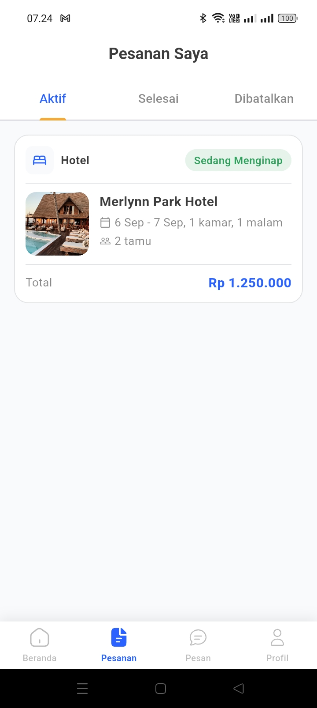
*Gambar 6.1: Halaman Pesanan Saya Menampilkan Pesanan Aktif Sedang Menginap*

#### Penjelasan Elemen Antarmuka:
- **Tab Klasifikasi Status:**
  - **Aktif:** Pesanan yang sedang berlangsung atau jadwal menginap mendatang.
  - **Selesai:** Riwayat pesanan yang telah rampung dan siap diberikan ulasan.
  - **Dibatalkan:** Riwayat reservasi yang dibatalkan oleh tamu atau sistem.
- **Kartu Pesanan Hotel Aktif:**
  - Jenis properti: Berikon tempat tidur dengan label *Hotel*.
  - Badge status hijau: **Sedang Menginap** (menandakan tamu telah sukses check-in).
  - Nama akomodasi: *Merlynn Park Hotel*.
  - Detail jadwal: *6 Sep - 7 Sep, 1 kamar, 1 malam, 2 tamu*.
  - Total transaksi: *Rp 1.250.000*.

---

### 6.2 Membaca E-Voucher Digital, Kode Booking & Kebijakan Akomodasi

Mengetuk kartu pesanan akan membuka lembar tiket digital lengkap (*E-Voucher*).

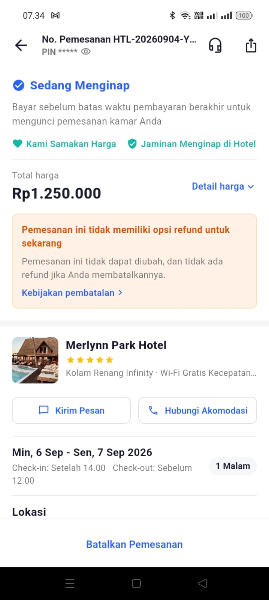
*Gambar 6.2: E-Voucher Digital Lengkap dengan Nomor Pemesanan dan Aturan Check-in*

#### Penjelasan Elemen Antarmuka:
- **Nomor Pemesanan:** Kode alfanumerik resmi (*No. Pemesanan HTL-20260904-YE7K*) disertai PIN reservasi tersembunyi yang dapat dibuka dengan ikon mata.
- **Status Sedang Menginap:** Penanda status aktif yang sah di resepsionis gedung.
- **Lencana Jaminan:** *Kami Samakan Harga* dan *Jaminan Menginap di Hotel*.
- **Rincian Total Biaya:** Total tagihan *Rp 1.250.000* disertai tombol *Detail harga* untuk melihat komponen pajak.
- **Peringatan Kebijakan Pembatalan:** Kotak oranye yang menjelaskan ketentuan pengembalian dana (*Non-refundable* atau batas waktu pembatalan gratis).
- **Profil Akomodasi & Tombol Komunikasi:**
  - Nama dan rating bintang hotel (*Merlynn Park Hotel, Bintang 5*).
  - Tombol **"Kirim Pesan"**: Mengirimkan chat langsung kepada front desk akomodasi.
  - Tombol **"Hubungi Akomodasi"**: Membuka dialer telepon resmi pihak hotel.
- **Jadwal Jam Check-in & Check-out:** Waktu check-in setelah *14:00* dan check-out sebelum *12:00*.
- **Tombol "Batalkan Pemesanan":** Tautan teks biru di bagian bawah untuk mengajukan permohonan pembatalan sesuai aturan yang berlaku.

---

# BAB 7: KOMUNIKASI CHAT & KOTAK MASUK PESAN

### 7.1 Tampilan Tab Pesan saat Tamu Belum Masuk Akun

Bagi pengguna yang menjelajah aplikasi tanpa masuk ke akun, tab Pesan menyajikan himbauan keamanan.

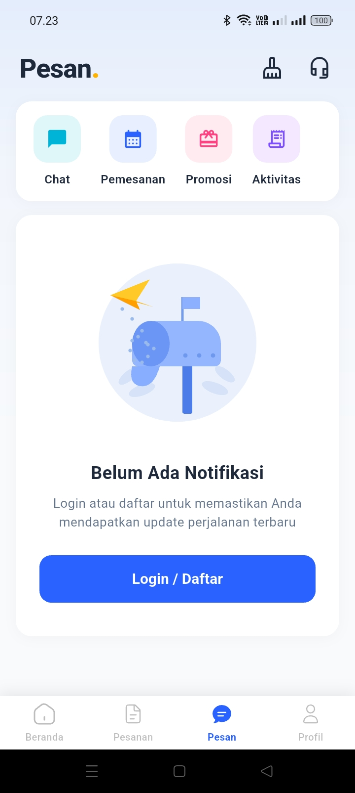
*Gambar 7.1: Tampilan Tab Pesan untuk Pengguna yang Belum Masuk Akun*

#### Penjelasan Elemen Antarmuka:
- **Header Kategori:** Tab navigasi *Chat*, *Pemesanan*, *Promosi*, dan *Aktivitas*.
- **Ilustrasi Kotak Surat:** Visual ramah bertuliskan *"Belum Ada Notifikasi"*.
- **Pesan Edukasi:** *"Login atau daftar untuk memastikan Anda mendapatkan update perjalanan terbaru."*
- **Tombol Biru "Login / Daftar":** Pintasan satu ketukan untuk segera masuk atau membuat akun.

---

### 7.2 Memahami Tab Kategori Kotak Masuk (Chat, Pemesanan, Promosi, Aktivitas)

Setelah masuk ke akun, tab Pesan bertransformasi menjadi pusat komunikasi perjalanan terpadu.

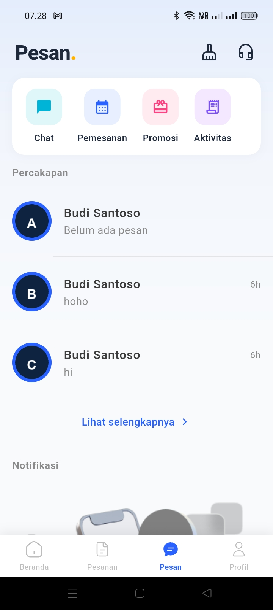
*Gambar 7.2: Pusat Kotak Masuk Pesan dengan Kategori Komunikasi Lengkap*

#### Penjelasan Elemen Antarmuka:
- **Kategori Tab Atas:**
  - 💬 **Chat:** Riwayat obrolan langsung dengan pemilik properti (host) dan staf operasional.
  - 📅 **Pemesanan:** Notifikasi konfirmasi booking, pengingat check-in, dan e-voucher.
  - 🎁 **Promosi:** Informasi diskon mingguan, flash sale, dan kupon reward cashback.
  - 🧾 **Aktivitas:** Pemberitahuan perubahan akun, bukti pembayaran, dan log login.
- **Daftar Kontak Percakapan:** Menampilkan pesan masuk dari staf/host (misal: *Budi Santoso*) dengan cuplikan pesan terakhir dan penanda waktu kirim (*6h* yang lalu).
- **Tautan "Lihat selengkapnya":** Membuka arsip obrolan terdahulu.

---

### 7.3 Daftar Percakapan Terkait Nomor Reservasi

Untuk mempermudah identifikasi pesanan, obrolan otomatis ditandai dengan kode reservasi kamar terkait.

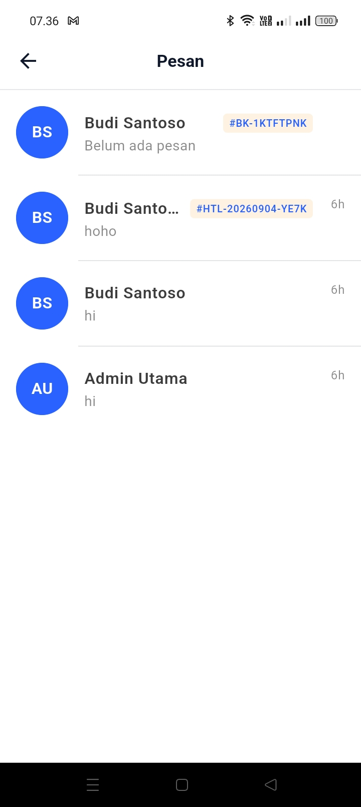
*Gambar 7.4: Daftar Percakapan Terkait Kode Reservasi Spesifik*

#### Penjelasan Elemen Antarmuka:
- **Percakapan Booking Apartemen:** Ditandai dengan kode unik booking apartemen (*#BK-1KTFTPNK*).
- **Percakapan Booking Hotel:** Ditandai dengan kode booking hotel (*#HTL-20260904-YE7K*).
- **Avatar Inisial Pengirim:** *BS* (Budi Santoso - Host) dan *AU* (Admin Utama - Customer Service Livirooms) sehingga tamu dapat membedakan pihak yang sedang diajak berkomunikasi.

---

### 7.4 Berinteraksi Langsung di Ruang Chat dengan Host Properti

Tamu dapat mengobrol secara leluasa dengan pemilik unit sebelum dan selama masa menginap.

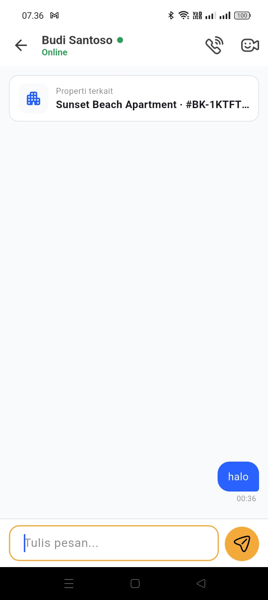
*Gambar 7.5: Ruang Obrolan Interaktif dengan Host Sunset Beach Apartment*

#### Penjelasan Elemen Antarmuka:
- **Header Obrolan:** Nama host (*Budi Santoso*) lengkap dengan indikator status hijau (*Online*).
- **Label Properti Terkait:** Teks penanda *"Properti terkait: Sunset Beach Apartment"* yang memastikan konteks pembicaraan tidak tertukar.
- **Gelembung Pesan (Chat Bubbles):** Pesan keluar di sisi kanan dan pesan masuk di sisi kiri lengkap dengan penanda waktu (*00:36*).
- **Kolom Tulis Pesan:** Kolom teks interaktif *"Tulis pesan..."* disertai tombol kirim dan lampiran berkas.

---

# BAB 8: PROMO KUPON & NOTIFIKASI SISTEM

### 8.1 Membuka Halaman Promo Saya & Mengklaim Kode Kupon

Aplikasi Livirooms menyediakan halaman khusus untuk melihat seluruh kupon diskon yang siap Anda pakai saat checkout.

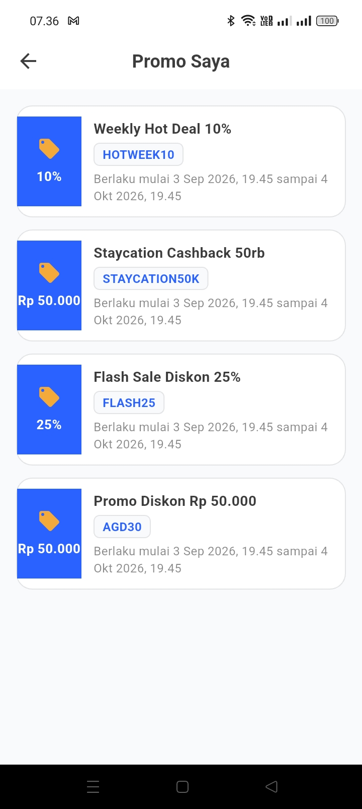
*Gambar 8.1: Daftar Kupon Diskon dan Kode Promo Aktif di Menu "Promo Saya"*

#### Penjelasan Elemen Antarmuka:
- **Kupon "Weekly Hot Deal 10%":**
  - Kode Kupon: `HOTWEEK10`
  - Potongan: Diskon 10%
  - Masa Berlaku: *3 Sep 2026 s/d 4 Okt 2026*.
- **Kupon "Staycation Cashback 50rb":**
  - Kode Kupon: `STAYCATION50K`
  - Nilai: Cashback saldo dompet Rp 50.000.
- **Kupon "Flash Sale Diskon 25%":**
  - Kode Kupon: `FLASH25`
  - Nilai: Potongan harga langsung 25%.
- **Kupon "Promo Diskon Rp 50.000":**
  - Kode Kupon: `AGD30`
  - Nilai: Potongan flat Rp 50.000 untuk pengguna baru.

#### Cara Menggunakan Kupon Promo:
1. Catat kode promo di atas (contoh: `FLASH25`).
2. Saat berada di layar pemesanan / checkout, ketuk kolom **Gunakan Kode Promo**.
3. Tempelkan kode tersebut lalu tekan tombol **Terapkan**. Tagihan Anda akan terpotong seketika!

---

### 8.2 Memeriksa Riwayat Notifikasi Aplikasi

Halaman Notifikasi mencatat pembaruan status sistem dan pengingat jadwal check-in.

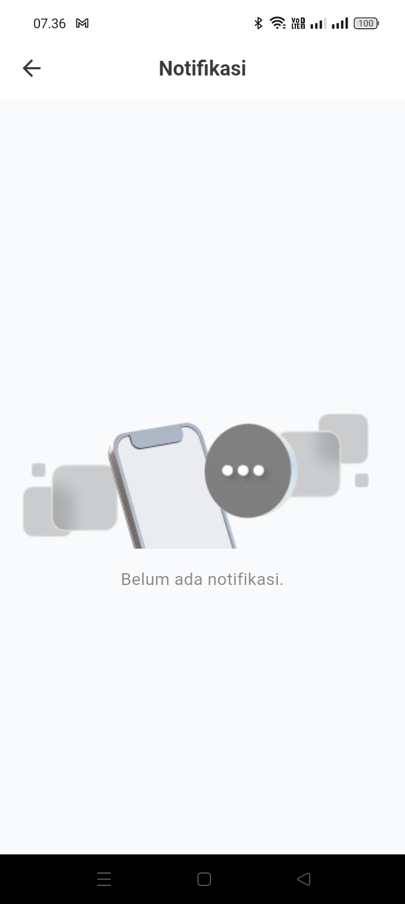
*Gambar 8.2: Halaman Notifikasi Aplikasi Livirooms*

#### Penjelasan Elemen Antarmuka:
- **Header "Notifikasi":** Disertai tombol kembali.
- **Tampilan Status Bersih:** Ilustrasi smartphone minimalis dengan pesan ramah *"Belum ada notifikasi"* jika seluruh pengingat telah selesai dibaca.

---

# BAB 9: PROFIL PENGGUNA & MANAJEMEN TRAVELER / KONTAK

### 9.1 Halaman Profil Pengguna Belum Masuk Akun

Bagi pengguna dalam mode tamu (*guest mode*), tab Profil menampilkan keuntungan bergabung.

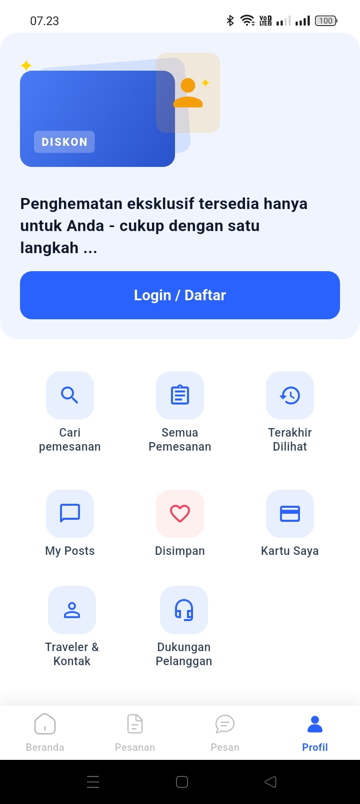
*Gambar 9.1: Tab Profil dalam Mode Tamu (Belum Masuk Akun)*

#### Penjelasan Elemen Antarmuka:
- **Kartu Promo Eksklusif:** Visual kartu keanggotaan biru dengan teks ajakan: *"Penghematan eksklusif tersedia hanya untuk Anda - cukup dengan satu langkah..."*
- **Tombol Utama "Login / Daftar":** Tombol biru berukuran penuh untuk pendaftaran cepat.
- **Grid Menu Pintasan Cepat:**
  - 🔍 **Cari pemesanan:** Mencari reservasi menggunakan kode booking fisik.
  - 📋 **Semua Pemesanan:** Melihat arsip seluruh reservasi.
  - 🕒 **Terakhir Dilihat:** Melihat kembali unit apartemen yang baru saja Anda buka.
  - 💬 **My Posts:** Catatan ulasan atau pertanyaan yang pernah Anda kirimkan.
  - ❤️ **Disimpan:** Daftar hunian favorit (Wishlist).
  - 💳 **Kartu Saya:** Pengelolaan metode kartu kredit/debit tersimpan.
  - 👤 **Traveler & Kontak:** Pengelolaan buku kontak penginap.
  - 🎧 **Dukungan Pelanggan:** Akses cepat ke pusat bantuan 24 jam.

---

### 9.2 Halaman Profil Pengguna Member Terdaftar

Setelah Anda masuk ke akun, halaman Profil berubah menampilkan data identitas keanggotaan Anda.

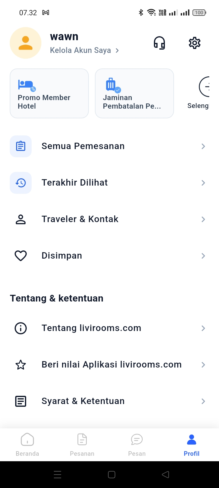
*Gambar 9.2: Halaman Profil Pengguna Member Aktif (Livirooms Member)*

#### Penjelasan Elemen Antarmuka:
- **Header Pengguna:** Avatar profil, nama akun (*wawn*), serta tautan *"Kelola Akun Saya >"* untuk mengubah kata sandi dan alamat surel.
- **Ikon Bantuan & Pengaturan:** Tombol headset (Customer Care) dan roda gigi (Pengaturan Notifikasi & Bahasa) di pojok kanan atas.
- **Banner Manfaat Keanggotaan:**
  - 🛏️ **Promo Member Hotel:** Potongan harga khusus pelanggan setia.
  - 🧳 **Jaminan Pembatalan Fleksibel:** Opsi pembatalan aman dengan pengembalian saldo.
- **Menu Navigasi Utama:**
  - **Semua Pemesanan:** Arsip lengkap seluruh transaksi reservasi.
  - **Terakhir Dilihat:** Rekam jejak unit yang baru dibuka.
  - **Traveler & Kontak:** Pengelolaan data tamu penginap.
  - **Disimpan:** Properti yang diberi tanda suka.
- **Bagian "Tentang & Ketentuan":** Informasi legal perusahaan (*Tentang livirooms.com*), *Beri nilai Aplikasi*, dan *Syarat & Ketentuan Layanan*.

---

### 9.3 Menu Manajemen Traveler & Kontak Tersimpan

Fitur unggulan Livirooms untuk mempercepat pengisian formulir checkout saat memesan untuk keluarga atau rekan kerja tanpa mengetik ulang berulang kali.

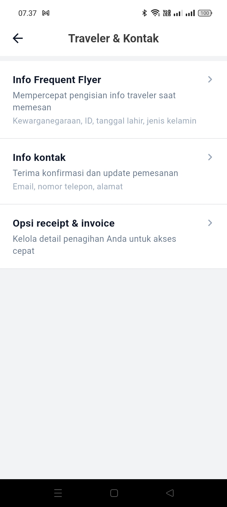
*Gambar 9.3: Menu Pengaturan Traveler, Kontak Pemesanan & Opsi Faktur (Invoice)*

#### Penjelasan Elemen Antarmuka:
- **Menu "Info Frequent Flyer":** Menyimpan kewarganegaraan, nomor identitas, tanggal lahir, dan jenis kelamin untuk penerbangan.
- **Menu "Info Kontak":** Mengelola email, nomor telepon WhatsApp, dan alamat surat-menyurat untuk konfirmasi reservasi dan serah terima kunci.
- **Menu "Opsi Receipt & Invoice":** Pengelolaan data nama perusahaan (*billing company*), NPWP, dan alamat penagihan resmi untuk keperluan *reimbursement* kantor.

---

### 9.4 Buku Kontak Pemesanan & Alamat Pengiriman

Melihat daftar seluruh kontak yang telah berhasil Anda simpan di memori akun.

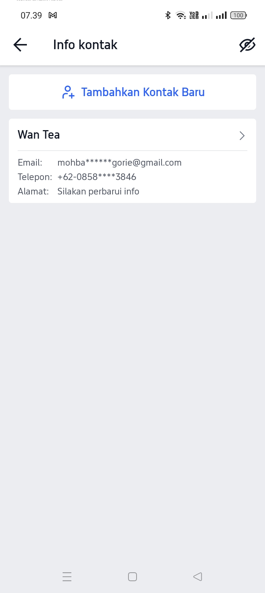
*Gambar 9.5: Buku Kontak Tersimpan dengan Opsi Tambah Kontak Baru*

#### Penjelasan Elemen Antarmuka:
- **Tombol "Tambahkan Kontak Baru":** Tombol biru untuk mendaftarkan nama penginap baru.
- **Kartu Kontak Tersimpan:**
  - Nama: *Wan Tea*
  - Email: *gorie@gmail.com*
  - Telepon & Alamat: Indikator status kelengkapan data (*Silakan perbarui info*).
- **Aksi Cepat:** Ketuk kartu kontak untuk mengedit atau memperbarui informasi alamat.

---

### 9.5 Menambahkan Kontak Baru (Identitas & Alamat Lengkap)

Formulir terpadu untuk mendaftarkan identitas penginap atau rekan yang sering Anda pesankan kamar.

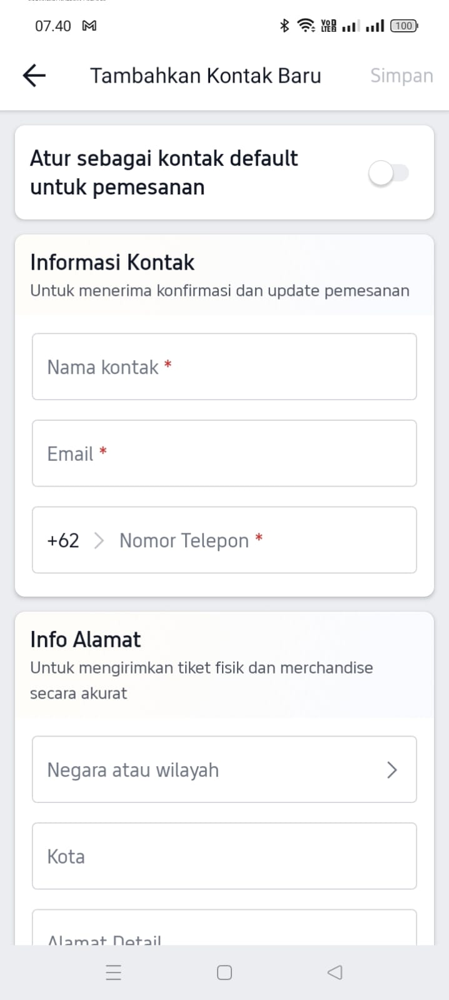
*Gambar 9.6: Formulir Tambah Kontak - Data Kontak Utama & Checkbox Default*

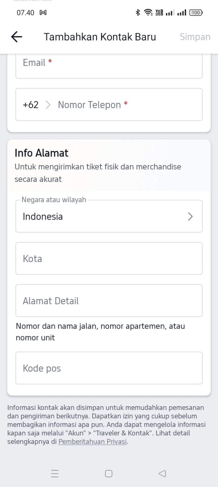
*Gambar 9.7: Formulir Tambah Kontak - Pengisian Detail Alamat Domisili*

#### Penjelasan Elemen Antarmuka:
1. **Atur sebagai kontak default untuk pemesanan:** Centang opsi ini agar data kontak ini otomatis terisi pada setiap formulir checkout baru.
2. **Nama Kontak (*):** Nama lengkap penyewa sesuai KTP.
3. **Email (*):** Alamat email aktif untuk menerima salinan voucher.
4. **Nomor Telepon (*):** Kode negara (*+62*) diikuti nomor WhatsApp aktif.
5. **Info Alamat Pengiriman Tiket/Merchandise:**
   - **Negara atau wilayah:** Pilihan negara asal (*Indonesia*).
   - **Kota:** Nama kota tempat tinggal.
   - **Alamat Detail:** Nama jalan, nomor rumah, lantai/unit apartemen.
   - **Kode Pos:** 5 digit kode pos domisili.
6. **Tombol "Simpan":** Terletak di pojok kanan atas untuk menyimpan kontak ke server.

---

### 9.6 Memilih Negara Asal & Kode Telepon Internasional

Bagi tamu mancanegara, Livirooms mendukung kode panggilan dan kewarganegaraan global.

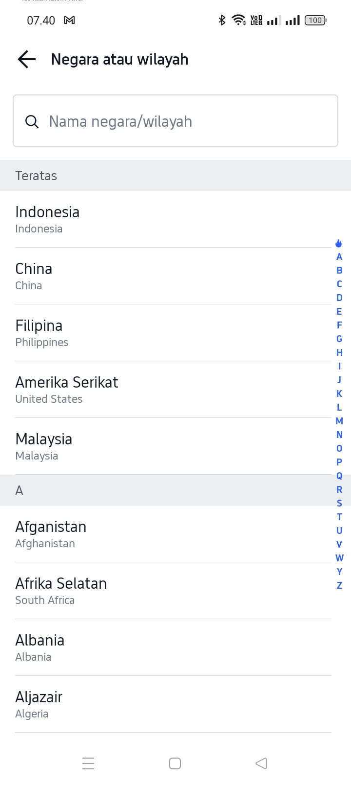
*Gambar 9.8: Dialog Pemilihan Negara Asal dan Kode Wilayah Telepon Internasional*

#### Penjelasan Elemen Antarmuka:
- **Bilah Pencarian Cepat:** Ketik nama negara pada kolom *"Nama negara/wilayah"*.
- **Pilihan Negara Teratas:** Akses satu ketukan untuk *Indonesia*, *China*, *Filipina (Philippines)*, *Amerika Serikat (United States)*, dan *Malaysia*.
- **Daftar Lengkap Abjad (A-Z):** Navigasi cepat dari huruf A (*Afganistan, Afrika Selatan, Albania, Aljazair*) hingga Z.

---

### 9.7 Mengubah Data Kontak Tersimpan & Menghapus Traveler

Jika rekan Anda berpindah nomor telepon atau Anda ingin membersihkan buku kontak lama:

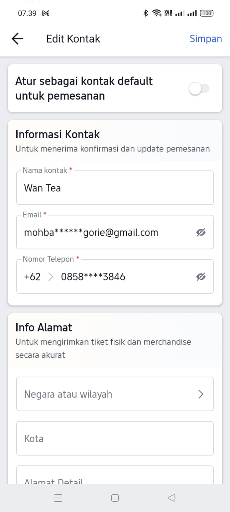
*Gambar 9.9: Mengubah Data Kontak Tersimpan (Nama, Surel, Nomor HP)*

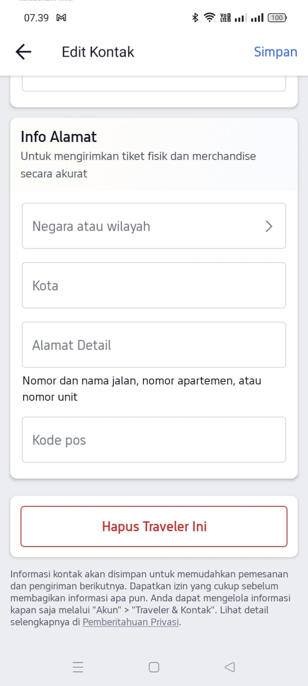
*Gambar 9.10: Form Edit Kontak dan Tombol Hapus Traveler Ini*

#### Penjelasan Elemen Antarmuka:
- **Pembaruan Kolom:** Anda dapat langsung mengganti data *Nama kontak*, *Email*, atau *Nomor Telepon*.
- **Tombol "Simpan":** Menyimpan perubahan terbaru pada data traveler.
- **Tombol Merah "Hapus Traveler Ini":** Terletak di bagian bawah formulir untuk menghapus kontak secara permanen dari buku alamat profil Anda jika data tersebut sudah tidak lagi diperlukan.

---

*Buku Panduan Pengguna Aplikasi Mobile Livirooms ini merupakan hak cipta resmi Livirooms Hospitality. Seluruh ilustrasi dan alur diselaraskan persis dengan versi aplikasi rilis produksi.*
