# USER GUIDE WEB ADMINISTRATOR
## Panduan Operasional & Petunjuk Penggunaan Website Admin Livirooms
**Workspace Sumber:** `laravel/` (Laravel 12 & Metronic Admin Theme)  
**Versi Dokumen:** v2.4.0  
**Target Pengguna:** Administrator, Supervisor Operasional, Front Desk, Tim Keuangan (Finance), Customer Service  

---

## DAFTAR ISI

1. [Bab 1: Login & Autentikasi Sistem](#bab-1-login--autentikasi-sistem)
   - 1.1 Cara Masuk ke Dashboard Admin (Login)
   - 1.2 Cara Memulihkan Kata Sandi (Lupa Password)
   - 1.3 Memahami Hak Akses Pengguna (Role-Based Access Control)
2. [Bab 2: Membaca & Menggunakan Dashboard Utama](#bab-2-membaca--menggunakan-dashboard-utama)
   - 2.1 Membaca Kartu Ringkasan (KPI Metrics Overview)
   - 2.2 Navigasi Pintas Operasional
3. [Bab 3: Manajemen Properti, Kamar & Kompleks Gedung](#bab-3-manajemen-properti-kamar--kompleks-gedung)
   - 3.1 Meninjau Tabel Daftar Properti Aktif
   - 3.2 Memulai Pendaftaran Properti Baru (Modal Form Awal)
   - 3.3 Alur Pendaftaran Properti Mode HOTEL (7 Langkah Wizard)
   - 3.4 Alur Pendaftaran Properti Mode APARTEMEN (7 Langkah Wizard)
   - 3.5 Mengelola Master Data Wilayah Kota Operasional
   - 3.6 Mengelola Master Kompleks Gedung & Tower Apartemen
4. [Bab 4: Kurasi Konten Beranda & Analisis Pencarian](#bab-4-kurasi-konten-beranda--analisis-pencarian)
   - 4.1 Mengatur Rekomendasi Akomodasi Pilihan Beranda
   - 4.2 Memantau Log Pencarian Tamu & Analisis Tren Pasar
   - 4.3 Mengelola Banner Promosi & Slider Kampanye Iklan
5. [Bab 5: Manajemen Reservasi, Pemesanan & Billing Order](#bab-5-manajemen-reservasi-pemesanan--billing-order)
   - 5.1 Memantau Tabel Reservasi Booking Tamu
   - 5.2 Rincian Pemesanan, Status Staying & Cetak Invoice PDF
   - 5.3 Manajemen Order Penagihan Satelit
6. [Bab 6: Transaksi Pembayaran, Saluran & Integrasi Gateway Midtrans](#bab-6-transaksi-pembayaran-saluran--integrasi-gateway-midtrans)
   - 6.1 Memantau Riwayat Transaksi Pembayaran Gateway
   - 6.2 Mengelola Master Saluran Pembayaran (VA, QRIS, E-Wallet, Kartu Kredit)
   - 6.3 Mengatur Kredensial & Saluran Pembayaran Gateway Midtrans
7. [Bab 7: Manajemen Keuangan Mitra & Penarikan Saldo Host](#bab-7-manajemen-keuangan-mitra--penarikan-saldo-host)
   - 7.1 Memantau Antrean Pengajuan Penarikan Saldo (Withdrawal)
   - 7.2 Memproses Transfer Perbankan & Persetujuan Pencairan Dana
8. [Bab 8: Program Marketing, Kupon Diskon & Referral](#bab-8-program-marketing-kupon-diskon--referral)
   - 8.1 Mengelola Kupon Promo & Voucher Diskon Konsumen
   - 8.2 Memantau Program Rujukan Pengguna (Referral System)
9. [Bab 9: Manajemen Reputasi, Bantuan & Konten Legal](#bab-9-manajemen-reputasi-bantuan--konten-legal)
   - 9.1 Memantau & Memberikan Balasan Ulasan Tamu (Review & Rating)
   - 9.2 Mengelola Pusat Bantuan & Tanya Jawab Pengguna (FAQ)
   - 9.3 Mengelola Dokumen Legal Halaman Konten Statis (CMS Page)
10. [Bab 10: Komunikasi Chat & Pemantauan Minat Pelanggan](#bab-10-komunikasi-chat--pemantauan-minat-pelanggan)
    - 10.1 Memantau Pesan Percakapan Chat Tamu dan Host
    - 10.2 Menganalisis Minat Properti Favorit Konsumen (Wishlist)
11. [Bab 11: Rekapitulasi & Laporan Eksekutif](#bab-11-rekapitulasi--laporan-eksekutif)
    - 11.1 Ringkasan Pusat Laporan Eksekutif (Reports Hub)
    - 11.2 Laporan Pemesanan & Reservasi Booking
    - 11.3 Laporan Pendapatan Platform & Transaksi Masuk
    - 11.4 Laporan Pencairan Saldo & Payout Host
    - 11.5 Laporan Performa Akomodasi & Properti Terlaris
12. [Bab 12: Pemantauan Log Sistem & Notifikasi Broadcast](#bab-12-pemantauan-log-sistem--notifikasi-broadcast)
    - 12.1 Mengelola Riwayat & Pengiriman Notifikasi Push
    - 12.2 Prosedur Penulisan Notifikasi Baru ke Pengguna
    - 12.3 Memantau Jejak Audit Log Aktivitas Keamanan
    - 12.4 Pencatatan Audit Log Khusus & Investigasi Keamanan
13. [Bab 13: Manajemen Pengguna & Detail Analitis Akun](#bab-13-manajemen-pengguna--detail-analitis-akun)
    - 13.1 Memantau Tabel Pengguna & Filter Akun
    - 13.2 Menambah Pengguna Baru & Penugasan Role
    - 13.3 Memperbarui Biodata Profil & Akun Pengguna
    - 13.4 Meninjau Detail Pengguna — Tab Overview
    - 13.5 Meninjau Detail Pengguna — Tab Riwayat Booking
    - 13.6 Meninjau Detail Pengguna — Tab Keuangan & Payout
    - 13.7 Meninjau Detail Pengguna — Tab Kontak & Penagihan Faktur
    - 13.8 Meninjau Detail Pengguna — Tab Aktivitas, Token & Wishlist
    - 13.9 Meninjau Detail Pengguna — Tab Keamanan & Akses Kredensial
14. [Bab 14: Manajemen Role, Hak Akses & Matriks Izin (RBAC)](#bab-14-manajemen-role-hak-akses--matriks-izin-rbac)
    - 14.1 Memantau Kartu Ringkasan Peran / Roles
    - 14.2 Menambah / Mengonfigurasi Role Baru dengan Matriks Permissions
    - 14.3 Mengonfigurasi Hak Akses Role Host
    - 14.4 Meninjau Detail Role & Staf / Pengguna yang Ditugaskan
    - 14.5 Memantau Master Daftar Izin Sistem (Permissions Table)
    - 14.6 Menambah Butir Izin Hak Akses Baru ke Sistem
    - 14.7 Memperbarui Butir Izin yang Ada
15. [Bab 15: Verifikasi Dokumen KYC & Validasi Host](#bab-15-verifikasi-dokumen-kyc--validasi-host)
    - 15.1 Memantau Antrean Validasi Dokumen Host
    - 15.2 Memproses & Menetapkan Status Host Terverifikasi
16. [Bab 16: Pengaturan Umum Sistem & Konfigurasi Notifikasi](#bab-16-pengaturan-umum-sistem--konfigurasi-notifikasi)
    - 16.1 Mengatur Identitas Platform, Logo, Favicon & Kontak
    - 16.2 Mengatur Notifikasi Push FCM, Firebase & Kebijakan Tampilan Harga
17. [Pusat Bantuan & Kontak Layanan Operasional](#pusat-bantuan--kontak-layanan-operasional)

---

## BAB 1: LOGIN & AUTENTIKASI SISTEM

### 1.1 Cara Masuk ke Dashboard Admin (Login)
1. **Buka Browser Komputer:** Gunakan Google Chrome, Microsoft Edge, atau Mozilla Firefox versi terbaru untuk performa terbaik.
2. **Akses Alamat Web:** Masukkan alamat URL panel admin: `https://app.livirooms.com/admin` (atau alamat IP server operasional Anda).
3. **Masukkan Identitas Akun:**
   - Masukkan **Alamat Email Resmi** Anda (contoh: `admin@livirooms.com`).
   - Masukkan **Kata Sandi (Password)** Anda. Klik ikon mata untuk melihat karakter yang diketik guna mencegah salah ketik.
4. **Opsi "Ingat Saya":** Beri centang pada opsi *Remember Me* jika menggunakan perangkat kerja pribadi.
5. **Klik Tombol "Masuk":** Tekan tombol biru **"Sign In"**.
6. **Hasil yang Diharapkan:** Sistem memvalidasi akun dan secara otomatis mengarahkan Anda ke tampilan **Dashboard Utama**.

> 💡 **TIPS OPERASIONAL:**
> - Demi menjaga keamanan data reservasi tamu, sesi admin akan otomatis keluar (*auto-logout*) jika tidak ada aktivitas selama 120 menit.
> - Jangan pernah menyimpan kata sandi admin di komputer umum (*shared device*).

### 1.2 Cara Memulihkan Kata Sandi (Lupa Password)
1. Pada halaman login admin, klik tautan **"Lupa Kata Sandi?"**.
2. Masukkan alamat email terdaftar Anda, lalu klik **"Kirim Tautan Pemulihan"**.
3. Buka kotak masuk email Anda, buka pesan dari *Livirooms Security*, lalu klik tombol **"Reset Password"**.
4. Buat kata sandi baru (minimal 8 karakter dengan perpaduan huruf besar, huruf kecil, angka, dan simbol).
5. Simpan kata sandi baru dan masuklah kembali melalui halaman login.

### 1.3 Memahami Hak Akses Pengguna (Role-Based Access Control)
Sistem membagi tugas operasional ke dalam beberapa tingkatan wewenang:
- **Super Administrator (`admin`):** Berwenang mengatur seluruh sistem, integrasi pembayaran Midtrans, komisi, data staf, dan audit log.
- **Host / Mitra Pemilik Properti (`host`):** Hanya dapat melihat properti miliknya, mengatur ketersediaan kamar, dan mengajukan penarikan saldo (*withdrawal*).
- **Front Desk / Customer Service (`cs_operator`):** Berwenang mengelola daftar reservasi harian, memverifikasi check-in/out tamu di lokasi, dan membalas pesan obrolan tamu.

---

## BAB 2: MEMBACA & MENGGUNAKAN DASHBOARD UTAMA

### 2.1 Membaca Kartu Ringkasan (KPI Metrics Overview)

Setelah berhasil masuk ke sistem, halaman pertama yang ditampilkan adalah Dashboard Eksekutif. Bagian ini memberikan ringkasan angka-angka kunci operasional harian platform Livirooms secara langsung (*real-time*).

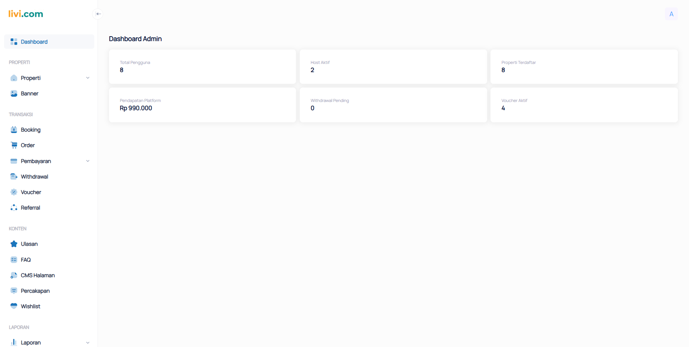
*Gambar 2.1: Tampilan Antarmuka Dashboard Utama (Executive Overview) Panel Administrasi Livirooms*

**Penjelasan Elemen & Metrik Utama:**
1. **Total Pengguna (8):** Menampilkan jumlah seluruh akun yang telah terdaftar di dalam platform (termasuk tamu konsumen dan mitra pemilik properti).
2. **Pendapatan Platform (Rp 990.000):** Akumulasi pendapatan bruto dari seluruh transaksi pemesanan unit dan kamar yang telah lunas terbayar melalui payment gateway.
3. **Properti Terdaftar (8):** Total unit apartemen dan kamar hotel yang statusnya aktif dan siap dipesan di aplikasi mobile Livirooms.
4. **Host Aktif (2):** Jumlah mitra pemilik properti terverifikasi yang saat ini memiliki listing unit hunian aktif.
5. **Voucher Aktif (4):** Jumlah kupon promosi yang sedang berlaku dan dapat diklaim oleh pengguna di aplikasi mobile.
6. **Withdrawal Pending:** Kartu peringatan antrean permohonan penarikan dana dari mitra host yang memerlukan verifikasi dan eksekusi transfer dari bagian Finance.

### 2.2 Navigasi Pintas Operasional
- **Sidebar Kiri (Menu Utama):** Dikelompokkan menjadi menu *Dashboard*, *Properti*, *Transaksi*, *Konten*, *Laporan*, *Logs*, *User Management*, dan *Setting*.
- **Profil Staf (Kanan Atas):** Menampilkan avatar dan nama staf yang sedang bertugas, disertai menu dropdown untuk mengubah kata sandi atau keluar sistem (*Sign Out*).

---

## BAB 3: MANAJEMEN PROPERTI, KAMAR & KOMPLEKS GEDUNG

### 3.1 Meninjau Tabel Daftar Properti Aktif

Menu Daftar Properti digunakan untuk memantau, mencari, menyaring, dan memperbarui seluruh listing akomodasi yang dipasarkan di platform.

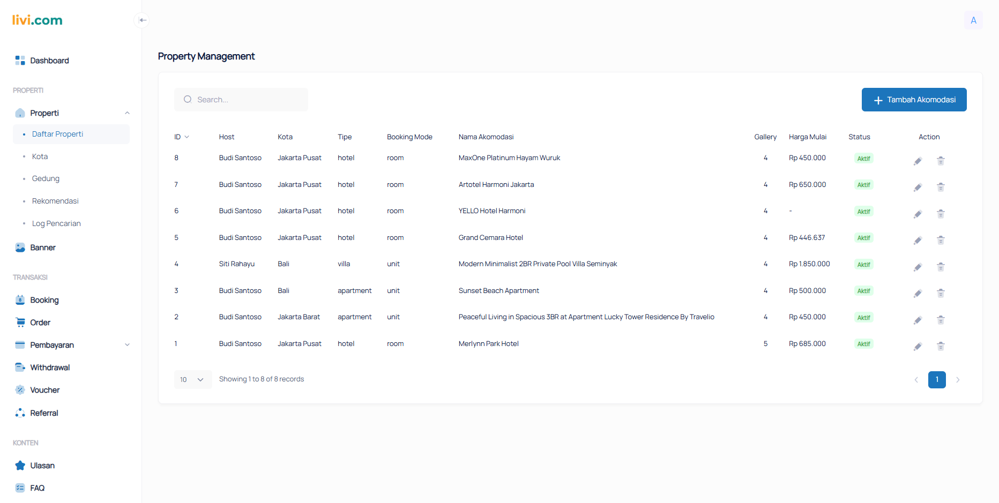
*Gambar 3.1: Tabel Manajemen Properti Menggunakan DataGrid Interaktif*

**Rincian Kolom & Fungsi Antarmuka:**
1. **Kolom Host:** Nama mitra pemilik listing properti (contoh: *Budi Santoso*, *Siti Rahayu*).
2. **Kolom Kota:** Kota tempat properti berada (*Jakarta Pusat*, *Bali*, *Jakarta Barat*).
3. **Kolom Booking Mode:** Pembeda arsitektur listing:
   - `room`: Mode Hotel / Guest House (pemesanan berbasis tipe kamar dan stok harian).
   - `unit`: Mode Apartemen / Villa / Kost (pemesanan unit hunian utuh).
4. **Kolom Nama Akomodasi:** Nama komersial listing beserta kategorinya (*hotel*, *apartment*, *villa*).
5. **Kolom Gallery:** Thumbnail foto sampul utama yang dilihat tamu di aplikasi.
6. **Kolom Harga Mulai:** Tarif sewa terendah yang berlaku untuk listing tersebut.
7. **Kolom Status:** Status keaktifan properti (`active` atau `inactive`).
8. **Tombol "+ Tambah Akomodasi":** Tombol biru di kanan atas untuk membuka wizard pendaftaran properti baru.

---

### 3.2 Memulai Pendaftaran Properti Baru (Modal Form Awal)

Saat tombol **"+ Tambah Akomodasi"** ditekan, sistem menampilkan jendela formulir pendaftaran awal:

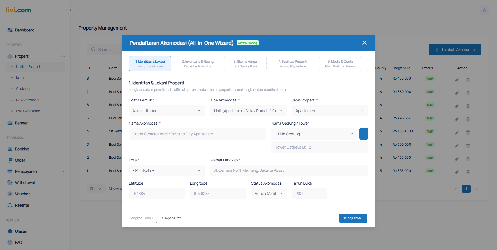
*Gambar 3.2: Modal Inisiasi Pendaftaran Properti Baru (Langkah 1 Form Input Kosong)*

**Langkah Operasional Staf:**
1. Tentukan **Tipe Mode Pemesanan (`Booking Mode`)**:
   - Pilih **"Hotel / Room"** jika properti berupa Hotel dengan banyak kamar per tipe.
   - Pilih **"Apartemen / Unit"** jika properti berupa unit sewa mandiri utuh.
2. Masukkan **Nama Properti** resmi.
3. Pilih **Kota Operasional** dan **Nama Gedung / Tower** tempat properti berada.
4. Tentukan **Host Pemilik Properti** yang bertanggung jawab atas listing tersebut.
5. Masukkan koordinat peta dan alamat lengkap, lalu klik tombol **"Selanjutnya"** untuk melanjutkan ke wizard konfigurasi terperinci.

---

### 3.3 Alur Pendaftaran Properti Mode HOTEL (7 Langkah Wizard)

Pendaftaran properti mode Hotel mengikuti 7 langkah terpandu:

#### Langkah 1: Identitas & Lokasi Hotel
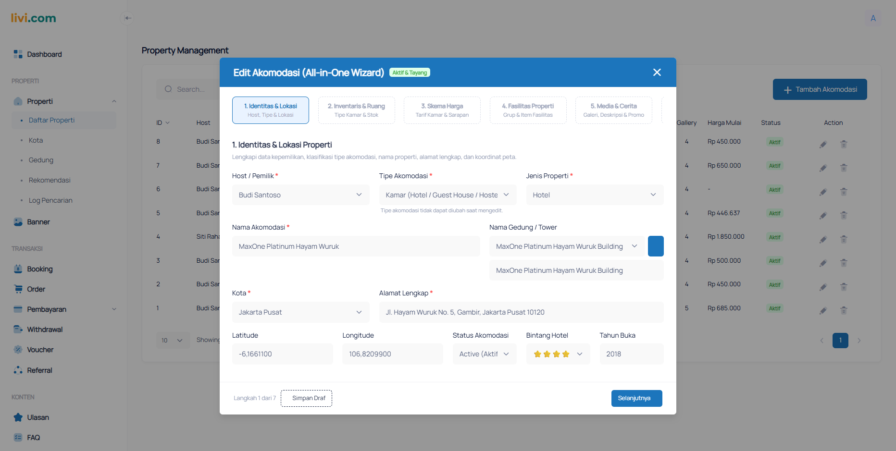
*Gambar 3.3: Hotel Wizard Langkah 1 - Pengisian Identitas Hotel Bintang 4 & Titik Lokasi Peta Hayam Wuruk*

- Masukkan nama hotel (*MaxOne Platinum Hayam Wuruk*), klasifikasi bintang (*Bintang 4*), alamat lengkap di Hayam Wuruk Jakarta Pusat, nomor telepon front desk, dan tentukan titik koordinat peta untuk akurasi navigasi tamu.

#### Langkah 2: Inventaris & Tipe Kamar Hotel
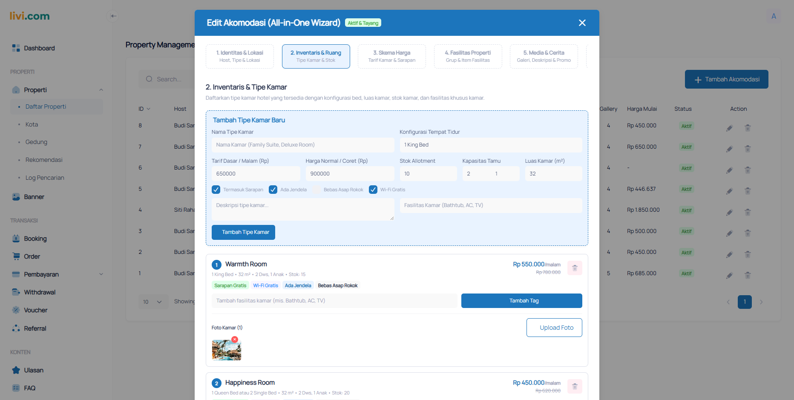
*Gambar 3.4: Hotel Wizard Langkah 2 - Konfigurasi Tipe Kamar Happiness Room & Alokasi Stok Unit Fisik*

- Daftarkan tipe-tipe kamar yang tersedia (contoh: *Happiness Room*). Tentukan kapasitas maksimal dewasa dan anak, tipe ranjang (*Double Bed / Twin Bed*), serta jumlah total unit kamar fisik yang dialokasikan ke sistem.

#### Langkah 3: Skema Harga & Pajak Layanan
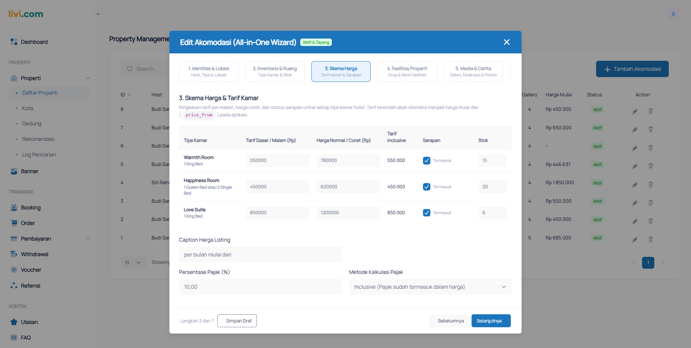
*Gambar 3.5: Hotel Wizard Langkah 3 - Pengaturan Tarif Kamar Harian & Konfigurasi Persentase Pajak*

- Masukkan tarif sewa kamar per malam (*Daily Rate*), biaya sarapan tambahan (opsional), serta tentukan apakah harga sudah termasuk pajak layanan (*Tax Included*) atau belum.

#### Langkah 4: Fasilitas Hotel & Kamar
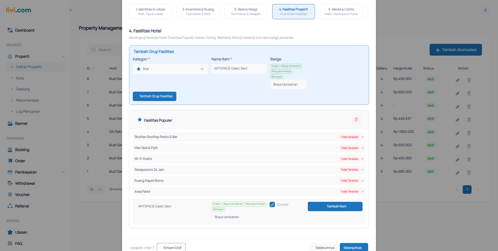
*Gambar 3.6: Hotel Wizard Langkah 4 - Pemilihan Fasilitas Umum Hotel & Fasilitas Khusus Kamar*

- Beri centang pada fasilitas hotel yang tersedia: WiFi berkecepatan tinggi, restoran, kolam renang, pusat kebugaran, resepsionis 24 jam, perlengkapan mandi, dan pendingin ruangan (AC).

#### Langkah 5: Galeri Media & Foto
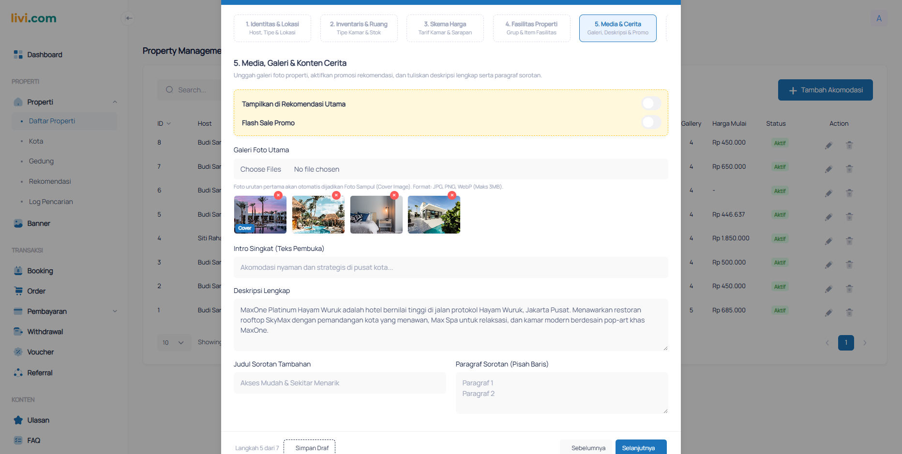
*Gambar 3.7: Hotel Wizard Langkah 5 - Galeri Foto Fasad Depan, Lobi & Foto Kamar*

- Unggah foto berkualitas tinggi untuk lobi, tampak depan hotel, interior kamar tidur, kamar mandi, dan fasilitas restoran untuk menarik minat calon tamu.

#### Langkah 6: Kebijakan Operasional & Aturan Menginap
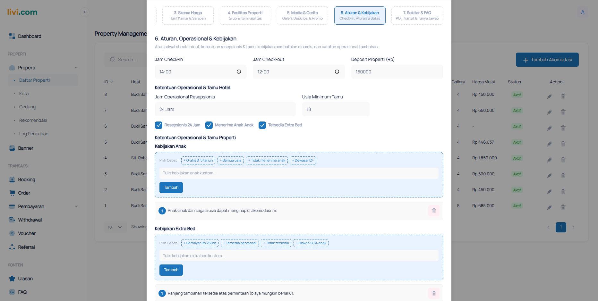
*Gambar 3.8: Hotel Wizard Langkah 6 (Bagian 1) - Jam Check-in/out & Persyaratan Identitas Tamu*

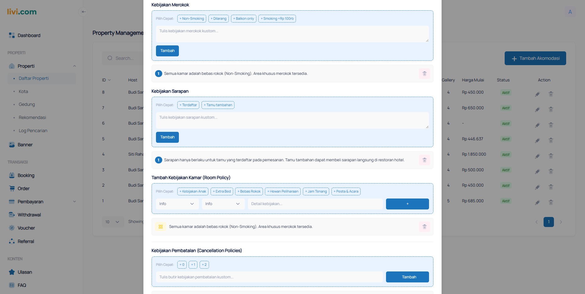
*Gambar 3.9: Hotel Wizard Langkah 6 (Bagian 2) - Aturan Dilarang Merokok & Jam Tenang*

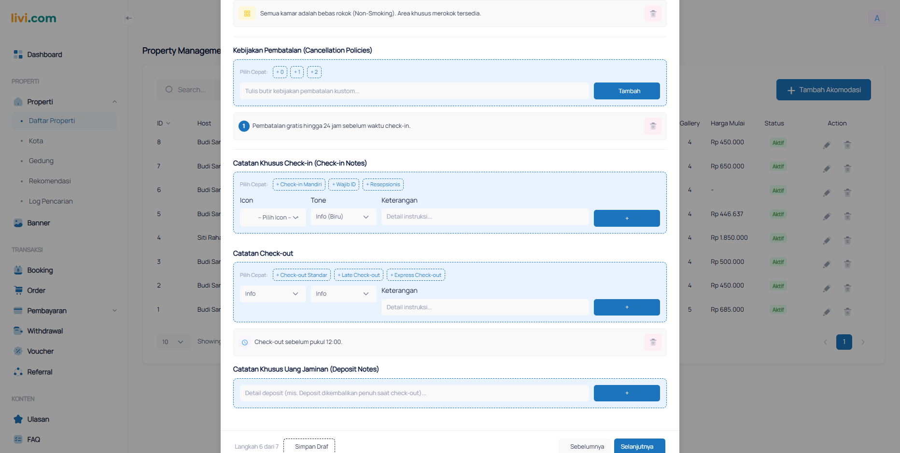
*Gambar 3.10: Hotel Wizard Langkah 6 (Bagian 3) - Kebijakan Uang Jaminan/Deposit & Batasan Usia Anak*

- Atur jam standar check-in (*14:00*) dan check-out (*12:00*), dokumen identitas wajib (KTP/Paspor), aturan bebas rokok (*Non-Smoking*), larangan membawa hewan peliharaan, ketentuan deposit jaminan kerusakan, dan kebijakan batas usia anak tanpa biaya tambahan.

#### Langkah 7: Titik Penting (POI) & Publikasi Hotel
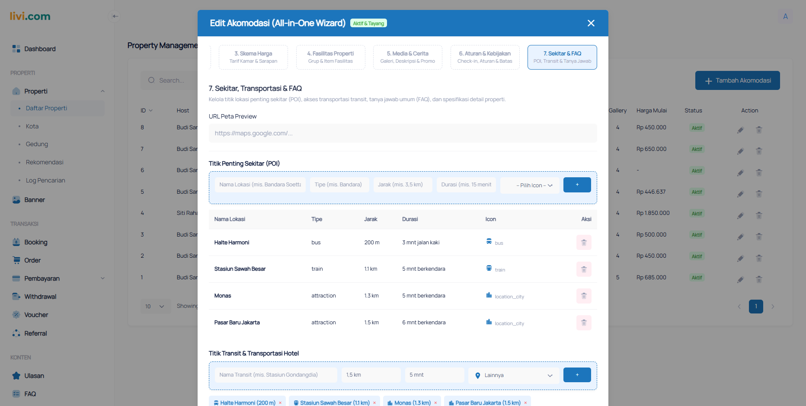
*Gambar 3.11: Hotel Wizard Langkah 7 (Bagian 1) - Titik Penting POI & Akses Transportasi Terdekat*

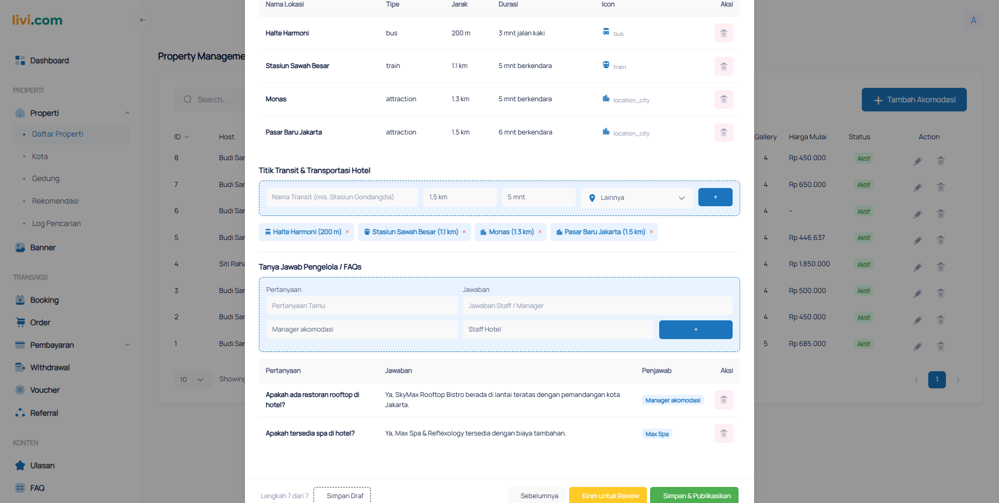
*Gambar 3.12: Hotel Wizard Langkah 7 (Bagian 2) - Tanya Jawab Khusus Hotel & Tombol Publikasi*

- Masukkan tempat menarik di sekitar hotel (stasiun kereta, halte TransJakarta, pusat belanja), tambahkan pertanyaan umum tamu beserta jawabannya, lalu klik tombol biru **"Publikasikan Hotel"**.

---

### 3.4 Alur Pendaftaran Properti Mode APARTEMEN (7 Langkah Wizard)

Pendaftaran properti mode Apartemen mengikuti alur 7 langkah yang disesuaikan untuk unit sewa utuh:

#### Langkah 1: Identitas & Lokasi Apartemen
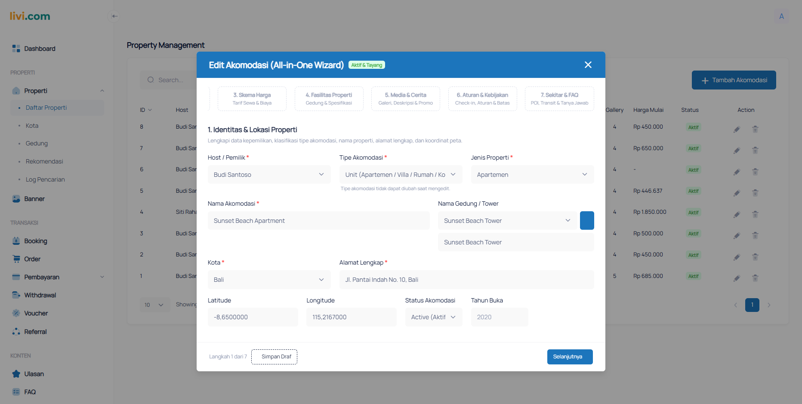
*Gambar 3.13: Apartemen Wizard Langkah 1 - Identitas Unit Sunset Beach Apartment & Titik Koordinat Peta*

- Masukkan nama unit (*Sunset Beach Apartment*), pilih tower gedung, kota operasional, lantai unit, dan koordinat peta lokasi apartemen.

#### Langkah 2: Ruangan, Kamar & Perabot
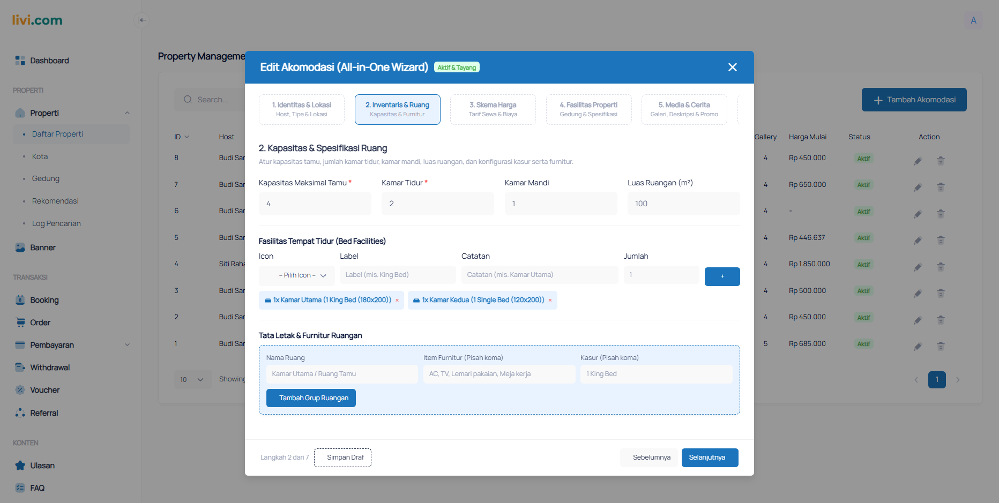
*Gambar 3.14: Apartemen Wizard Langkah 2 - Konfigurasi Kamar Tidur, Kamar Mandi & Furnitur Dapur*

- Tentukan jumlah kamar tidur (*2 Bedroom*), jumlah kamar mandi, konfigurasi kasur (*King Bed & Single Bed*), perabot ruang keluarga (sofa, smart TV), dan peralatan dapur lengkap (kompor, kulkas, microwave).

#### Langkah 3: Skema Tarif Multi-Durasi
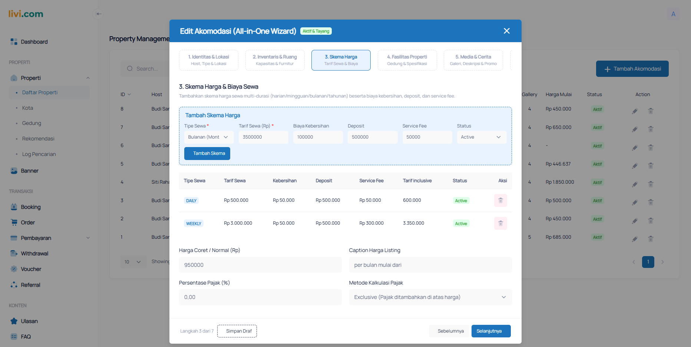
*Gambar 3.15: Apartemen Wizard Langkah 3 - Skema Tarif Fleksibel Harian, Bulanan & Tahunan*

- Masukkan tarif sewa sesuai skema durasi: harga sewa harian (*Rp 450.000/malam*), harga sewa bulanan (*Rp 6.500.000/bulan*), biaya pembersihan (*Cleaning Fee*), dan besaran deposit jaminan kerusakan unit.

#### Langkah 4: Fasilitas Gedung Apartemen
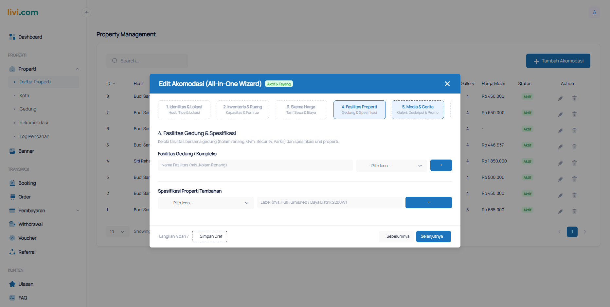
*Gambar 3.16: Apartemen Wizard Langkah 4 - Fasilitas Bersama Gedung (Kolam Renang, Gym, Akses Lift)*

- Pilih fasilitas gedung yang dapat diakses penghuni: kolam renang infinity, fitness center, kartu akses lift khusus penghuni, pos sekuriti 24 jam, dan lahan parkir kendaraan.

#### Langkah 5: Galeri Foto & Deskripsi Unit
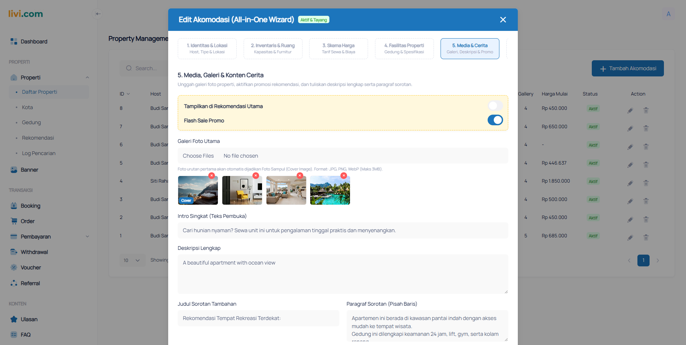
*Gambar 3.17: Apartemen Wizard Langkah 5 - Galeri Foto Interior Unit & Deskripsi Menarik*

- Unggah foto-foto interior unit apartemen (ruang tamu, balkon dengan pemandangan, kamar tidur utama, kamar mandi bersih, dapur) dan tuliskan kalimat promosi yang memikat calon penyewa.

#### Langkah 6: Kebijakan Check-in Mandiri & Tata Tertib
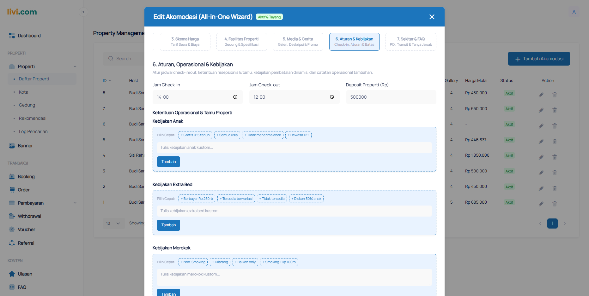
*Gambar 3.18: Apartemen Wizard Langkah 6 (Bagian 1) - Jam Check-in, Nilai Deposit & Prosedur Masuk*

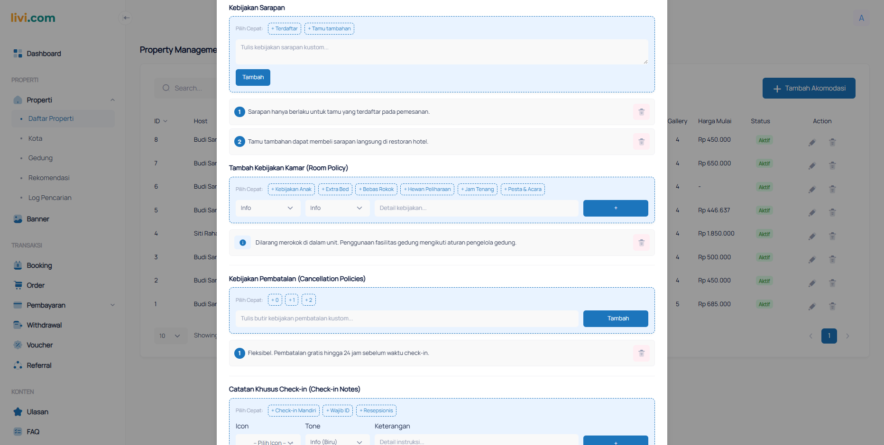
*Gambar 3.19: Apartemen Wizard Langkah 6 (Bagian 2) - Aturan Hunian & Larangan Merokok*

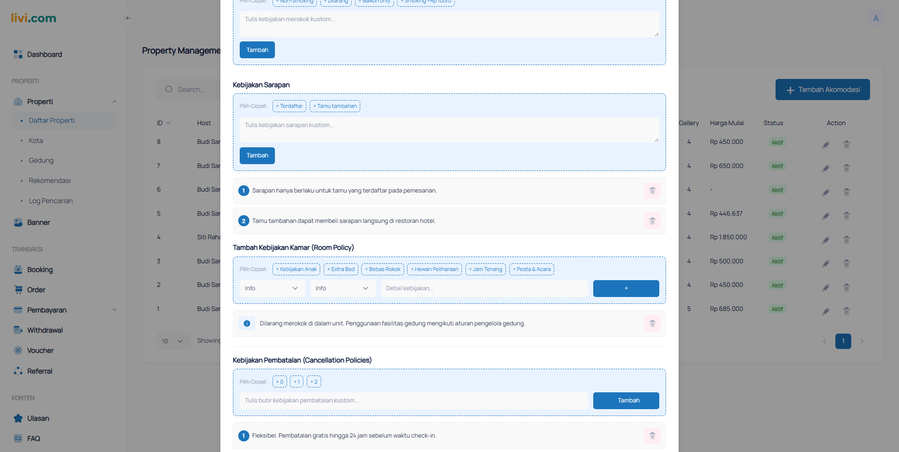
*Gambar 3.20: Apartemen Wizard Langkah 6 (Bagian 3) - Kebijakan Pembatalan Fleksibel 24 Jam*

- Tentukan mekanisme check-in mandiri (*Self Check-in via Smart Lock / Kotak Kunci Lockbox*), tata tertib gedung hunian, aturan jam tenang malam hari, serta kebijakan pembatalan sewa fleksibel (pengembalian penuh jika dibatalkan 24 jam sebelum kedatangan).

#### Langkah 7: Transportasi, Spesifikasi & Publikasi
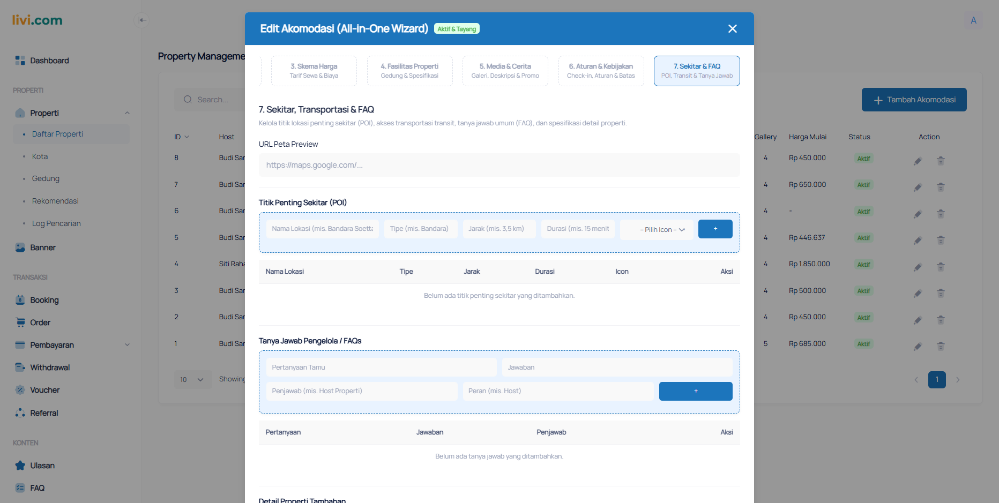
*Gambar 3.21: Apartemen Wizard Langkah 7 (Bagian 1) - Integrasi Peta Google Maps & Akses Jalan Tol*

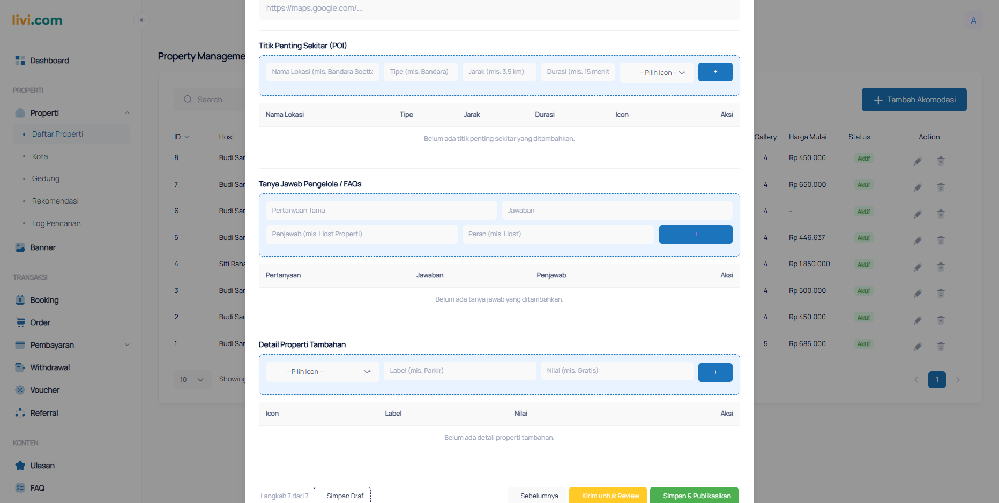
*Gambar 3.22: Apartemen Wizard Langkah 7 (Bagian 2) - Spesifikasi Daya Listrik & Tombol Publikasi*

- Cantumkan petunjuk transportasi menuju apartemen, spesifikasi teknis daya listrik (*2200 Watt*), lalu klik tombol biru **"Publikasikan Akomodasi"** untuk mengaktifkan listing di aplikasi konsumen.

---

### 3.5 Mengelola Master Data Wilayah Kota Operasional

Menu Master Kota mengatur daftar kota tempat Livirooms membuka layanan sewa apartemen dan hotel:

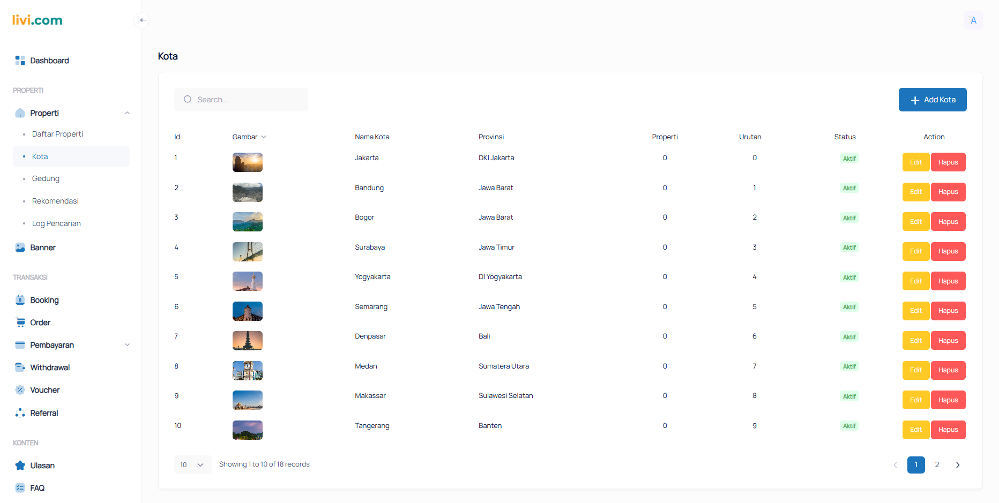
*Gambar 3.23: Tabel Master Data Kota Operasional Livirooms*

- **Tabel Rekap Kota:** Menampilkan daftar kota (*Jakarta, Bandung, Surabaya, Bali, dsb*), provinsi induk, urutan prioritas tampil di beranda, dan status aktif.

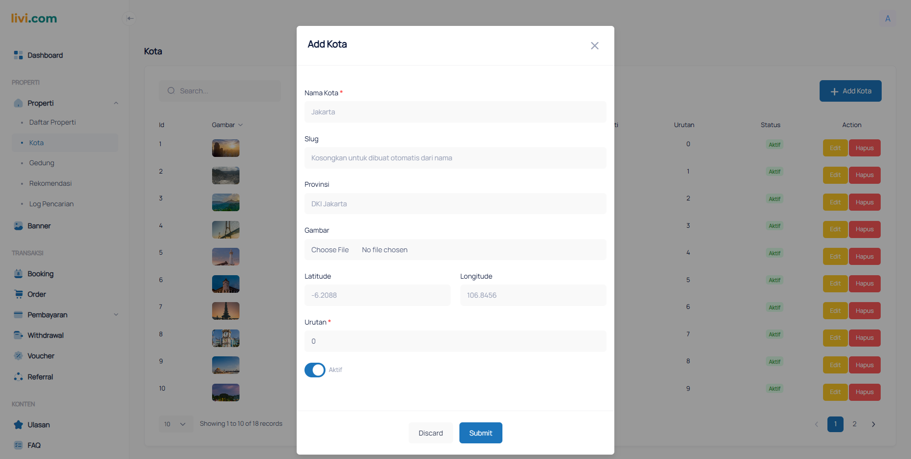
*Gambar 3.24: Modal Tambah Kota Baru Beserta Titik Koordinat Latitude & Longitude*

- **Menambah Kota Baru:** Klik tombol **"+ Add Kota"**, masukkan Nama Kota (*Jakarta*), Provinsi (*DKI Jakarta*), titik koordinat peta Latitude (*-6.2088*) dan Longitude (*106.8456*) untuk perhitungan radius pencarian tamu, urutan prioritas, unggah foto thumbnail landmark kota, lalu klik **Submit**.

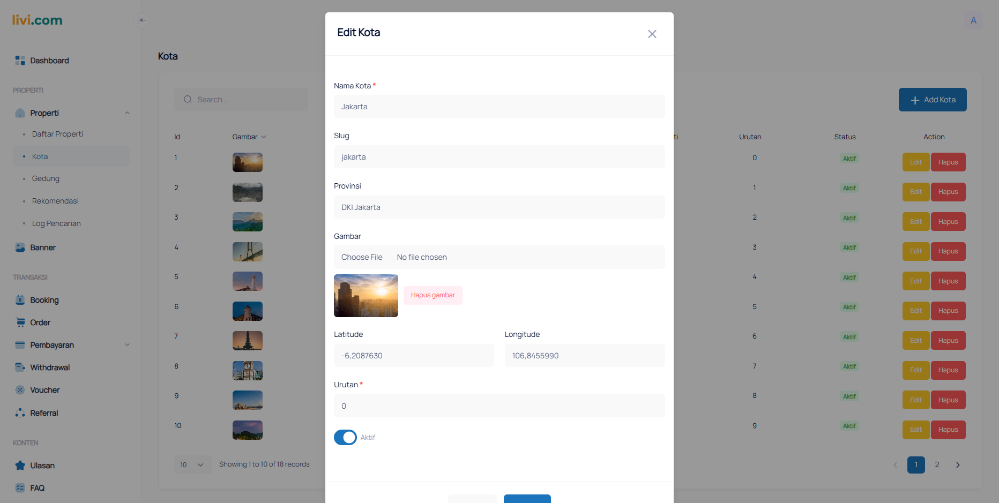
*Gambar 3.25: Modal Pengubahan Data Kota & Opsi Reset Gambar*

- **Mengedit Kota:** Klik tombol **Edit** pada baris kota untuk memperbarui koordinat lintang/bujur atau mengganti foto thumbnail kota.

---

### 3.6 Mengelola Master Kompleks Gedung & Tower Apartemen

Menu Master Gedung digunakan untuk mengelompokkan unit-unit apartemen yang berada di dalam kawasan kondominium atau kompleks gedung yang sama:

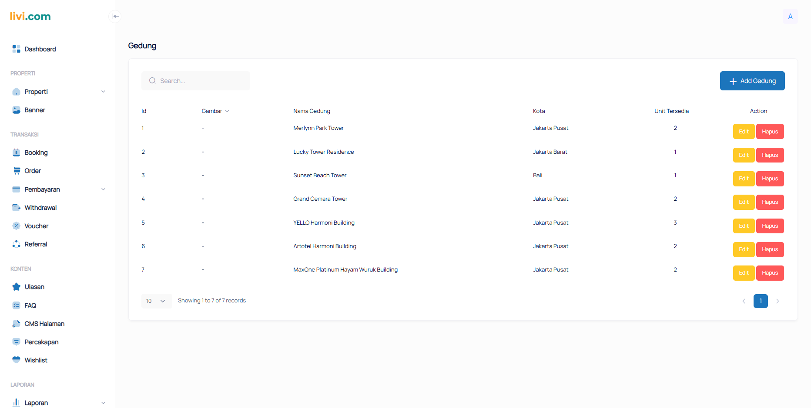
*Gambar 3.26: Tabel Master Kompleks Gedung & Tower Apartemen*

- Menampilkan daftar tower (*Verlynn Park Tower, Sunset Beach Tower, MaxOne Building*), kota lokasi, dan jumlah unit hunian aktif yang siap disewakan.

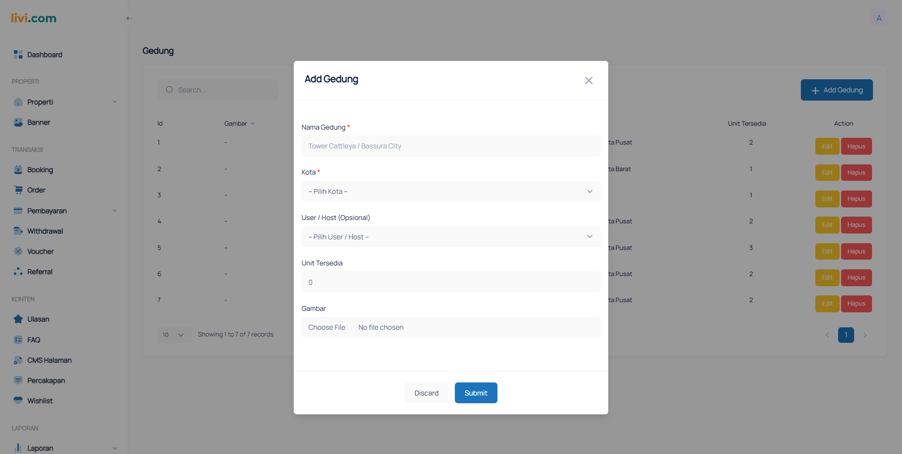
*Gambar 3.27: Modal Pendaftaran Gedung Baru & Penugasan Host Pengelola*

- Klik **"+ Add Gedung"**, masukkan nama gedung (*Tower Cattleya Bassura City*), pilih kota induk, pilih mitra Host penanggung jawab gedung, tentukan kuota unit, unggah foto tampak depan gedung, lalu klik **Submit**.

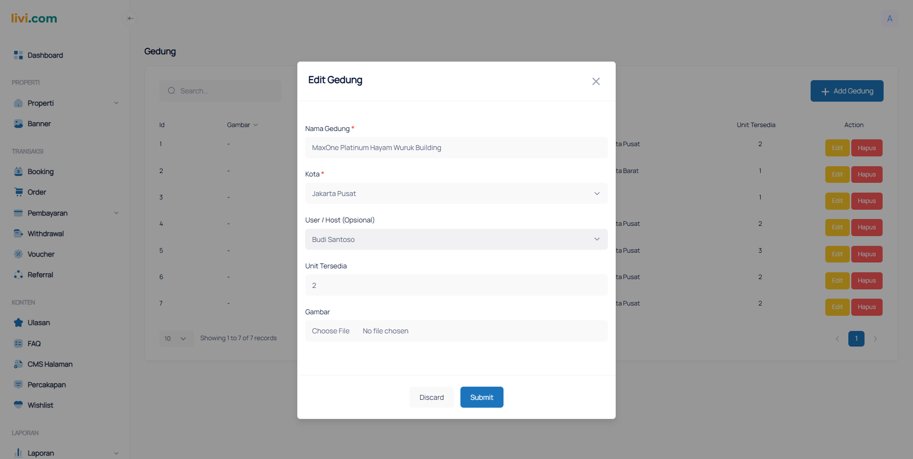
*Gambar 3.28: Modal Edit Gedung & Penyesuaian Unit Tersedia*

- Digunakan untuk memperbarui data pengelola gedung atau menambah/mengurangi alokasi unit kamar yang tersedia di gedung tersebut.

---

## BAB 4: KURASI KONTEN BERANDA & ANALISIS PENCARIAN

### 4.1 Mengatur Rekomendasi Akomodasi Pilihan Beranda

Menu Rekomendasi mengontrol properti mana saja yang dipromosikan di halaman utama aplikasi mobile tamu:

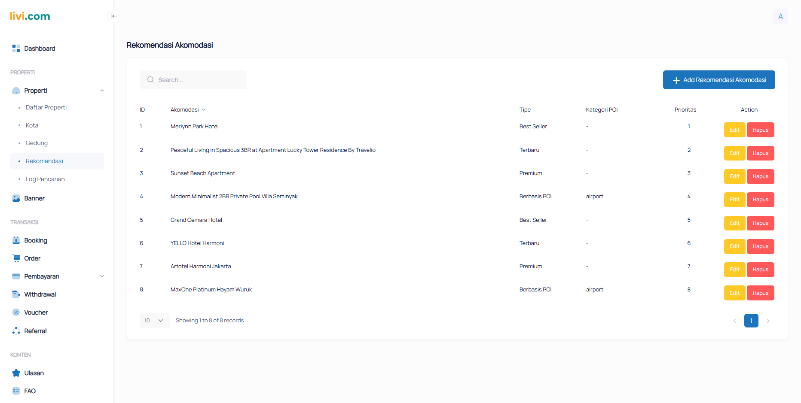
*Gambar 4.1: Tabel Kurasi Rekomendasi Akomodasi Beranda Mobile*

- Menampilkan daftar akomodasi terpilih, badge kategori (*Best Seller, Terbaru, Premium, Berbasis POI*), dan angka prioritas urutan tampil.

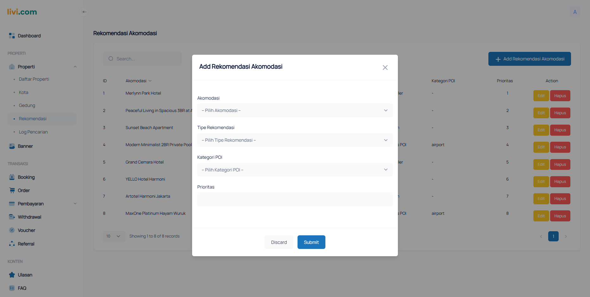
*Gambar 4.2: Modal Tambah Properti ke Daftar Rekomendasi Beranda*

- Klik **"+ Add Rekomendasi"**, pilih properti dari daftar dropdown, pilih tipe rekomendasi (*Best Seller / Premium*), tentukan angka prioritas (angka 1 tampil paling awal), lalu klik **Submit**.

*Gambar 4.3: Modal Edit Prioritas Rekomendasi Akomodasi*

- Memungkinkan admin menaikkan atau menurunkan prioritas kurasi properti menjelang musim liburan atau kampanye promosi tertentu.

---

### 4.2 Memantau Log Pencarian Tamu & Analisis Tren Pasar

Menu Log Pencarian merekam aktivitas pencarian yang dilakukan pengguna aplikasi mobile secara transparan:

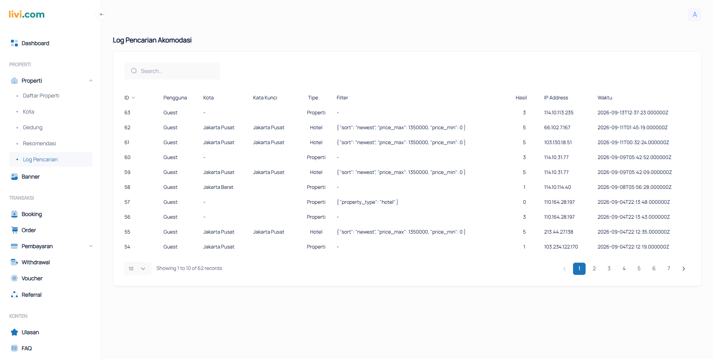
*Gambar 4.4: Tabel Log Penelusuran Tamu, Kata Kunci & Filter Harga*

- **Pemanfaatan Data:** Staf pemasaran dapat memantau kata kunci yang paling sering dicari, wilayah kota paling populer (*Jakarta Pusat, Jakarta Barat*), dan rentang harga favorit konsumen untuk merancang promo diskon yang tepat sasaran.

---

### 4.3 Mengelola Banner Promosi & Slider Kampanye Iklan

Menu Banner mengelola gambar promosi geser (*carousel slider*) di bagian atas aplikasi mobile:

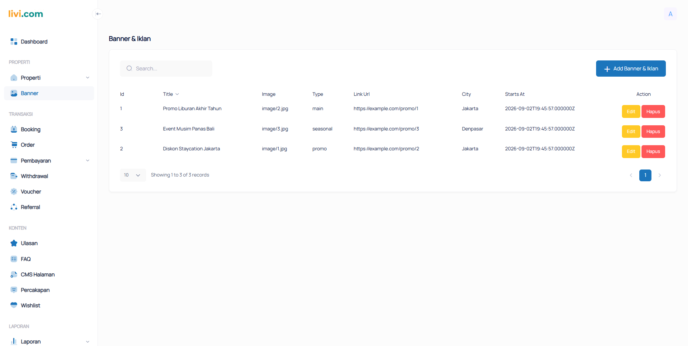
*Gambar 4.5: Tabel Manajemen Banner Promosi & Iklan Aplikasi*

- Menampilkan judul promosi (*Promo Liburan Akhir Tahun, Event Musim Panas Bali*), tautan target tujuan (*URL*), kota penayangan, dan tanggal mulai tayang banner. Klik **"+ Add Banner & Iklan"** untuk memasang materi promosi baru.

---

## BAB 5: MANAJEMEN RESERVASI, PEMESANAN & BILLING ORDER

### 5.1 Memantau Tabel Reservasi Booking Tamu

Menu Booking adalah pusat kendali operasional pemesanan menginap harian:

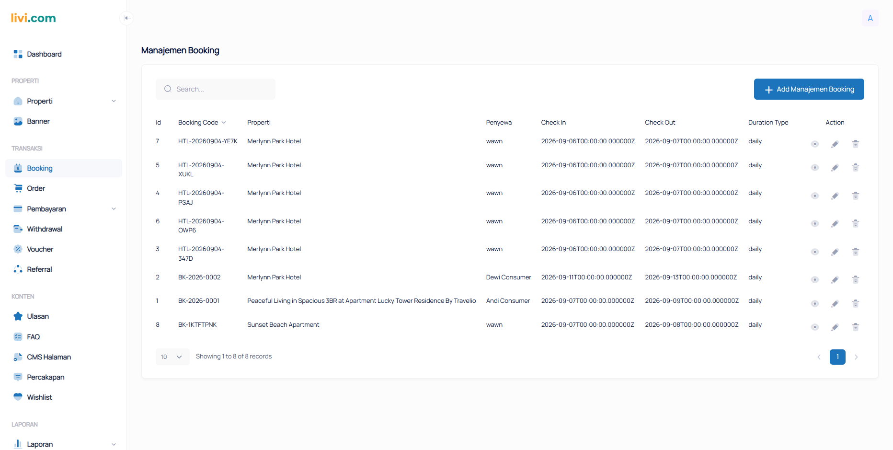
*Gambar 5.1: Tabel Manajemen Reservasi Pemesanan Tamu (Booking Control Desk)*

- **Informasi Kolom:** Kode Booking unik (*HTL-20260904-YE7K, BK-2026-0001*), nama properti, nama penyewa (*Dewi Consumer, Andi Consumer*), tanggal check-in dan check-out, serta tipe durasi sewa (*daily / monthly*).
- Gunakan kolom pencarian di atas tabel untuk mencari pesanan dengan cepat saat tamu tiba di lokasi resepsionis.

---

### 5.2 Rincian Pemesanan, Status Staying & Cetak Invoice PDF

Layar Rincian Pemesanan menyajikan lembar tagihan resmi yang diterbitkan Livirooms:

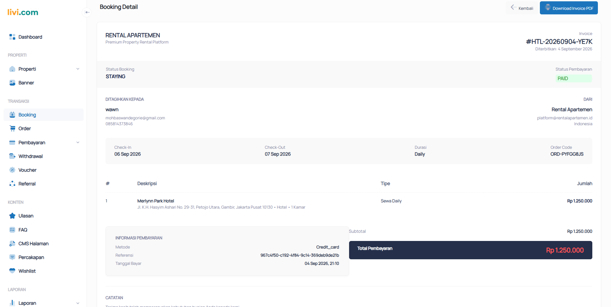
*Gambar 5.2: Layar Rincian Pemesanan, Status Menginap Aktif (Staying) & Tombol Unduh Invoice PDF*

**Fitur & Prosedur Operasional:**
1. **Status Badge Hijau (STAYING):** Menunjukkan bahwa tamu telah menyelesaikan proses check-in fisik dan sedang aktif menempati kamar.
2. **Identitas Penyewa:** Email resmi tamu (*mohbaswandegorie@gmail.com*) dan nomor telepon kontak.
3. **Mencetak Tagihan:** Klik tombol biru **"Download Invoice PDF"** untuk mengunduh dokumen penagihan resmi siap cetak untuk diserahkan ke tamu atau arsip keuangan.

---

### 5.3 Manajemen Order Penagihan Satelit

Menu Order mengelola pesanan penagihan transaksi sewa dan biaya tambahan:

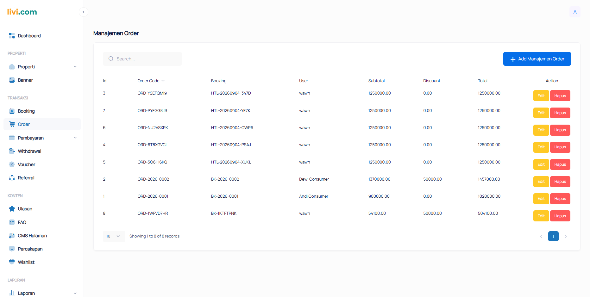
*Gambar 5.3: Tabel Manajemen Order Penagihan Transaksi*

- Menampilkan relasi antara kode order penagihan (*ORD-YSEFOM19, ORD-2026-0001*) dengan kode booking menginap dan total nominal rupiah yang wajib diselesaikan konsumen.

---

## BAB 6: TRANSAKSI PEMBAYARAN, SALURAN & INTEGRASI GATEWAY MIDTRANS

### 6.1 Memantau Riwayat Transaksi Pembayaran Gateway

Menu Pembayaran mencatat seluruh lalu lintas penerimaan uang dari payment gateway:

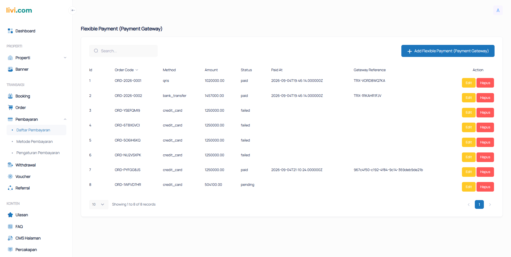
*Gambar 6.1: Tabel Riwayat Transaksi Pembayaran Gateway*

- Menampilkan kode order, nomor referensi transaksi perbankan (*TRX-VORD8W07KA*), nominal bayar, dan waktu penyelesaian transaksi.

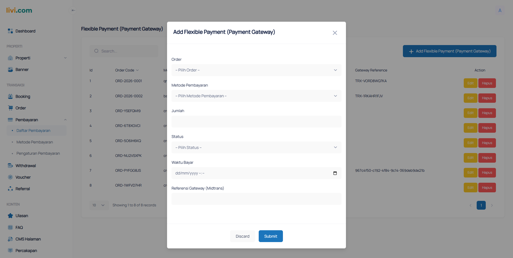
*Gambar 6.2: Modal Pencatatan Pembayaran Gateway Manual*

- Digunakan jika ada transaksi offline tunai yang perlu dicatatkan manual ke dalam sistem pembukuan.

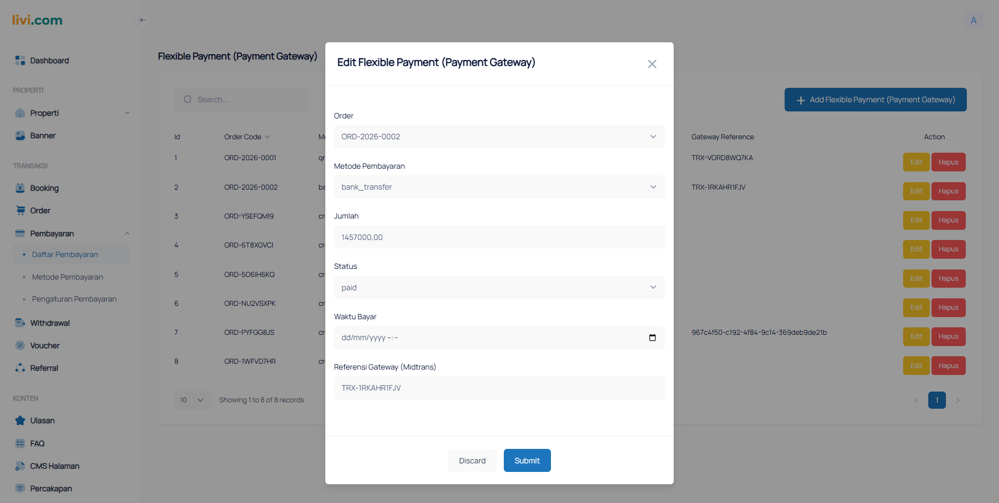
*Gambar 6.3: Modal Koreksi & Rekonsiliasi Transaksi Pembayaran*

- Digunakan untuk koreksi nomor referensi perbankan saat proses rekonsiliasi kas bulanan.

---

### 6.2 Mengelola Master Saluran Pembayaran (VA, QRIS, E-Wallet, Kartu Kredit)

Menu Metode Pembayaran mengelola katalog saluran bayar yang aktif di aplikasi:

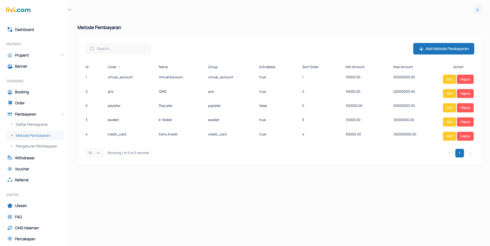
*Gambar 6.4: Tabel Saluran Pembayaran Resmi Livirooms*

- Mengontrol saluran *Virtual Account, QRIS, PayLater, E-Wallet, dan Kartu Kredit*.

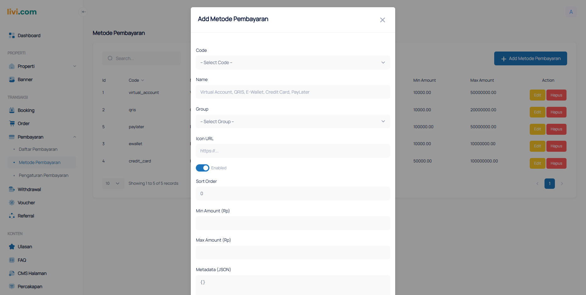
*Gambar 6.5: Modal Pendaftaran Saluran Pembayaran Baru*

- Digunakan untuk mendaftarkan saluran pembayaran perbankan baru beserta biaya administrasi penanganan transaksi (*fee*).

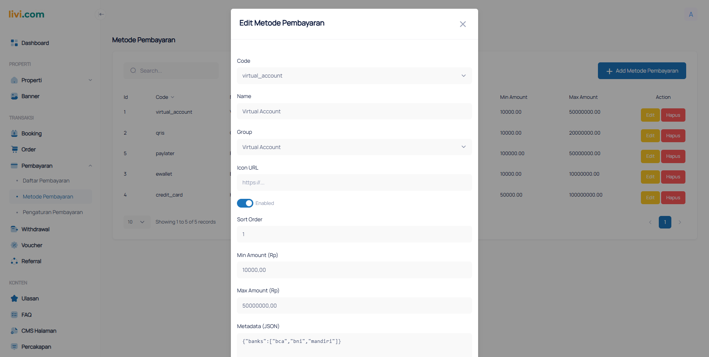
*Gambar 6.6: Modal Pengaturan Saluran Pembayaran Virtual Account*

- Memungkinkan admin memperbarui logo bank atau mengubah besaran biaya penanganan saluran bayar.

---

### 6.3 Mengatur Kredensial & Saluran Pembayaran Gateway Midtrans

Livirooms terintegrasi secara *native* dengan gerbang pembayaran **Midtrans**:

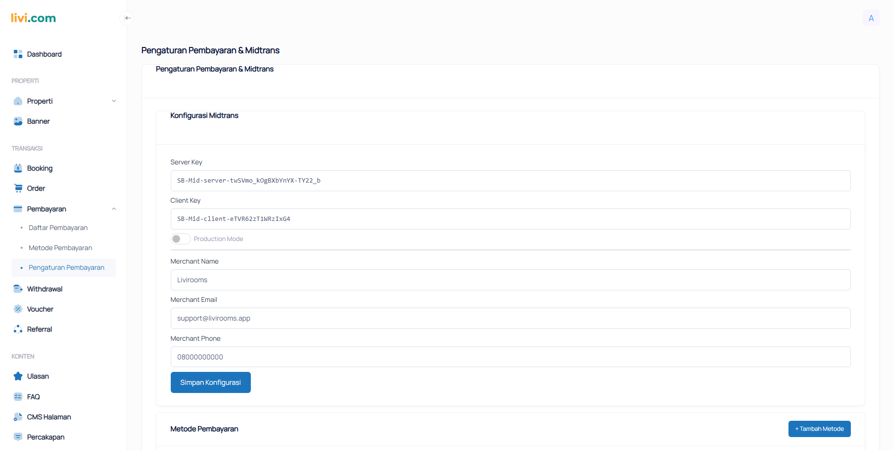
*Gambar 6.7: Layar Konfigurasi Kunci API Midtrans Server Key, Client Key & Mode Produksi*

1. **Pengaturan Kredensial API:**
   - **Server Key:** Kunci rahasia backend dari dashboard Midtrans.
   - **Client Key:** Kunci publik frontend untuk aplikasi mobile Flutter.
   - **Production Mode:** Sakelar switch untuk berpindah antara lingkungan uji coba (*Sandbox*) dan lingkungan transaksi komersial langsung (*Live*).
   - **Identitas Merchant:** Nama Usaha (*Livirooms*), Email Dukungan, dan Nomor Telepon Operasional.

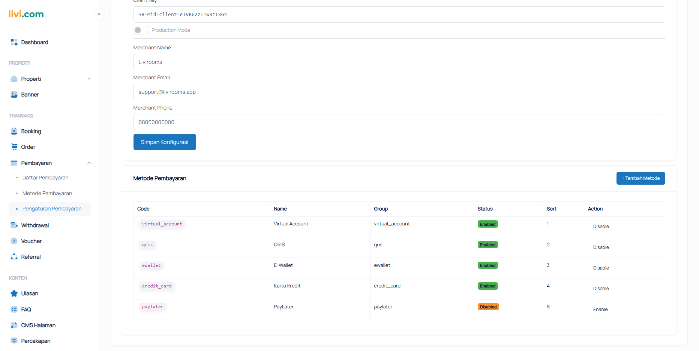
*Gambar 6.8: Sakelar Aktivasi Kanal Pembayaran Midtrans & Tombol Simpan Konfigurasi*

2. **Aktivasi Saluran Bayar Midtrans:**
   - Cukup geser sakelar toggle untuk mengaktifkan saluran bayar yang diinginkan (*Virtual Account, QRIS, E-Wallet, Kartu Kredit, PayLater*).
   - Klik tombol biru **"Simpan Konfigurasi"** untuk langsung menerapkan perubahan ke aplikasi mobile secara instan.

---

## BAB 7: MANAJEMEN KEUANGAN MITRA & PENARIKAN SALDO HOST

### 7.1 Memantau Antrean Pengajuan Penarikan Saldo (Withdrawal)

Pemilik properti (*Host*) dapat mengajukan pencairan pendapatan sewa melalui aplikasi mobile mereka. Bagian Finance mengawasi permohonan tersebut pada menu Withdrawal:

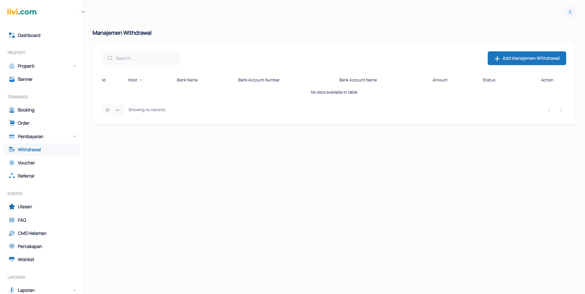
*Gambar 7.1: Tabel Antrean Pengajuan Penarikan Saldo Mitra Host*

- Menampilkan nama host, nama bank tujuan (*BCA, Mandiri, BRI*), nomor rekening, nama pemilik rekening, nominal permohonan pencairan dana, dan status verifikasi (*Pending, Approved, Rejected*).

---

### 7.2 Memproses Transfer Perbankan & Persetujuan Pencairan Dana

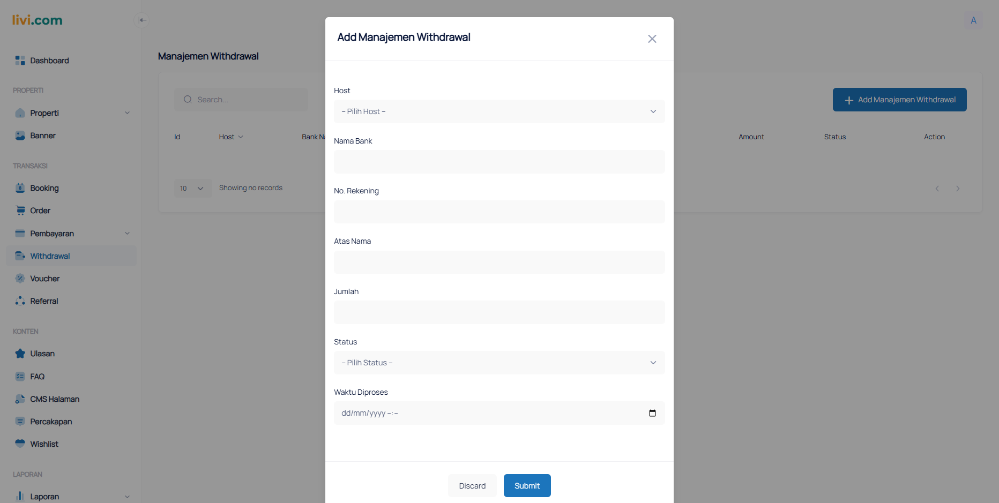
*Gambar 7.2: Modal Pemrosesan & Persetujuan Pencairan Dana Host*

**Langkah Operasional Tim Finance:**
1. Periksa pengajuan yang berstatus *Pending*, cocokkan nomor rekening dan pastikan saldo dompet host mencukupi.
2. Lakukan transfer bank ke rekening host melalui internet banking korporat.
3. Buka modal pengajuan, ubah status menjadi **Approved**, catat tanggal transfer berhasil, lalu klik **Submit**.
4. Saldo dompet host otomatis terpotong dan notifikasi berhasil otomatis masuk ke ponsel host.

---

## BAB 8: PROGRAM MARKETING, KUPON DISKON & REFERRAL

### 8.1 Mengelola Kupon Promo & Voucher Diskon Konsumen

Menu Voucher mengelola pembuatan kupon potongan harga untuk mendorong volume transaksi:

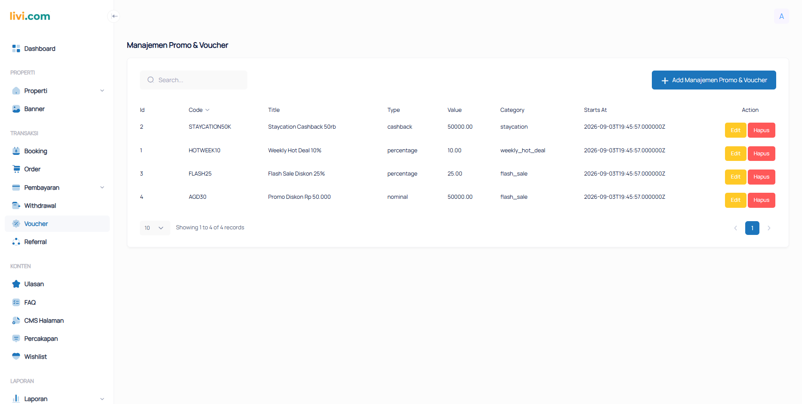
*Gambar 8.1: Tabel Manajemen Kupon Promo & Voucher Diskon*

- Menampilkan daftar kupon aktif (*STAYCATION50K, HOTWEEK10, FLASH25, AGD30*), jenis potongan (*cashback, percentage %, nominal Rupiah*), nilai diskon, masa berlaku, dan batas penggunaan.

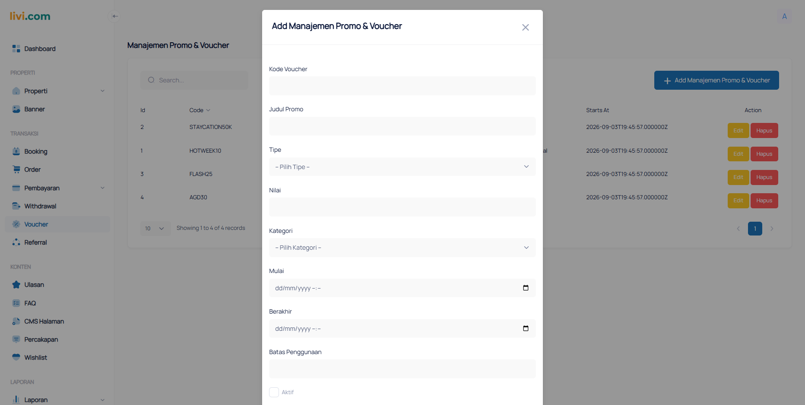
*Gambar 8.2: Modal Pembuatan Kupon Promo Baru*

- Klik **"+ Add Manajemen Promo & Voucher"**, masukkan kode voucher unik, judul promo, tipe potongan, nilai diskon, kategori promo, tanggal mulai dan berakhir, batas kuota penggunaan, aktifkan sakelar status, lalu klik **Submit**.

*Gambar 8.3: Modal Edit Kupon Promo Berjalan*

- Memungkinkan admin memperpanjang tanggal kedaluwarsa kupon atau menambah kuota klaim bagi konsumen.

---

### 8.2 Memantau Program Rujukan Pengguna (Referral System)

Menu Referral melacak efektivitas program rujukan kode ajak teman (*member-get-member*):

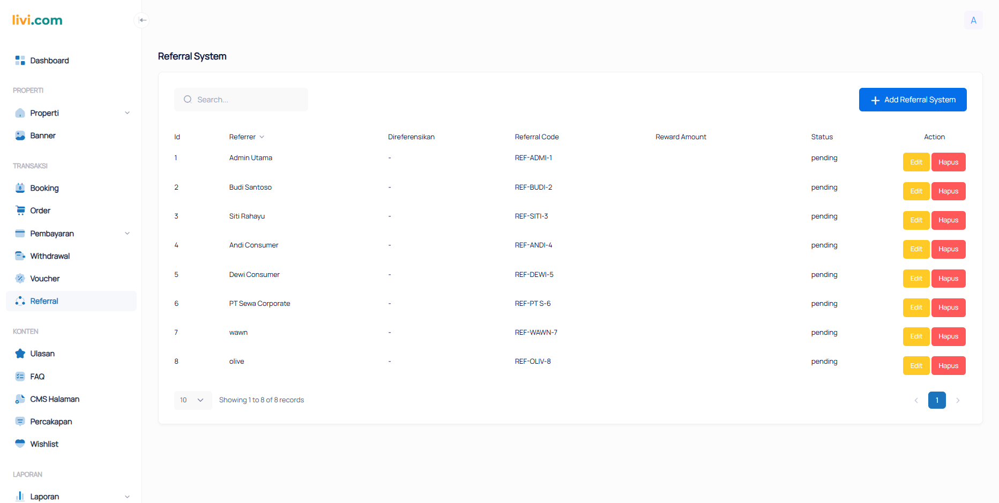
*Gambar 8.4: Tabel Pelacakan Program Rujukan Referral Pengguna*

- Menampilkan akun pemberi rujukan (*Referrer*), kode referral unik (*REF-BUDI-2*), dan besaran bonus reward yang berhak diterima pengundang.

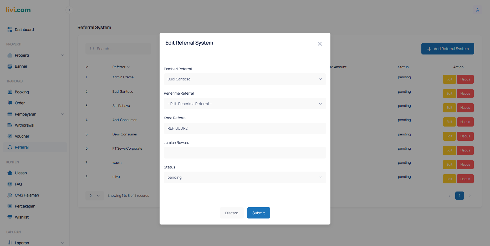
*Gambar 8.5: Modal Verifikasi & Persetujuan Reward Referral*

- Staf memeriksa apakah teman yang diundang telah berhasil menyelesaikan reservasi pertamanya sebelum mengubah status menjadi *Approved* untuk mencairkan bonus reward.

---

## BAB 9: MANAJEMEN REPUTASI, BANTUAN & KONTEN LEGAL

### 9.1 Memantau & Memberikan Balasan Ulasan Tamu (Review & Rating)

Menu Review mengelola transparansi penilaian dan ulasan pengalaman menginap tamu:

*Gambar 9.1: Tabel Moderasi Ulasan & Penilaian Tamu*

- Menampilkan nama akomodasi yang dinilai, skor bintang kepuasan, komentar testimoni tamu, dan kolom balasan resmi host (*Host Reply*).

*Gambar 9.2: Modal Entri Ulasan Tamu Manual*

- Digunakan untuk mencatatkan formulir survei kepuasan offline ke dalam data sistem.

*Gambar 9.3: Modal Penulisan Tanggapan Resmi Host terhadap Ulasan Tamu*

- Staf atau host menuliskan kalimat apresiasi terima kasih atau klarifikasi atas keluhan tamu pada kolom *Host Reply* agar terlihat profesional di aplikasi mobile.

---

### 9.2 Mengelola Pusat Bantuan & Tanya Jawab Pengguna (FAQ)

Menu FAQ mengelola panduan mandiri yang tampil pada menu Bantuan di aplikasi mobile:

*Gambar 9.4: Tabel Manajemen Tanya Jawab FAQ Pusat Bantuan*

- Menampilkan kategori kendala (*Pemesanan, Pembayaran, Pembatalan, Lainnya*), kalimat pertanyaan, urutan tampil, dan status terbit.

*Gambar 9.5: Modal Penambahan Butir Tanya Jawab Bantuan Baru*

- Klik **"+ Add FAQ & Help Center"**, pilih kategori, ketik kalimat pertanyaan umum, tuliskan solusi jawaban yang jelas dan ramah, atur nomor urutan, aktifkan sakelar terbit, lalu klik **Submit**.

*Gambar 9.6: Modal Pengubahan Jawaban Bantuan FAQ Operasional*

- Memperbarui penjelasan kontak layanan pelanggan atau tata cara penanganan kendala tamu terbaru.

---

### 9.3 Mengelola Dokumen Legal Halaman Konten Statis (CMS Page)

Menu CMS Halaman mengelola dokumen hukum resmi platform tanpa perlu bantuan programmer:

*Gambar 9.7: Tabel Manajemen Dokumen Statis CMS (Terms, Privacy, About)*

- Menampilkan slug alamat web (*tentang-kami, syarat-ketentuan, kebijakan-privasi*), judul halaman, dan status publikasi.

*Gambar 9.8: Modal Editor Teks Paragraf Dokumen Syarat & Ketentuan*

- Memungkinkan admin memperbarui pasal-pasal perjanjian sewa, ketentuan ganti rugi, atau kebijakan privasi perlindungan data pengguna dengan mudah.

---

## BAB 10: KOMUNIKASI CHAT & PEMANTAUAN MINAT PELANGGAN

### 10.1 Memantau Pesan Percakapan Chat Tamu dan Host

Menu Manajemen Chat memantau percakapan langsung antara calon penyewa dengan pihak pemilik properti:

*Gambar 10.1: Tabel Pemantauan Percakapan Chat Tamu dan Host*

- Menampilkan nama pengirim, penerima obrolan, akomodasi yang ditanyakan, cuplikan pesan terakhir, dan timestamp waktu kirim.
- Membantu tim Customer Support memonitor kualitas pelayanan host dan mencegah upaya transaksi di luar sistem (*bypass komisi*).

---

### 10.2 Menganalisis Minat Properti Favorit Konsumen (Wishlist)

Menu Wishlist mencatat daftar listing properti yang disimpan ke daftar keinginan oleh pengguna aplikasi mobile:

*Gambar 10.2: Tabel Analisis Minat Properti Favorit Konsumen (Wishlist)*

- Menampilkan akun pengguna yang menandai properti sebagai favorit beserta tanggal penyimpanan.
- Membantu tim bisnis mengevaluasi properti yang diminati banyak calon tamu guna menentukan strategi promo penawaran khusus.

---

---

## BAB 11: REKAPITULASI & LAPORAN EKSEKUTIF

### 11.1 Ringkasan Pusat Laporan Eksekutif (Reports Hub)

Menu Laporan Ringkasan berfungsi sebagai pusat kendali (*hub*) seluruh modul analisis dan pelaporan kinerja platform Livirooms:

*Gambar 11.1: Tampilan Antarmuka Pusat Laporan Eksekutif (Reports Hub) Panel Admin Livirooms*

**Struktur Kartu Laporan Utama:**
1. **Booking Report (Lihat Laporan Pemesanan):** Akses langsung untuk melihat rekapitulasi seluruh transaksi reservasi yang masuk, baik harian maupun bulanan.
2. **Revenue Report (Lihat Laporan Pendapatan):** Akses cepat menuju laporan omzet kotor, pendapatan bersih platform, dan riwayat pelunasan konsumen.
3. **Withdrawal Report (Lihat Laporan Penarikan Dana):** Akses pemantauan mutasi pencairan dana bagi hasil sewa yang diajukan oleh mitra pemilik unit (*Host*).
4. **Property Performance (Lihat Performa Properti):** Akses evaluasi metrik kinerja masing-masing listing properti berdasarkan jumlah booking dan ulasan bintang tamu.
5. **Indikator Metrik Cepat:** Di sudut kanan atas terdapat indikator pendapatan berjalan (contoh: `300k`) yang memperlihatkan volume perputaran dana pada siklus aktif.

---

### 11.2 Laporan Pemesanan & Reservasi Booking

Laporan Booking menyediakan data transaksi reservasi secara detail dengan filter periode tanggal:

*Gambar 11.2: Tabel Laporan Reservasi Pemesanan Tamu dengan Filter Rentang Tanggal*

**Rincian Kolom & Prosedur Audit:**
1. **Filter Tanggal (*Date Range Filter*):** Tentukan rentang tanggal pelaporan menggunakan kolom *From* (contoh: `01/09/2026`) dan *To* (contoh: `30/09/2026`), lalu klik tombol **Filter** untuk menyaring data secara presisi.
2. **Kolom ID & Kode Booking:** Mencantumkan nomor urut identitas unik sistem serta kode booking resmi (*BK-2026-0002, BK-2026-0001, HTL-20260904-PSAJ, HTL-20260904-XUKL, HTL-20260904-347D, HTL-20260904-OWP6, HTL-20260904-YE7K, BK-IKTFTPNK*).
3. **Kolom Properti:** Menampilkan unit akomodasi yang dipesan tamu (contoh: *Merlynn Park Hotel, Sunset Beach Apartment, dsb*).
4. **Fungsi Operasional:** Membantu tim manajemen mengevaluasi fluktuasi pesanan antara akhir pekan (*weekend*) dan hari kerja (*weekday*).

---

### 11.3 Laporan Pendapatan Platform & Transaksi Masuk

Laporan Pendapatan menyajikan rekonsiliasi arus kas masuk (*cash inflow*) dari pembayaran sewa yang telah tervalidasi:

*Gambar 11.3: Tabel Laporan Pendapatan Bruto & Transaksi Pembayaran Lunas*

**Rincian Kolom & Prosedur Rekonsiliasi:**
1. **Kolom Order:** Menampilkan nomor urut order penagihan terkait pesanan tamu.
2. **Kolom Metode Pembayaran:** Kanal bayar yang digunakan konsumen (contoh: Virtual Account BCA, Mandiri, QRIS, dsb).
3. **Kolom Amount (Nominal Transaksi):** Jumlah nominal rupiah yang telah dibayarkan tamu (contoh: *Rp 1.020.000, Rp 1.457.000, Rp 1.250.000*).
4. **Kolom Status:** Indikator status transaksi (`paid`), membuktikan dana telah sukses diterima dari payment gateway Midtrans.
5. **Kolom Paid At:** Waktu dan tanggal tepat saat dana berhasil diselesaikan (*timestamp* audit perbankan).

---

### 11.4 Laporan Pencairan Saldo & Payout Host

Laporan Withdrawal mencatat arus kas keluar (*cash outflow*) berupa pencairan pendapatan bagi hasil kepada mitra pemilik properti:

*Gambar 11.4: Tabel Laporan Riwayat Penarikan Dana (Payout) Host*

**Rincian Kolom & Penjelasan:**
1. **Kolom Host:** Nama mitra pemilik properti penerima pencairan saldo.
2. **Kolom Amount:** Nominal dana yang dicairkan ke rekening bank mitra.
3. **Kolom Status:** Status transaksi penarikan (*Pending / Approved / Rejected*).
4. **Catatan Status Kosong (*No data available*):** Jika tabel menampilkan keterangan *No data available*, hal ini menunjukkan bahwa pada rentang tanggal yang dipilih belum terdapat pengajuan pencairan saldo baru atau seluruh antrean penarikan dana telah selesai diproses oleh bagian Finance.

---

### 11.5 Laporan Performa Akomodasi & Properti Terlaris

Laporan Performa Properti menyajikan analisis perbandingan tingkat keterisian antar-unit akomodasi:

*Gambar 11.5: Tabel Laporan Kinerja & Peringkat Okupansi Akomodasi*

**Rincian Kolom & Analisis Bisnis:**
1. **Kolom Total Bookings:** Jumlah akumulasi reservasi yang berhasil dibukukan oleh properti (contoh: *6, 3, 4, 5, 7, 2, 8 pemesanan*).
2. **Kolom Property:** Daftar nama komersial akomodasi yang dipantau (*Merlynn Park Hotel, Sunset Beach Apartment, Modern Minimalist 2BR, Private Pool Villa Seminyak, Grand Cemara Hotel, Artotel Harmoni Jakarta, YELLO Hotel*).
3. **Pemanfaatan Bisnis:** Properti dengan angka pemesanan tinggi dapat diberikan badge *Recommended* di halaman beranda, sedangkan properti dengan okupansi rendah dapat dibantu melalui promo potongan harga atau optimasi foto galeri.

---

## BAB 12: PEMANTAUAN LOG SISTEM & NOTIFIKASI BROADCAST

### 12.1 Mengelola Riwayat & Pengiriman Notifikasi Push

Menu Manajemen Notifikasi digunakan untuk mengawasi riwayat pesan pemberitahuan yang dikirimkan sistem ke aplikasi ponsel pengguna:

*Gambar 12.1: Tabel Manajemen Riwayat Pengiriman Notifikasi Sistem*

**Rincian Kolom & Fungsi:**
1. **Kolom Title & Body:** Judul ringkas dan pesan detail pemberitahuan yang muncul pada bilah status (*status bar*) ponsel tamu atau host.
2. **Kolom Type:** Kategori pemberitahuan (contoh: *Pemesanan, Promo Diskon, Pengingat Check-in, Sistem*).
3. **Kolom Is Read:** Status apakah pesan telah dibuka dan dibaca oleh pengguna.
4. **Kolom User ID:** Nomor identitas akun penerima pesan notifikasi.
5. **Kolom Sent At:** Waktu tepat notifikasi disiarkan ke server FCM (*Firebase Cloud Messaging*).
6. **Tombol "+ Add Manajemen Notifikasi":** Tombol di kanan atas untuk menyusun dan mengirimkan pengumuman baru.

---

### 12.2 Prosedur Penulisan Notifikasi Baru ke Pengguna

Saat tombol **"+ Add Manajemen Notifikasi"** ditekan, modal pengiriman notifikasi akan terbuka:

*Gambar 12.2: Modal Form Penyiaran Pesan Notifikasi Push Baru*

**Langkah Operasional Staf:**
1. **Pilih Pengguna:** Tentukan apakah notifikasi ditujukan ke pengguna spesifik melalui dropdown *Pilih Pengguna*, atau dikosongkan untuk siaran massal (*broadcast*).
2. **Judul Notifikasi:** Ketik judul pesan yang menarik dan jelas (maksimal 60 karakter).
3. **Isi Notifikasi:** Tuliskan kalimat pengumuman atau instruksi yang ingin disampaikan kepada pengguna.
4. **Tipe Notifikasi:** Tentukan klasifikasi kategori pesan (*Promo, Transaksi, Update Aplikasi, Informasi Layanan*).
5. **Waktu Kirim:** Atur jadwal pengiriman (format `dd/mm/yyyy hh:mm`) atau pilih waktu sekarang untuk pengiriman instan.
6. Klik **Submit** untuk menyiarkan notifikasi ke perangkat pengguna.

---

### 12.3 Memantau Jejak Audit Log Aktivitas Keamanan

Menu Log Aktivitas (Audit Log) merekam seluruh interaksi mutasi data yang terjadi di dalam panel administrasi guna memastikan akuntabilitas operasional:

*Gambar 12.3: Tabel Rekaman Jejak Audit Aktivitas & Keamanan Sistem*

**Rincian Kolom & Manfaat Audit Keamanan:**
1. **Kolom Action:** Tindakan operasional yang dieksekusi (contoh: `create`, `update`, `delete`, `login`, `export`).
2. **Kolom Model Type & Model ID:** Entitas data yang dipengaruhi oleh aksi tersebut (contoh: `App\Models\Booking`, `App\Models\User`, `App\Models\Accommodation`).
3. **Kolom Old Values & New Values:** Catatan perbandingan nilai data sebelum dan sesudah diubah secara otomatis oleh sistem.
4. **Kolom IP Address:** Alamat protokol internet komputer staf yang melakukan perubahan data.
5. **Kolom User ID:** Identitas staf administrator penanggung jawab aktivitas tersebut.

---

### 12.4 Pencatatan Audit Log Khusus & Investigasi Keamanan

Dalam situasi investigasi keamanan khusus, administrator dapat mencatatkan rekaman audit manual:

*Gambar 12.4: Modal Entri Manual Rekaman Audit Keamanan Khusus*

**Formulir Isian:**
1. **Aksi (Action):** Masukkan jenis penindakan keamanan (contoh: *investigasi_akun*, *blokir_perangkat_mencurigakan*).
2. **Tipe Model & ID Model:** Cantumkan model data dan nomor ID entitas yang sedang diperiksa.
3. **IP Address:** Masukkan alamat IP komputer target investigasi, lalu klik **Submit** untuk mengabadikan catatan forensik.

---

## BAB 13: MANAJEMEN PENGGUNA & DETAIL ANALITIS AKUN

### 13.1 Memantau Tabel Pengguna & Filter Akun

Menu Users menampilkan direktori seluruh pengguna terdaftar, baik tamu penyewa, pemilik properti (*Host*), maupun staf internal:

*Gambar 13.1: Tabel Manajemen Direktori Seluruh Akun Pengguna Platform*

**Rincian Kolom & Fitur Antarmuka:**
1. **Kolom Pengguna (User):** Menampilkan nama lengkap, inisial avatar berwarna, dan alamat email resmi (*olive, mohbaswandegorie, PT Sewa Corporate, Dewi Consumer, Andi Consumer, Siti Rahayu, Budi Santoso, Admin Utama*).
2. **Kolom Role Badge:** Klasifikasi hak akses akun:
   - Badge Hijau/Abu: `Consumer` (tamu penyewa reguler).
   - Badge Biru/Ungu: `Host` (mitra pemilik unit properti).
   - Badge Hitam/Emas: `Admin` (staf pengelola sistem).
3. **Kolom Last Login & Joined Date:** Catatan waktu terakhir pengguna masuk ke aplikasi serta tanggal pertama kali akun didaftarkan.
4. **Kolom Aksi:** Tombol **Edit** untuk memperbarui data akun dan tombol **Hapus** untuk menghapus akun secara aman (*Soft Delete*).

---

### 13.2 Menambah Pengguna Baru & Penugasan Role

Klik tombol biru **"+ Add User"** di sudut kanan atas tabel untuk membuka formulir pembuatan akun baru:

*Gambar 13.2: Modal Pendaftaran Akun Pengguna & Pengisian Biodata Profil Baru*

**Langkah Pengisian Formulir Terpadu:**
1. **Seksi Akun User (Kiri):**
   - **Avatar:** Unggah foto profil pengguna (format PNG/JPG, maksimal 2MB).
   - **Nama Lengkap:** Masukkan nama resmi pengguna sesuai KTP.
   - **Email:** Masukkan alamat email aktif untuk pengiriman bukti reservasi dan invoice.
   - **Password:** Tetapkan kata sandi awal akun.
   - **Role:** Tentukan peran pengguna dari dropdown (*Admin, Host, Consumer*).
2. **Seksi Profil User (Kanan):**
   - **Tipe User:** Pilih tipe akun penyewa (*Consumer*) atau pengelola (*Host*).
   - **Nomor Telepon:** Masukkan nomor WhatsApp aktif (contoh: `08123456789`).
   - **Nama Perusahaan & NPWP (Opsional):** Diisi khusus untuk akun perusahaan penyewa korporat.
   - **Alamat:** Masukkan alamat domisili lengkap.
   - **Sakelar Terverifikasi:** Aktifkan sakelar jika dokumen pengguna telah diperiksa secara manual oleh staf.
3. Klik tombol biru **Simpan** untuk menyimpan data ke basis data.

---

### 13.3 Memperbarui Biodata Profil & Akun Pengguna

Saat tombol **Edit** ditekan pada baris pengguna tertentu, sistem menampilkan jendela pengubahan data akun:

*Gambar 13.3: Modal Pengubahan Data Akun, Nomor Telepon & Perusahaan Pengguna*

**Prosedur Pembaruan:**
1. Perbarui nomor WhatsApp atau email jika pengguna mengajukan permohonan koreksi kontak.
2. **Kolom Password:** Kosongkan kolom kata sandi jika tidak ingin mengubah password akun pengguna yang bersangkutan.
3. Perbarui nomor NPWP atau status verifikasi akun, lalu klik tombol **Simpan**.

---

### 13.4 Meninjau Detail Pengguna — Tab Overview

Dengan mengklik nama pengguna pada tabel direktori, administrator diarahkan ke halaman detail analitis pengguna (*User Details*):

*Gambar 13.4: Halaman Detail Pengguna: Tab Ringkasan (Overview), KPI Metrik & Dokumen KYC*

**Rincian Informasi & Kartu Ringkasan:**
1. **Sidebar Identitas Kiri:** Menampilkan avatar profil, nama lengkap pengguna (*mohbaswandegorie*), ID pengguna unik, alamat email resmi, nomor WhatsApp (*085814373846*), status verifikasi identitas KYC, serta tanggal pendaftaran akun.
2. **Kartu Statistik Kinerja (KPI Summary):**
   - **Total Bookings (6):** Akumulasi pemesanan kamar yang pernah dilakukan.
   - **Total Orders (5):** Akumulasi transaksi penagihan sewa.
   - **Total Payout (0):** Akumulasi penarikan saldo pendapatan sewa.
3. **Tabel Ringkasan Pemesanan Terbaru:** Memperlihatkan 5 transaksi terakhir untuk pemantauan cepat.
4. **Pratinjau Dokumen KYC:** Kartu pratinjau foto KTP dan foto selfie wajah bersama KTP untuk pengecekan keabsahan data pengguna.

---

### 13.5 Meninjau Detail Pengguna — Tab Riwayat Booking

Tab Bookings menyajikan riwayat komprehensif seluruh pemesanan yang pernah dilakukan oleh pengguna:

*Gambar 13.5: Halaman Detail Pengguna: Tab Riwayat Lengkap Seluruh Pemesanan (Bookings)*

**Elemen Informasi:**
1. **Daftar Seluruh Reservasi (*All Reservations & Bookings*):** Menampilkan kode booking unik (*BK-IKTFTPNK, dsb*), tanggal reservasi (*07 Sep 2026 - 08 Sep 2026*), nama properti tujuan, durasi menginap, dan total nominal tagihan sewa.
2. **Status Reservasi:** Indikator badge warna yang menunjukkan status pembayaran dan fase menginap tamu (*Paid, Staying, Completed, Cancelled*).

---

### 13.6 Meninjau Detail Pengguna — Tab Keuangan & Payout

Tab Finance menyajikan rekapitulasi data keuangan penagihan dan pencairan dana pengguna:

*Gambar 13.6: Halaman Detail Pengguna: Tab Keuangan Transaksi Order & Pencairan Saldo*

**Elemen Informasi:**
1. **Billing & Payment Orders:** Daftar order penagihan langsung (*Direct Payment Records*) yang diterbitkan atas transaksi pengguna beserta kode unik order, kanal pembayaran, dan nilai subtotal.
2. **Riwayat Penarikan Dana (Withdrawals):** Daftar pengajuan pencairan saldo pendapatan jika akun berstatus sebagai mitra pemilik unit (*Host*).

---

### 13.7 Meninjau Detail Pengguna — Tab Kontak & Penagihan Faktur

Tab Contacts & Billing mengelola buku alamat pemesan dan profil faktur pajak:

*Gambar 13.7: Halaman Detail Pengguna: Tab Kontak Reservasi & Profil Faktur Pajak*

**Elemen Informasi:**
1. **Buku Kontak Reservasi (*Contact Info*):** Daftar nomor kontak darurat dan nama pemesan yang tersimpan di akun pengguna untuk kemudahan proses reservasi berikutnya.
2. **Profil Faktur Pajak (*Invoice Profile*):** Data penagihan resmi untuk perusahaan atau perorangan (Nama Entitas, Alamat Penagihan, Nomor NPWP) yang dicantumkan pada invoice PDF.

---

### 13.8 Meninjau Detail Pengguna — Tab Aktivitas, Token & Wishlist

Tab Activity & Wishlist memantau preferensi minat dan interaksi sistem pengguna:

*Gambar 13.8: Halaman Detail Pengguna: Tab Aktivitas, Unit Favorit (Wishlist) & Perangkat*

**Elemen Informasi:**
1. **Daftar Wishlist Favorit:** Menampilkan daftar unit hunian atau kamar hotel yang ditandai oleh pengguna sebagai akomodasi idaman. Jika kosong, sistem menampilkan label *Wishlist is empty*.
2. **Token Perangkat Aktif (*Device Tokens*):** Menampilkan daftar token FCM ponsel cerdas yang aktif terhubung ke akun pengguna untuk pengiriman push notification.
3. **Log Jejak Audit Pengguna:** Rekaman aktivitas masuk dan transaksi personal pengguna.

---

### 13.9 Meninjau Detail Pengguna — Tab Keamanan & Akses Kredensial

Tab Security menyajikan rincian keamanan akun pengguna:

*Gambar 13.9: Halaman Detail Pengguna: Tab Kredensial Keamanan Akun & Hak Akses Role*

**Elemen Informasi:**
1. **Account Credentials & Access:** Menampilkan alamat email login terdaftar, status proteksi kata sandi terenkripsi (*bcrypt*), serta penugasan peran aktif (*Assigned Roles: Consumer, Host, Admin*).
2. **Autentikasi Dua Faktor (2FA):** Status keaktifan verifikasi dua langkah untuk keamanan ekstra akun staf.
3. **Preferensi Notifikasi Keamanan:** Konfigurasi penerimaan email alert saat terjadi upaya masuk dari perangkat baru.

---

## BAB 14: MANAJEMEN ROLE, HAK AKSES & MATRIKS IZIN (RBAC)

### 14.1 Memantau Kartu Ringkasan Peran / Roles

Menu Roles menyajikan manajemen hak akses berbasis peran (*Role-Based Access Control / RBAC*) yang diterapkan di platform Livirooms:

*Gambar 14.1: Tampilan Kartu Ringkasan Peran Pengguna (Admin, Host, Consumer)*

**Rincian Kartu Peran:**
1. **Peran Admin (Administrator):** Memiliki wewenang penuh atas seluruh 114 butir perizinan sistem (*Total users with this role: 1*).
2. **Peran Host (Mitra Pemilik Properti):** Memiliki wewenang terbatas atas modul akomodasi, ketersediaan, pemantauan pesanan unit miliknya, dan form pencairan saldo (*Total users with this role: 2*).
3. **Peran Consumer (Tamu Penyewa):** Peran dasar untuk pengguna yang hanya berhak mencari dan menyewa unit akomodasi (*Total users with this role: 4*).
4. **Tombol Navigasi:** Setiap kartu dilengkapi tombol **View Role** untuk melihat daftar anggota dan tombol **Edit Role** untuk menyesuaikan matriks hak akses.

---

### 14.2 Menambah / Mengonfigurasi Role Baru dengan Matriks Permissions

Saat tombol pembuatan peran baru dibuka, sistem menyajikan formulir matriks perizinan granular:

*Gambar 14.2: Modal Konfigurasi Peran Baru & Matriks Penugasan Hak Akses*

**Langkah Konfigurasi:**
1. **Role Name:** Masukkan nama peran baru (contoh: *cs_supervisor, finance_operator*).
2. **Role Permissions Matrix:** Tentukan hak akses per modul melalui pilihan checkbox:
   - Modul Data: *Cities, Building Lists, Properties, Property Search Logs, Bookings, Availabilities, Property Prices, Vouchers, Recommendations*.
   - Modul Komunikasi & Layanan: *Conversations, FAQs, Notification Logs, Reviews, Reports*.
   - Aksi Granular: *View (Lihat), Create (Tambah), Edit (Ubah), Delete (Hapus)*.
3. **Pintas Wewenang Penuh (*Administrator Access*):** Centang opsi *Select All* untuk memberikan seluruh hak akses secara otomatis.
4. Klik **Submit** untuk mendaftarkan peran baru ke sistem.

---

### 14.3 Mengonfigurasi Hak Akses Role Host

Untuk memastikan keamanan data antar-mitra, wewenang peran Host dikonfigurasi secara presisi:

*Gambar 14.3: Modal Pengaturan Hak Akses Spesifik untuk Peran Host*

**Prinsip Pembatasan Hak Akses Host:**
- Role `host` hanya diberikan izin melihat dan mengedit unit akomodasi yang terikat dengan ID miliknya (*View properties, Edit properties, View availabilities, Edit availabilities*).
- Izin manipulasi sistem sensitif (seperti konfigurasi gateway pembayaran Midtrans, penghapusan audit log, atau pengubahan tarif komisi platform) wajib dinonaktifkan.

---

### 14.4 Meninjau Detail Role & Staf / Pengguna yang Ditugaskan

Dengan menekan tombol **View Role** pada kartu peran Host, administrator dapat melihat daftar pengguna yang memegang peran tersebut:

*Gambar 14.4: Halaman Rincian Peran Host Beserta Daftar Anggota yang Ditugaskan*

**Informasi Antarmuka:**
1. **Daftar Izin Aktif (*Role Permissions*):** Memperlihatkan wewenang yang dimiliki role Host (contoh: *View withdrawals, View dashboard_host, View wishlists, View reports, View properties*).
2. **Tabel Users Assigned:** Menampilkan daftar nama mitra (*Siti Rahayu, PT Sewa Corporate, Budi Santoso*), alamat email resmi, serta tanggal penugasan peran.

---

### 14.5 Memantau Master Daftar Izin Sistem (Permissions Table)

Menu Permissions mengelola master butir-butir otorisasi terkecil yang ada di dalam kerangka kerja Laravel Spatie:

*Gambar 14.5: Tabel Master Hak Akses & Izin Sistem (Permissions Matrix)*

**Rincian Kolom:**
1. **Kolom Name:** Nama permission unik terstandar (contoh: *View Withdrawals, View Wishlists, View Vouchers, View user_profiles, View user_management, View Roles, View Reviews, View Reports, View Remote_config*).
2. **Kolom Assigned To:** Menunjukkan peran mana saja yang saat ini mengadopsi butir izin tersebut.
3. **Kolom Created Date:** Waktu pembuatan butir izin di basis data.

---

### 14.6 Menambah Butir Izin Hak Akses Baru ke Sistem

Saat modul baru dikembangkan di backend, administrator dapat mendaftarkan nama izin baru melalui modal Add Permission:

*Gambar 14.6: Modal Penambahan Butir Izin Hak Akses Baru ke Sistem*

**Peringatan Sistem (*Warning Box*):**
> ⚠️ **PERINGATAN PENTING:** Mengubah atau menambah nama permission tanpa koordinasi dengan tim pengembang dapat merusak fungsionalitas proteksi rute aplikasi. Pastikan nama permission mengikuti konvensi penamaan kode backend (contoh: `export_tax_reports`).

---

### 14.7 Memperbarui Butir Izin yang Ada

Modal Update Permission digunakan untuk mengoreksi nama butir izin yang telah terdaftar:

*Gambar 14.7: Modal Perubahan & Penyesuaian Nama Izin Sistem*

- Masukkan koreksi nama izin (*Permission Name: view withdrawals*), lalu klik tombol biru **Submit** untuk menyimpan pembaruan.

---

## BAB 15: VERIFIKASI DOKUMEN KYC & VALIDASI HOST

### 15.1 Memantau Antrean Validasi Dokumen Host

Menu Validasi Host adalah pusat verifikasi dokumen identitas calon mitra pemilik properti (*Know Your Customer / KYC*):

*Gambar 15.1: Tabel Antrean Verifikasi Dokumen KYC Calon Mitra Host*

**Rincian Kolom & Prosedur Validasi:**
1. **Kolom Pengguna:** Nama lengkap dan alamat email calon mitra host yang mengajukan verifikasi (*olive / nolivia175@gmail.com*).
2. **Kolom Status:** Status proses pengajuan (contoh: `Menunggu` dengan badge warna kuning).
3. **Kolom Tanggal Upload:** Waktu pengunggahan dokumen KTP dan selfie ke server (*timestamp*).
4. **Kolom Aksi:** Tombol untuk membuka detail berkas foto identitas guna pemeriksaan keaslian fisik KTP.

---

### 15.2 Memproses & Menetapkan Status Host Terverifikasi

Administrator dapat menambahkan atau menyetujui validasi host secara langsung melalui modal interaktif:

*Gambar 15.2: Modal Pendaftaran & Persetujuan Dokumen Validasi Host (KTP & Selfie)*

**Langkah Operasional Pemeriksaan:**
1. **Pilih Pengguna:** Pilih nama pengguna yang mengajukan upgrade akun ke mitra Host melalui dropdown pencarian Select2.
2. **Unggah Foto KTP:** Periksa dan unggah foto kartu identitas (KTP/Paspor) beresolusi jelas, nomor NIK terbaca, dan foto wajah tidak silau.
3. **Unggah Foto Selfie:** Periksa dan unggah foto selfie wajah calon mitra memegang kartu KTP untuk memastikan kecocokan wajah asli (*biometric face-match*).
4. **Sakelar Status Validasi (*Setujui Host*):** Geser sakelar switch menjadi aktif (`is_validate = 1`).
5. **Otomatisasi Sistem:** Saat tombol **Submit** ditekan, sistem secara otomatis memberikan role `host` dan mencabut role `consumer`. Mitra kini memiliki hak akses penuh untuk mendaftarkan properti dan menerima pesanan sewa tamu.

---

## BAB 16: PENGATURAN UMUM SISTEM & KONFIGURASI NOTIFIKASI

### 16.1 Mengatur Identitas Platform, Logo, Favicon & Kontak

Menu Setting (Tab General) mengelola identitas visual dan informasi kontak operasional platform Livirooms:

*Gambar 16.1: Layar Konfigurasi Sistem: Tab Pengaturan Umum, Logo & Identitas Website*

**Parameter Konfigurasi:**
1. **Logo Website:** Unggah file logo resmi (*LIVI.COM*) berlatar belakang transparan (format PNG/SVG). Logo ini langsung muncul di bilah navigasi atas website admin dan dokumen invoice resmi.
2. **Favicon Browser:** Unggah ikon browser beresolusi 32x32 piksel untuk identitas tab browser.
3. **Setting Website Name:** Nama komersial resmi platform (*Livirooms Indonesia*).
4. **Moto & Slogan:** Kalimat penjelas branding layanan (contoh: *Sewa Apartemen & Hotel Harian Terpercaya*).
5. **Kontak Operasional:** Nomor telepon call center dan email dukungan pelanggan yang tercantum di bagian footer aplikasi mobile.

---

### 16.2 Mengatur Notifikasi Push FCM, Firebase & Kebijakan Tampilan Harga

Menu Setting (Tab Notifikasi) mengelola integrasi push notification Google Firebase dan transparansi tarif sewa:

*Gambar 16.2: Layar Konfigurasi Sistem: Tab Notifikasi FCM, Firebase & Parameter Pajak*

**Parameter Konfigurasi Lanjutan:**
1. **Aktivasi Notifikasi FCM:** Sakelar switch toggle On/Off untuk mengaktifkan atau menonaktifkan pengiriman notifikasi push Firebase secara global ke seluruh perangkat pengguna.
2. **Firebase Project & Service Account JSON:** Kolom pengunggahan file kredensial JSON private key dari Google Firebase Cloud Console guna menjamin transmisi pesan notifikasi terenkripsi dan terotentikasi aman.
3. **Tampilkan Pajak di Harga (*Tax Display Policy*):** Sakelar toggle On/Off untuk menentukan apakah harga sewa yang tampil di aplikasi tamu sudah mencakup pajak layanan hotel/daerah secara inklusif atau dihitung terpisah di lembar tagihan check-out.
4. **Tampilkan Biaya Lainnya di Harga (*Additional Fees Policy*):** Sakelar toggle untuk menampilkan estimasi biaya kebersihan (*cleaning fee*) dan uang jaminan (*deposit*) secara transparan pada ringkasan katalog akomodasi.

---
## PUSAT BANTUAN & KONTAK LAYANAN OPERASIONAL

- **Kantor Pusat Operasional:** Livirooms Tower, Lantai 12, Jl. Casablanca Kav. 88, Jakarta Selatan 12870.
- **WhatsApp Dukungan Internal Staf:** +62 812-3456-7890
- **Email Administrator Sistem:** admin@livirooms.com
