# USER GUIDE HOST MOBILE APP
## Panduan Pengguna & Petunjuk Operasional Lengkap Aplikasi Mitra Host Livirooms (Flutter)
**Berkas Sumber:** `flutter/` (Aplikasi Seluler Android & iOS — Sisi Mitra Host)  
**Versi Aplikasi:** v2.4.0  
**Target Pengguna:** Pemilik Apartemen, Pengelola Hotel / Villa, Manajer Properti, Staf Resepsionis & Mitra Host Livirooms  

---

## DAFTAR ISI PANDUAN

1. [Tentang Aplikasi Mitra Host Livirooms](#1-tentang-aplikasi-mitra-host-livirooms)
2. [BAB 1: Dashboard Kinerja & Metrik Operasional Mitra](#bab-1-dashboard-kinerja--metrik-operasional-mitra)
   - 1.1 Ringkasan Kinerja Properti, Pendapatan Bulanan & Rating
   - 1.2 Grafik Arus Kas Pendapatan 6 Bulan & Pesanan Berjalan
3. [BAB 2: Manajemen Properti & Inventaris Akomodasi](#bab-2-manajemen-properti--inventaris-akomodasi)
   - 2.1 Menjelajahi Daftar Akomodasi Mitra
   - 2.2 Memfilter Status Listing (Semua, Hotel, Apartemen, Status Unit)
   - 2.3 Memulai Pendaftaran Akomodasi Baru
4. [BAB 3: Formulir & Konfigurasi Hotel (7-Step Wizard Hotel Form)](#bab-3-formulir--konfigurasi-hotel-7-step-wizard-hotel-form)
   - 3.1 Identitas & Klasifikasi Bintang Hotel
   - 3.2 Alamat Lengkap, Koordinat Geografis & Pratinjau Google Maps
   - 3.3 Pemilihan Titik Lokasi Peta Interaktif GPS
   - 3.4 Inventaris & Manajemen Tipe Kamar Hotel
   - 3.5 Formulir Tambah Tipe Kamar Baru
   - 3.6 Konfigurasi Kasur, Luas Kamar, Kuota Allotment & Fasilitas Kamar
   - 3.7 Matrix Skema Tarif Kamar & Kuota Harian
   - 3.8 Pengaturan Pajak Inclusive & Harga Coret Promosi
   - 3.9 Modal Perubahan Tarif Pokok, Biaya Kebersihan, Deposit & Service Fee
   - 3.10 Pengelolaan Grup Fasilitas Hotel & Layanan Unggulan
   - 3.11 Modal Penambahan Fasilitas Hotel & Penetapan Badge
   - 3.12 Media Galeri Foto Hotel, Rekomendasi Utama & Flash Sale Promo
   - 3.13 Aturan Operasional, Jadwal Check-in/out, Min Usia & Kebijakan Kamar
   - 3.14 Daftar Titik Akses Transit Transportasi Sekitar Hotel
   - 3.15 Modal Tambah Titik Transit, Estimasi Jarak & Durasi Akses
5. [BAB 4: Formulir & Konfigurasi Properti Apartemen (Unit Stay)](#bab-4-formulir--konfigurasi-properti-apartemen-unit-stay)
   - 4.1 Ringkasan Kapasitas Tamu, Kamar Tidur & Luas Unit
   - 4.2 Modal Tambah Fasilitas Kasur & Tipe Tempat Tidur
   - 4.3 Modal Tambah Grup Ruangan & Penataan Furnitur Unit
   - 4.4 Pengaturan Skema Sewa Multi-Durasi (Harian & Mingguan)
   - 4.5 Modal Tambah Skema Harga Durasi Sewa Apartemen
   - 4.6 Pengaturan Harga Coret & Kalkulasi Pajak Exclusive
   - 4.7 Fasilitas Bersama Gedung & Spesifikasi Unit Apartemen
   - 4.8 Modal Penambahan Fasilitas Gedung Bersama
   - 4.9 Modal Penambahan Spesifikasi Unit (Specs & Furnished)
6. [BAB 5: Manajemen Ketersediaan Cepat & Perubahan Tarif (Quick Edit)](#bab-5-manajemen-ketersediaan-cepat--perubahan-tarif-quick-edit)
   - 5.1 Quick Edit Ketersediaan & Multi-Durasi Unit Apartemen
   - 5.2 Quick Edit Kuota Allotment Stok & Status Kamar Hotel
   - 5.3 Modal Pembaruan Cepat Tarif Pokok & Biaya Tambahan
   - 5.4 Modal Penyesuaian Cepat Harga Coret & Ketentuan Pajak
7. [BAB 6: Manajemen Reservasi & Siklus Pesanan (Order Management)](#bab-6-manajemen-reservasi--siklus-pesanan-order-management)
   - 6.1 Memantau Order Baru Masuk (Tab Baru)
   - 6.2 Memantau Tamu Menginap & Reservasi Dikonfirmasi (Tab Dikonfirmasi)
   - 6.3 Meninjau Riwayat Order Dibatalkan & Selesai (Tab Dibatalkan)
   - 6.4 Rincian Order Tamu Sedang Menginap & Fitur Geser Check-out
   - 6.5 Rincian Order Transaksi Dibatalkan & Status Pembayaran
8. [BAB 7: Komunikasi & Layanan Pelanggan (Kotak Masuk & Chat)](#bab-7-komunikasi--layanan-pelanggan-kotak-masuk--chat)
   - 7.1 Membaca Kotak Masuk Pesan Terkait Nomor Reservasi
   - 7.2 Berinteraksi Langsung di Ruang Chat dengan Tamu Properti
9. [BAB 8: Saldo Dompet Mitra & Penarikan Dana (Wallet & Payouts)](#bab-8-saldo-dompet-mitra--penarikan-dana-wallet--payouts)
   - 8.1 Memeriksa Saldo Tersedia & Saldo Tertahan
   - 8.2 Prosedur Permohonan Tarik Dana & Rekonsiliasi Pembayaran
10. [BAB 9: Profil Akun Mitra, Verifikasi & Arsitektur Sistem](#bab-9-profil-akun-mitra-verifikasi--arsitektur-sistem)
    - 9.1 Informasi Profil Mitra, Reputasi & Response Rate
    - 9.2 Akses Menu Cepat & Beralih ke Mode Konsumen
    - 9.3 Standar Keamanan & Otorisasi Akun Mitra
    - 9.4 Arsitektur Cerdas & Alur Data Kontekstual Sistem

---

# 1. TENTANG APLIKASI MITRA HOST LIVIROOMS

Aplikasi seluler **Livirooms Mitra (Host)** adalah modul manajemen properti perhotelan dan hunian sewa terpadu yang dirancang khusus bagi pemilik properti, manajer hotel, dan staf operasional. Dibangun menggunakan framework **Flutter** berstandar modern, aplikasi ini terhubung secara mulus dengan arsitektur backend Laravel untuk memberikan kendali menyeluruh atas reservasi tamu, ketersediaan unit real-time, skema harga multi-durasi, komunikasi pesan instan, dan penarikan dana hasil sewa.

Platform Livirooms menerapkan prinsip **Dual Architecture (`hotel-vs-property`)**:
1. **Property (Apartemen / Villa / Unit Stay):** Penyewaan unit hunian utuh yang mendukung multi-durasi sewa (harian, mingguan, bulanan, tahunan) dengan perhitungan ketersediaan unit tunggal berbasis tanggal kalender.
2. **Hotel (Room Allotment):** Penyewaan akomodasi berbasis kamar bertipe banyak (Love Suite, Warmth Room, Happiness Room, dll.) dengan kuota alokasi harian (*daily stock allotment*) serta kebijakan operasional perhotelan terpusat.

Seluruh panduan di bawah ini disusun menggunakan tangkapan layar asli (*actual host mobile screenshot*) dari aplikasi rilis produksi beserta rincian elemen fungsional dan tata cara pengoperasiannya.

---

# BAB 1: DASHBOARD KINERJA & METRIK OPERASIONAL MITRA

### 1.1 Ringkasan Kinerja Properti, Pendapatan Bulanan & Rating

Layar Dashboard Mitra merupakan pusat kendali awal saat Mitra membuka aplikasi. Layar ini menghadirkan ringkasan kesehatan finansial, volume portofolio properti, order aktif, serta reputasi pelayanan Mitra di mata pelanggan.

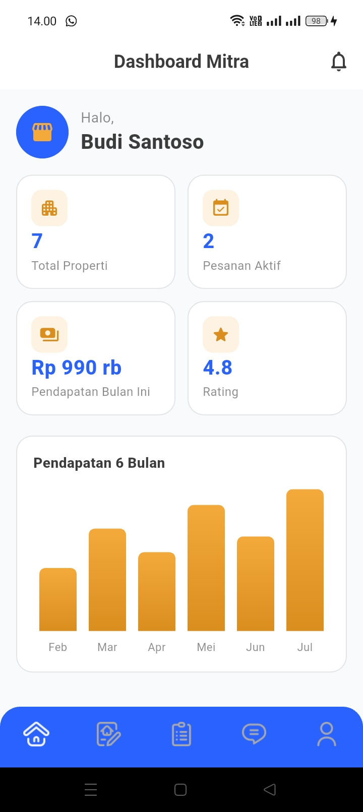
*Gambar 1.1: Layar Dashboard Mitra Livirooms dengan Metrik Kinerja & Grafik Pendapatan 6 Bulan*

#### Penjelasan Elemen Antarmuka:
- **Header Selamat Datang Mitra:** Menampilkan ucapan selamat datang personal dengan nama lengkap Mitra terdaftar (contoh: *"Dashboard Mitra - Budi Santoso"*).
- **Kartu Total Properti (7 Properti):** Kartu ringkasan angka total portofolio properti atau hotel yang sedang dikelola Mitra di bawah akun aktif.
- **Kartu Pesanan Aktif (2 Pesanan Aktif):** Indikator jumlah reservasi yang berstatus aktif (sedang menunggu check-in atau tamu sedang dalam masa inap).
- **Kartu Pendapatan Bulan Ini (Rp 990 rb):** Total penerimaan bersih Mitra pada bulan berjalan yang telah berhasil ditransaksikan.
- **Kartu Rating Akun (4.8 Rating):** Rata-rata skor ulasan bintang dari seluruh tamu yang telah menyelesaikan masa inap di properti Mitra.
- **Grafik Pendapatan 6 Bulan (Histogram Batang):** Visualisasi tren pendapatan riil selama 6 bulan terakhir (Februari hingga Juli) untuk membantu Mitra mengevaluasi fluktuasi okupansi musiman.
- **Bilah Navigasi Bawah (Bottom Navigation Bar):** Menu cepat 4 tab utama: Dashboard, Properti, Order, dan Profil.

#### Petunjuk Pengoperasian:
1. Periksa angka **Pesanan Aktif** setiap hari untuk mengantisipasi kedatangan tamu (check-in) dan kepulangan tamu (check-out).
2. Perhatikan kartu **Pendapatan Bulan Ini** untuk mencocokkan arus kas sewa dengan catatan operasional internal Anda.
3. Ketuk kartu pesanan untuk langsung berpindah ke modul manajemen reservasi secara cepat.

---

# BAB 2: MANAJEMEN PROPERTI & INVENTARIS AKOMODASI

### 2.1 Menjelajahi Daftar Akomodasi Mitra

Modul **Manajemen Accommodation** berfungsi untuk mengawasi seluruh unit properti dan properti hotel yang terdaftar di platform Livirooms. Mitra dapat memantau status operasional tiap unit secara seketika.

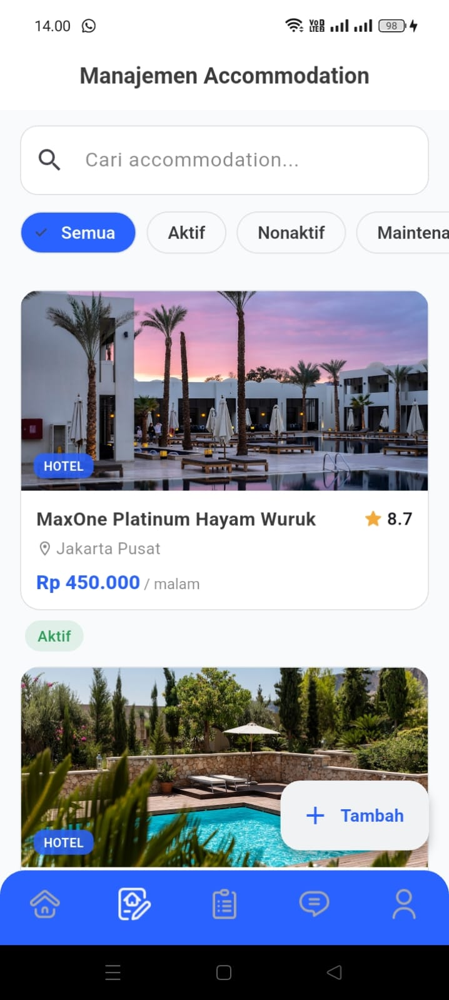
*Gambar 2.1: Daftar Manajemen Properti & Filter Klasifikasi Akomodasi Mitra*

#### Penjelasan Elemen Antarmuka:
- **Bilah Pencarian (Search Bar):** Kolom input *"Cari accommodation..."* untuk menyaring nama properti, hotel, atau lokasi secara instan.
- **Tab Filter Tipe Properti:** Tombol pemilihan kategori akomodasi:
  - **Semua:** Menampilkan seluruh listing tanpa batasan tipe.
  - **HOTEL:** Menyaring listing berjenis hotel kamar (*room allotment*).
  - **Apartemen:** Menyaring listing hunian unit apartemen mandiri.
- **Tab Status Operasional Listing:**
  - **Aktif:** Properti tayang di aplikasi tamu dan dapat dipesan.
  - **Nonaktif:** Properti dinonaktifkan sementara dari pencarian publik.
  - **Maintenance:** Properti dalam perbaikan fasilitas fisik dan tertutup dari pemesanan baru.
- **Kartu Listing Akomodasi:** Menampilkan foto sampul, nama properti (contoh: *"MaxOne Platinum Hayam Wuruk"*), nama kota (contoh: *"Jakarta Pusat"*), tarif mulai dari (contoh: *"Rp 450.000 / malam"*), label badge jenis akomodasi (`HOTEL`), serta chip status operasional (`Aktif`).
- **Tombol Tambah (+ Tambah):** Tombol aksi utama berwarna biru di pojok kanan atas untuk mendaftarkan properti atau hotel baru.

#### Petunjuk Pengoperasian:
1. Ketuk tab **HOTEL** atau **Apartemen** untuk membatasi tampilan sesuai jenis properti yang ingin dikelola.
2. Ketuk pada salah satu kartu akomodasi untuk membuka lembar penyuntingan cepat (*Quick Edit*) atau membuka formulir edit lengkap.
3. Gunakan tombol **+ Tambah** bila ingin mendaftarkan unit apartemen atau cabang hotel baru ke dalam katalog Mitra.

---

# BAB 3: FORMULIR & KONFIGURASI HOTEL (7-STEP WIZARD HOTEL FORM)

Pendaftaran dan penyuntingan properti hotel diatur melalui panduan wizard 7 langkah terstruktur (`hotel_form_screen.dart`) guna memastikan akurasi data operasional hotel bintang dan kamar.

### 3.1 Identitas & Klasifikasi Bintang Hotel

Langkah pertama berfokus pada legalitas nama properti, klasifikasi perhotelan, kelas bintang, serta tahun pendirian properti.

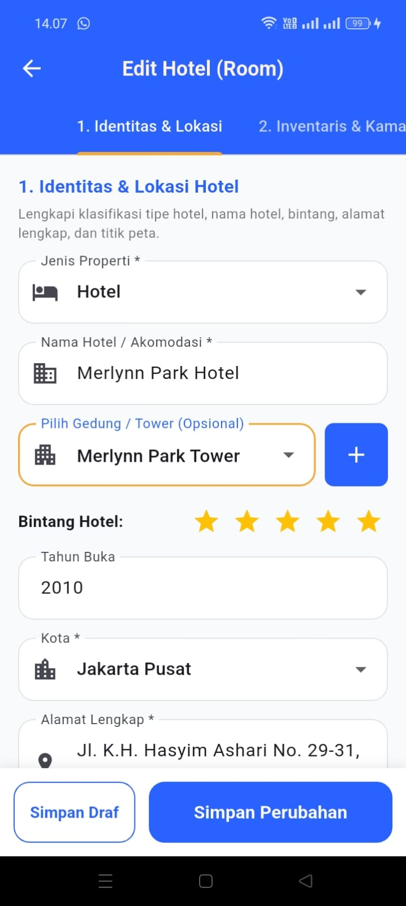
*Gambar 3.1: Formulir Hotel Langkah 1 - Identitas, Nama Properti & Klasifikasi Bintang*

#### Penjelasan Elemen Antarmuka:
- **Navigasi Langkah Wizard:** Tab atas interaktif bernomor 1 hingga 7: *1. Identitas & Lokasi*, *2. Inventaris & Kamar*, *3. Skema Harga*, *4. Fasilitas Hotel*, *5. Media & Cerita*, *6. Aturan & Kebijakan*, *7. Sekitar & FAQ*.
- **Dropdown Jenis Properti (*):** Pilihan wajib klasifikasi akomodasi (Hotel, Kondotel, Resort).
- **Kolom Nama Hotel / Akomodasi (*):** Input teks nama komersial hotel (contoh: *"Merlynn Park Hotel"*).
- **Kolom Gedung / Tower (Opsional):** Nama gedung spesifik (contoh: *"Merlynn Park Tower"*).
- **Pemilih Bintang Hotel:** Skala bintang hotel (1 hingga 5 bintang) untuk menentukan standar fasilitas.
- **Kolom Tahun Buka:** Tahun mulai beroperasinya hotel (contoh: *"2010"*).
- **Tombol "Simpan Draf":** Menyimpan isian formulir ke penyimpanan lokal tanpa mempublikasikannya.
- **Tombol "Simpan Perubahan":** Menyimpan seluruh data formulir ke server pusat Livirooms.

#### Petunjuk Pengoperasian:
1. Pastikan nama hotel ditulis secara lengkap sesuai izin usaha perhotelan agar memudahkan pencarian tamu.
2. Tentukan bintang hotel secara jujur sesuai sertifikasi perhotelan resmi.
3. Ketuk **Simpan Draf** jika Anda ingin melengkapi data pendukung di lain waktu.

---

### 3.2 Alamat Lengkap, Koordinat Geografis & Pratinjau Google Maps

Bagian bawah pada Langkah 1 mengharuskan penetapan alamat presisi dan koordinat GPS agar tamu tidak tersesat saat menuju hotel.

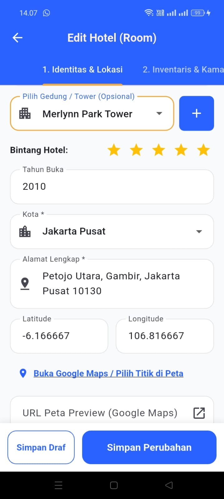
*Gambar 3.2: Formulir Hotel Langkah 1 - Alamat Lengkap & Penetapan Titik Koordinat GPS*

#### Penjelasan Elemen Antarmuka:
- **Pilihan Kota (*):** Dropdown kota administratif tempat hotel berada (contoh: *"Jakarta Pusat"*).
- **Alamat Lengkap (*):** Kolom teks multiline untuk nama jalan, nomor kavling, kelurahan, kecamatan, dan kode pos (contoh: *"Jl. K.H. Hasyim Ashari No. 29-31, Petojo Utara, Gambir, Jakarta Pusat 10130"*).
- **Kolom Latitude & Longitude:** Nilai koordinat numerik global (contoh: Lat `-6.166667`, Long `106.816667`).
- **Tombol "Buka Google Maps / Pilih Titik di Peta":** Tombol pembuka antarmuka peta interaktif.
- **Kolom URL Peta Preview (Google Maps):** Kolom tautan peta langsung untuk integrasi navigasi tamu.

#### Petunjuk Pengoperasian:
1. Ketikkan alamat fisik selengkap mungkin mencakup patokan gedung terdekat.
2. Ketuk tombol **Pilih Titik di Peta** untuk membuka jendela penentuan lokasi satelit.

---

### 3.3 Pemilihan Titik Lokasi Peta Interaktif GPS

Layar pemilihan titik lokasi (*Map Picker*) memungkinkan Mitra menggeser pin lokasi secara akurat di atas peta digital.

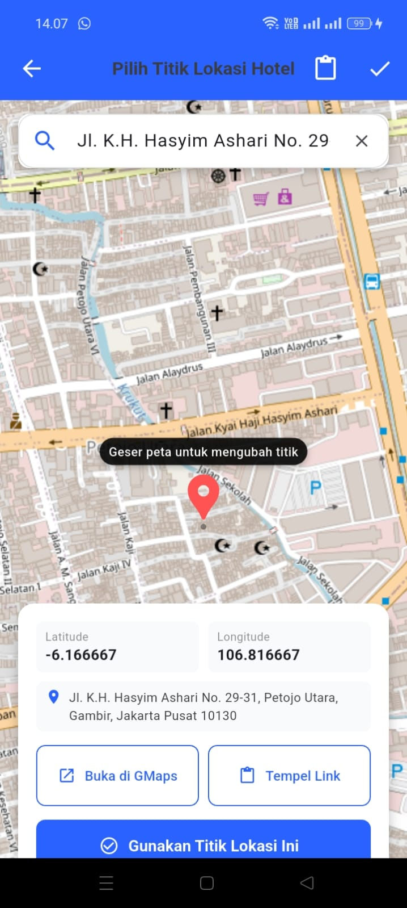
*Gambar 3.3: Layar Pemilihan Titik Lokasi Peta Interaktif & Konfirmasi Titik Koordinat*

#### Penjelasan Elemen Antarmuka:
- **Tampilan Peta Digital Interaktif:** Kanvas peta dengan penanda pin pusat (*pin marker*) yang dapat digeser.
- **Informasi Titik Terpilih:** Kotak info koordinat real-time: `Latitude: -6.166667`, `Longitude: 106.816667`.
- **Kotak Alamat Hasil Geocoding:** Konfirmasi alamat jalan yang terdeteksi secara otomatis di bawah pin.
- **Tombol "Buka di GMaps":** Membuka aplikasi Google Maps eksternal untuk memeriksa keakuratan navigasi rute.
- **Tombol "Tempel Link Lokasi":** Fitur menyalin link Google Maps untuk diisi secara instan.
- **Tombol "Gunakan Titik Ini":** Tombol konfirmasi untuk menerapkan koordinat ke formulir utama.

#### Petunjuk Pengoperasian:
1. Geser kanvas peta hingga ujung pin tepat berada di lobi utama atau pintu masuk kendaraan hotel Anda.
2. Verifikasi alamat jalan yang tertera di panel bawah peta.
3. Ketuk **Gunakan Titik Ini** untuk menyimpan posisi geografis.

---

### 3.4 Inventaris & Manajemen Tipe Kamar Hotel

Langkah kedua berfokus pada pendaftaran setiap tipe kamar hotel yang ditawarkan kepada tamu beserta kuota persediaannya.

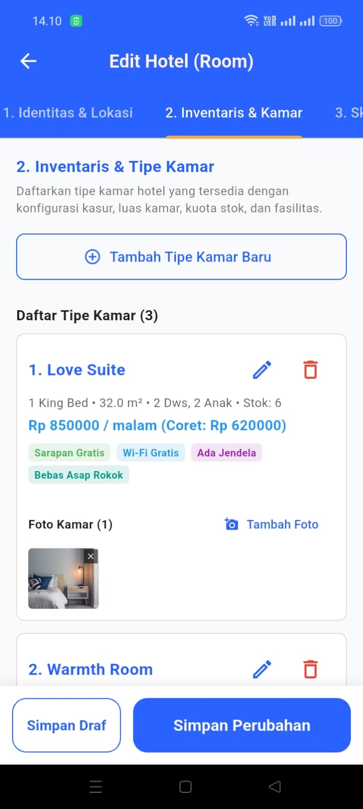
*Gambar 3.4: Formulir Hotel Langkah 2 - Daftar Inventaris Kamar & Kuota Allotment*

#### Penjelasan Elemen Antarmuka:
- **Deskripsi Langkah:** Petunjuk: *"Daftarkan tipe kamar hotel yang tersedia dengan konfigurasi kasur, luas kamar, kuota stok, dan fasilitas."*
- **Tombol "+ Tambah Tipe Kamar Baru":** Tombol biru untuk memunculkan formulir modal penambahan tipe kamar.
- **Daftar Tipe Kamar Terdaftar (Contoh: 3 Kamar):**
  - **Kartu Love Suite:** Memuat info *1 King Bed • 32.0 m² • 2 Dws, 2 Anak • Stok: 6*.
  - **Informasi Harga Kamar:** Tarif dasar *Rp 850.000 / malam* (Harga Normal Coret: *Rp 620.000*).
  - **Tag Fasilitas Inklusi:** Badge *Sarapan Gratis*, *Wi-Fi Gratis*, *Ada Jendela*, *Bebas Asap Rokok*.
  - **Galeri Kamar:** Pratinjau miniatur foto kamar terunggah serta tombol *+ Tambah Foto*.
  - **Kartu Kamar Lain:** Menampilkan tipe lain seperti *Warmth Room*, *Happiness Room*.

#### Petunjuk Pengoperasian:
1. Teliti setiap kartu kamar untuk memastikan kuota stok harian (*allotment*) telah sesuai dengan kapasitas nyata di lapangan.
2. Ketuk tombol **+ Tambah Foto** pada kamar terkait untuk mengunggah variasi sudut interior kamar.

---

### 3.5 Formulir Tambah Tipe Kamar Baru

Modal dialog ini digunakan saat Mitra ingin memperluas kategori kamar baru di dalam hotel.

*Gambar 3.5: Formulir Modal Dialog Pendaftaran Tipe Kamar Hotel Baru*

#### Penjelasan Elemen Antarmuka:
- **Judul Modal:** *"Tambah Tipe Kamar Baru - Konfigurasi kasur, tarif kamar, kuota stok, dan fasilitas."*
- **Kolom Nama Tipe Kamar (*):** Input nama varian kamar (contoh: *"Deluxe Executive Suite"*).
- **Kolom Konfigurasi Kasur:** Pilihan jenis kasur (contoh: *1 King Bed*, *2 Twin Beds*).
- **Kolom Tarif / Malam (*):** Nilai sewa dasar per malam sebelum penambahan pajak.
- **Kolom Harga Coret (Opsional):** Harga normal sebelum diskon untuk menampilkan daya tarik promosi.
- **Kolom Stok Allotment (*):** Batas maksimum unit kamar bertipe ini yang boleh dipesan secara simultan per malam (contoh: `10`).
- **Kolom Luas Ruangan (m²):** Ukuran fisik kamar dalam satuan meter persegi (contoh: `32`).
- **Input Kapasitas Tamu:** Penentuan kuota *Dewasa* (contoh: `2`) dan kuota *Anak* (contoh: `2`).
- **Tombol Batal & Tambah Tipe Kamar:** Tombol pembatalan abu-abu dan tombol simpan biru.

#### Petunjuk Pengoperasian:
1. Isi nama tipe kamar dan konfigurasi kasur dengan jelas.
2. Masukkan kuota allotment stok yang dialokasikan khusus untuk kanal online Livirooms.
3. Ketuk tombol **Tambah Tipe Kamar** untuk memasukkan kamar ke daftar inventaris.

---

### 3.6 Konfigurasi Kasur, Luas Kamar, Kuota Allotment & Fasilitas Kamar

Mitra dapat melengkapi spesifikasi pendukung dan fitur kenyamanan pada masing-masing tipe kamar.

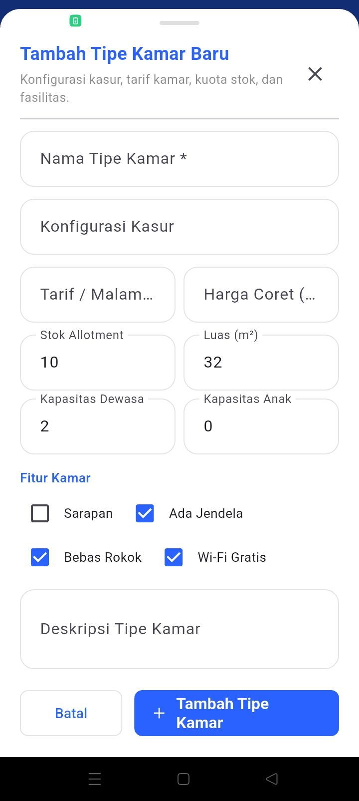
*Gambar 3.6: Formulir Penentuan Fitur Kamar & Inklusi Fasilitas Spesifik*

#### Penjelasan Elemen Antarmuka:
- **Checkbox Fitur Kamar:**
  - **Sarapan:** Menandakan apakah pemesanan kamar sudah termasuk sarapan pagi gratis (*breakfast included*).
  - **Ada Jendela:** Memastikan kamar memiliki bukaan jendela luar (ventilasi alami dan cahaya matahari).
  - **Bebas Rokok:** Menegaskan kamar bernon-smoking guna kenyamanan keluarga.
  - **Wi-Fi Gratis:** Akses jaringan nirkabel berkecepatan tinggi di dalam kamar.
- **Kolom Deskripsi Tipe Kamar:** Kotak isian narasi untuk menjelaskan keunggulan khusus kamar (pemandangan kota, balkon pribadi, bathtub).

#### Petunjuk Pengoperasian:
1. Centang fitur-fitur yang terjamin ada di kamar tersebut agar tidak menimbulkan komplain tamu saat check-in.
2. Berikan deskripsi yang menarik dan faktual.

---

### 3.7 Matrix Skema Tarif Kamar & Kuota Harian

Langkah ketiga menyajikan **Matrix Skema Tarif** terpusat untuk membandingkan tarif seluruh kamar hotel dalam satu tampilan ringkas.

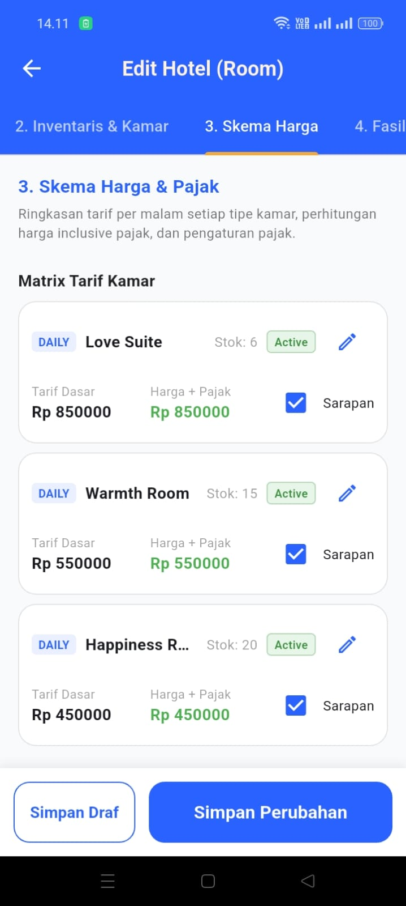
*Gambar 3.7: Formulir Hotel Langkah 3 - Ringkasan Matrix Tarif Kamar & Kuota Stok*

#### Penjelasan Elemen Antarmuka:
- **Judul Bagian:** *"3. Skema Harga & Pajak - Ringkasan tarif per malam setiap tipe kamar, perhitungan harga inclusive pajak, dan pengaturan pajak."*
- **Daftar Matrix Tarif Kamar:**
  - **Love Suite (DAILY):** Stok: `6` | Tarif Dasar: `Rp 850.000` | Harga + Pajak: `Rp 850.000` | Status: `Active`.
  - **Warmth Room (DAILY):** Stok: `15` | Tarif Dasar: `Rp 550.000` | Harga + Pajak: `Rp 550.000` | Status: `Active`.
  - **Happiness Room (DAILY):** Stok: `20` | Tarif Dasar: `Rp 450.000` | Harga + Pajak: `Rp 450.000` | Status: `Active`.
- **Indikator Fasilitas Singkat:** Label mini seperti *Sarapan* pada kamar yang menyertakan sarapan.

#### Petunjuk Pengoperasian:
1. Periksa perbandingan harga antar tipe kamar untuk menjaga struktur hierarki kelas kamar (standard vs suite).
2. Ketuk salah satu kartu kamar untuk mengubah tarif pokok atau rincian biaya pendukungnya.

---

### 3.8 Pengaturan Pajak Inclusive & Harga Coret Promosi

Livirooms mendukung perhitungan pajak hotel yang transparan dan fleksibel (*Inclusive* atau *Exclusive*).

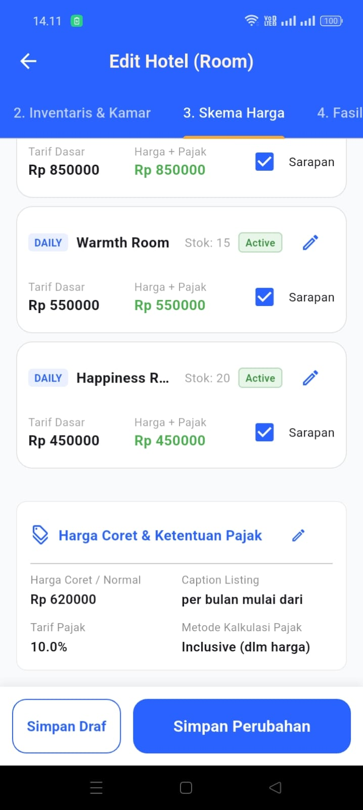
*Gambar 3.8: Pengaturan Ketentuan Pajak Hotel & Harga Coret Promosi*

#### Penjelasan Elemen Antarmuka:
- **Kolom Harga Coret / Normal (Rp):** Nilai patokan harga sebelum promo (contoh: *"Rp 620.000"*).
- **Kolom Tarif Pajak (%):** Persentase pajak pertambahan nilai atau pajak daerah (contoh: `10.0%`).
- **Kolom Caption Listing:** Teks pelengkap di kartu pencarian tamu (contoh: *"per bulan mulai dari"* atau *"per malam mulai dari"*).
- **Pilihan Metode Kalkulasi Pajak:**
  - **Inclusive (dlm harga):** Nilai pajak sudah termasuk di dalam nominal tarif yang ditampilkan ke tamu (tidak ada biaya tambahan mengejutkan di halaman pembayaran).
  - **Exclusive (+ pajak):** Pajak dihitung terpisah dan ditambahkan di atas tarif dasar saat checkout.

#### Petunjuk Pengoperasian:
1. Untuk pasar hotel di Indonesia, sangat dianjurkan memilih **Inclusive** demi transparansi harga kepada konsumen.
2. Masukkan persentase pajak daerah sesuai ketentuan regulasi setempat.

---

### 3.9 Modal Perubahan Tarif Pokok, Biaya Kebersihan, Deposit & Service Fee

Modal dialog ini memfasilitasi penyesuaian komponen biaya sewa kamar secara mendalam.

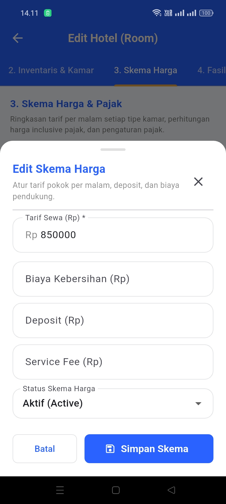
*Gambar 3.9: Modal Dialog Penyuntingan Komponen Tarif Pokok, Biaya Layanan & Deposit*

#### Penjelasan Elemen Antarmuka:
- **Kolom Tarif Sewa (Rp) (*):** Nominal tarif sewa pokok per malam (contoh: `850000`).
- **Kolom Biaya Kebersihan (Rp):** Biaya tambahan pembersihan unit (jika dikenakan).
- **Kolom Deposit (Rp):** Nominal jaminan keamanan yang wajib disetorkan tamu dan akan dikembalikan pasca checkout.
- **Kolom Service Fee (Rp):** Biaya layanan operasional tambahan hotel.
- **Dropdown Status Skema Harga:** Pilihan status `Aktif (Active)` atau `Nonaktif`.
- **Tombol "Batal" & "Simpan Skema":** Mengurungkan atau menerapkan perubahan tarif ke dalam matrix.

#### Petunjuk Pengoperasian:
1. Masukkan angka nominal tarif tanpa tanda titik atau koma.
2. Jika hotel Anda tidak memungut biaya kebersihan atau deposit terpisah, biarkan kolom tersebut kosong atau bernilai `0`.
3. Ketuk **Simpan Skema** untuk menyimpan perubahan.

---

### 3.10 Pengelolaan Grup Fasilitas Hotel & Layanan Unggulan

Langkah keempat mengatur katalog fasilitas umum hotel yang dikelompokkan secara rapi untuk memikat calon tamu.

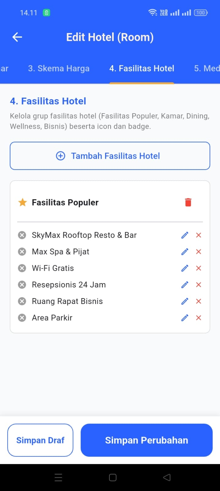
*Gambar 3.10: Formulir Hotel Langkah 4 - Daftar Fasilitas Umum & Layanan Populer*

#### Penjelasan Elemen Antarmuka:
- **Judul Bagian:** *"4. Fasilitas Hotel - Kelola grup fasilitas hotel (Fasilitas Populer, Kamar, Dining, Wellness, Bisnis) beserta icon dan badge."*
- **Tombol "+ Tambah Fasilitas Hotel":** Menambahkan item fasilitas baru ke dalam grup.
- **Grup Fasilitas Populer Terdaftar:**
  - *SkyMax Rooftop Resto & Bar*
  - *Max Spa & Pijat*
  - *Wi-Fi Gratis*
  - *Resepsionis 24 Jam*
  - *Ruang Rapat Bisnis*
  - *Area Parkir*
- **Tombol Hapus Fasilitas (Ikon Silang X):** Menghapus fasilitas dari listing jika sarana sedang ditutup atau tidak lagi tersedia.

#### Petunjuk Pengoperasian:
1. Pastikan seluruh fasilitas utama yang menjadi nilai jual hotel tercantum di daftar ini.
2. Apabila fasilitas tertentu sedang direnovasi, hapus sementara dari daftar agar tidak mengecewakan tamu.

---

### 3.11 Modal Penambahan Fasilitas Hotel & Penetapan Badge

Melalui modal ini, Mitra dapat mendefinisikan item fasilitas spesifik beserta lencana pemikat (*badge*).

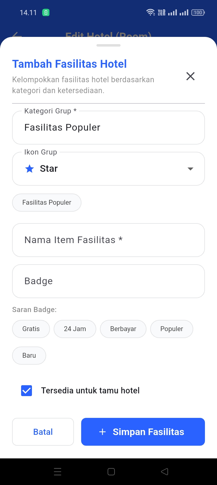
*Gambar 3.11: Modal Penambahan Item Fasilitas Hotel & Penentuan Kategori Badge*

#### Penjelasan Elemen Antarmuka:
- **Dropdown Kategori Grup (*):** Kategori penempatan fasilitas (contoh: *Fasilitas Populer*, *Dining*, *Wellness*).
- **Pemilih Ikon Grup:** Ikon representatif (contoh: Bintang `Star`, Cangkir Kopi, Dumbbell).
- **Kolom Nama Item Fasilitas (*):** Nama fasilitas yang mudah dikenali (contoh: *"SkyMax Rooftop Bar"*).
- **Pilihan Badge Saran:** Tombol pilihan cepat penanda istimewa fasilitas:
  - `Populer`: Layanan favorit tamu.
  - `Gratis`: Layanan tanpa pungutan biaya tambahan.
  - `Baru`: Fasilitas yang baru saja diresmikan.
  - `24 Jam`: Fasilitas yang beroperasi sepanjang waktu tanpa henti.
  - `Berbayar`: Fasilitas berbayar opsional.
- **Checkbox "Tersedia untuk tamu hotel":** Mengonfirmasi status aksesibilitas langsung bagi seluruh tamu menginap.

#### Petunjuk Pengoperasian:
1. Pilih kategori grup yang relevan agar fasilitas tersusun rapi di aplikasi tamu.
2. Pilih badge yang tepat (misalnya pasang badge `24 Jam` untuk *Resepsionis* atau *Room Service*).
3. Ketuk **Simpan Fasilitas** untuk menyematkannya ke profil hotel.

---

### 3.12 Media Galeri Foto Hotel, Rekomendasi Utama & Flash Sale Promo

Langkah kelima mengelola portofolio visual dan pemicu pemasaran (*promotional triggers*) untuk meningkatkan konversi pemesanan.

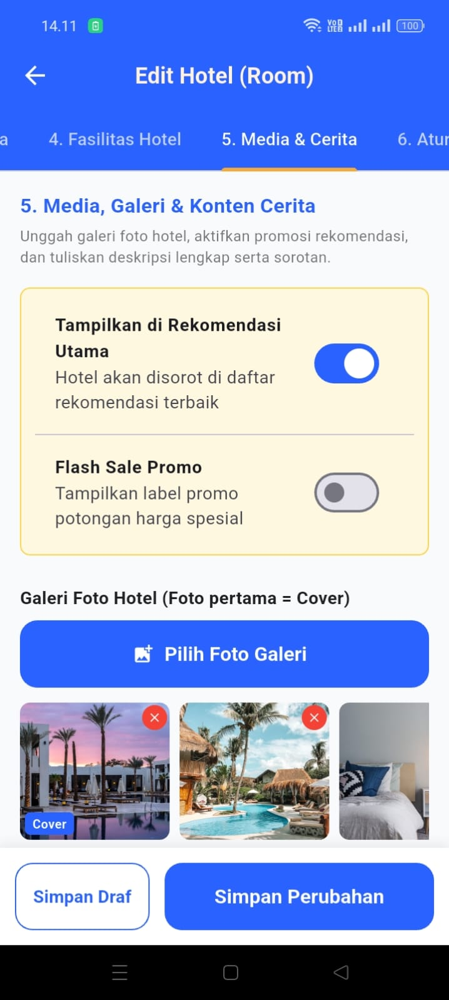
*Gambar 3.12: Formulir Hotel Langkah 5 - Manajemen Galeri Foto & Label Promosi*

#### Penjelasan Elemen Antarmuka:
- **Toggle "Tampilkan di Rekomendasi Utama":** Sakelar untuk mengikutsertakan hotel dalam seksi rekomendasi unggulan teratas beranda aplikasi tamu.
- **Toggle "Flash Sale Promo":** Sakelar aktivasi label promosi harga diskon kilat bertanda khusus.
- **Seksi Galeri Foto Hotel:** Pratinjau foto-foto bangunan hotel. Aturan platform menetapkan: *Foto pertama otomatis dijadikan foto sampul (Cover Image)*.
- **Tombol "Pilih Foto Galeri":** Membuka galeri perangkat seluler untuk memilih dan mengunggah foto beresolusi tinggi.

#### Petunjuk Pengoperasian:
1. Unggah minimal 5-10 foto dengan pencahayaan terang yang mencakup fasad luar gedung, lobi, restoran, kolam renang, dan kamar tidur.
2. Posisikan foto paling menarik di urutan pertama sebagai cover utama.
3. Aktifkan **Flash Sale Promo** jika Anda sedang menggelar promo potongan harga khusus akhir pekan.

---

### 3.13 Aturan Operasional, Jadwal Check-in/out, Min Usia & Kebijakan Kamar

Langkah keenam menentukan batas aturan operasional dan tata tertib menginap (*house rules*) untuk menjamin kelancaran operasional.

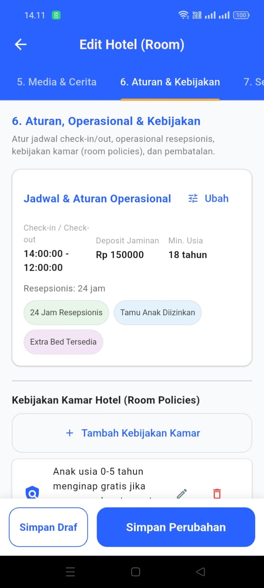
*Gambar 3.13: Formulir Hotel Langkah 6 - Jadwal Check-in, Resepsionis & Kebijakan Operasional*

#### Penjelasan Elemen Antarmuka:
- **Jadwal Check-in / Check-out:** Waktu baku penerimaan kedatangan tamu dan batas waktu penyerahan kunci (contoh: *Check-in 14:00, Check-out 12:00*).
- **Kolom Deposit Jaminan:** Nilai deposit kerusakan yang disyaratkan saat proses check-in (contoh: *"Rp 150.000"*).
- **Kolom Batas Usia Minimal:** Syarat usia minimal pemegang reservasi utama (contoh: *"18 tahun"*).
- **Indikator & Sakelar Layanan:**
  - *24 Jam Resepsionis*: Kesiapan staf lobi melayani tamu sepanjang malam.
  - *Extra Bed Tersedia*: Ketersediaan kasur tambahan berdasarkan permintaan.
  - *Tamu Anak Diizinkan*: Memperbolehkan tamu membawa anak di bawah umur.
- **Seksi Kebijakan Kamar Hotel (Room Policies):** Ketentuan tertulis mendalam, seperti syarat anak usia 0-5 tahun menginap gratis dengan kasur yang ada.

#### Petunjuk Pengoperasian:
1. Tetapkan batas waktu check-out yang cukup bagi staf tata graha (*housekeeping*) untuk membersihkan kamar sebelum tamu berikutnya datang.
2. Tuliskan rincian biaya penambahan ranjang (*extra bed*) dan syarat deposit secara gamblang.

---

### 3.14 Daftar Titik Akses Transit Transportasi Sekitar Hotel

Langkah ketujuh mengelola informasi jarak dan akses transportasi strategis di sekeliling properti guna membantu mobilitas tamu luar kota.

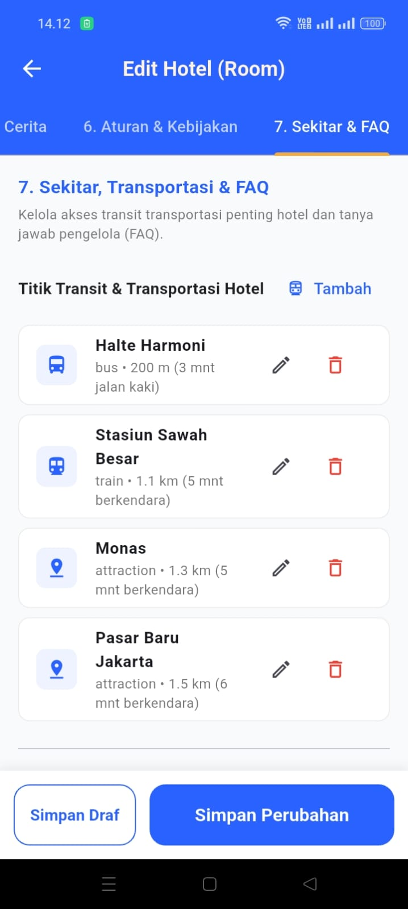
*Gambar 3.14: Formulir Hotel Langkah 7 - Daftar Titik Transit Transportasi & Akses Sekitar*

#### Penjelasan Elemen Antarmuka:
- **Judul Bagian:** *"7. Sekitar, Transportasi & FAQ - Kelola akses transit transportasi penting hotel dan tanya jawab pengelola (FAQ)."*
- **Tombol "Tambah Titik Transit":** Membuka dialog penambahan simpul transportasi baru.
- **Daftar Titik Transit Terdaftar:**
  - *Halte Harmoni:* Kategori `bus` • Jarak `200 m` (3 menit jalan kaki).
  - *Stasiun Sawah Besar:* Kategori `train` • Jarak `1.1 km` (5 menit berkendara).
  - *Monumen Nasional (Monas):* Kategori `attraction` • Jarak `1.3 km` (5 menit berkendara).
  - *Pasar Baru Jakarta:* Kategori `attraction` • Jarak `1.5 km` (6 menit berkendara).

#### Petunjuk Pengoperasian:
1. Daftarkan minimal halte bus terdekat, stasiun kereta, dan bandara terdekat beserta taksiran waktu tempuh normal.
2. Daftarkan pula destinasi rekreasi atau pusat belanja terkemuka di dekat hotel.

---

### 3.15 Modal Tambah Titik Transit, Estimasi Jarak & Durasi Akses

Melalui formulir modal ini, Mitra dapat mendefinisikan lokasi titik transit baru beserta parameter jaraknya.

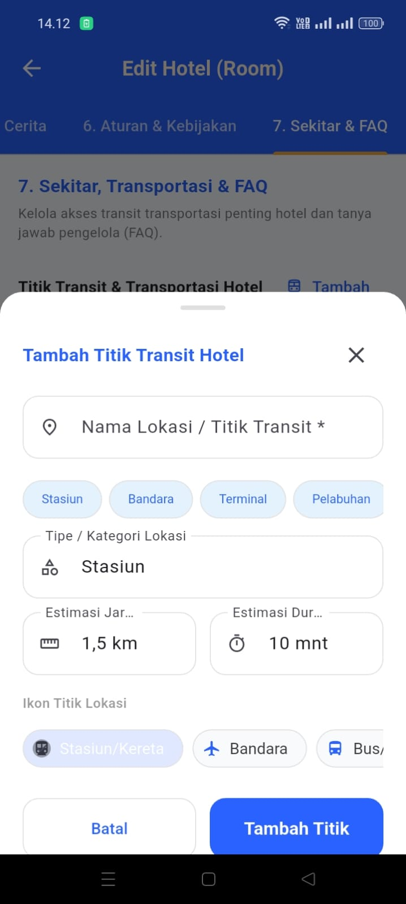
*Gambar 3.15: Modal Dialog Penambahan Titik Simpul Transportasi Sekitar Hotel*

#### Penjelasan Elemen Antarmuka:
- **Kolom Nama Lokasi / Titik Transit (*):** Nama terminal, stasiun, halte, atau bandara (contoh: *"Stasiun Gambir"*).
- **Pilihan Kategori Lokasi:** Tombol pemilihan jenis simpul: `Stasiun`, `Bandara`, `Terminal`, `Pelabuhan`.
- **Kolom Estimasi Jarak:** Jarak tempuh dalam kilometer (contoh: `1,5 km`).
- **Kolom Estimasi Durasi:** Perkiraan waktu tempuh dalam menit (contoh: `10 mnt`).
- **Pemilih Ikon Titik Lokasi:** Simbol ikonik penanda sarana (`Bandara`, `Bus`, `Kereta`).
- **Tombol "Batal" & "Tambah Titik":** Mengesahkan atau membatalkan penambahan titik transit.

#### Petunjuk Pengoperasian:
1. Pilih kategori simpul yang tepat agar ikon pada detail hotel di aplikasi tamu sesuai.
2. Masukkan taksiran durasi tempuh realistis pada jam sibuk.

---

# BAB 4: FORMULIR & KONFIGURASI PROPERTI APARTEMEN (UNIT STAY)

Untuk properti berjenis **Apartemen** atau **Villa Mandiri**, Livirooms menggunakan struktur formulir properti unit tunggal (`property_form_screen.dart`) yang berfokus pada denah ruangan fisik, konfigurasi kasur, dan skema sewa berjangka waktu fleksibel.

### 4.1 Ringkasan Kapasitas Tamu, Kamar Tidur & Luas Unit

Langkah kedua formulir properti berfokus pada daya tampung tamu dan spesifikasi luas ruangan hunian.

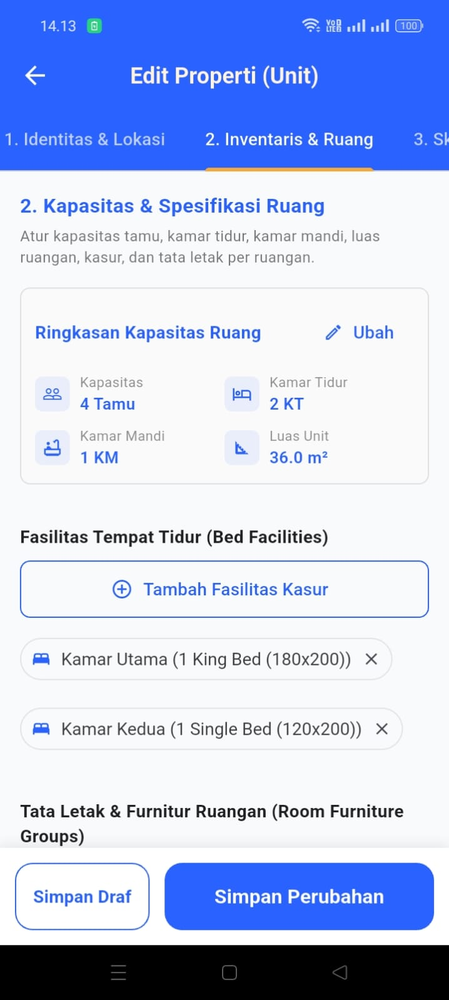
*Gambar 4.1: Formulir Properti Langkah 2 - Kapasitas Tamu, Kamar Tidur & Tempat Tidur*

#### Penjelasan Elemen Antarmuka:
- **Kotak Ringkasan Kapasitas Ruang:**
  - *Kapasitas:* `4 Tamu`
  - *Kamar Mandi:* `1 Ruang`
  - *Kamar Tidur:* `2 Ruang`
  - *Luas Unit:* `36.0 m²`
- **Seksi Fasilitas Tempat Tidur (Bed Facilities):** Menampilkan pembagian tempat tidur per ruangan:
  - *Kamar Utama:* `1 King Bed (180x200)` (disertai tombol hapus X).
  - *Kamar Kedua:* `1 Single Bed (120x200)` (disertai tombol hapus X).
- **Tombol "+ Tambah Fasilitas Kasur":** Membuka dialog penambahan ranjang pada kamar tertentu.
- **Seksi Tata Letak & Furnitur Ruangan (Room Furniture Groups):** Daftar furnitur pelengkap unit.

#### Petunjuk Pengoperasian:
1. Pastikan batas kapasitas tamu tidak melebihi kapasitas tempat tidur yang tersedia di dalam unit apartemen.
2. Masukkan ukuran luas unit apartemen secara akurat sesuai sertifikat unit (*semi-gross* atau *nett*).

---

### 4.2 Modal Tambah Fasilitas Kasur & Tipe Tempat Tidur

Modal dialog ini digunakan untuk menetapkan ukuran ranjang pada kamar tidur yang dipilih.

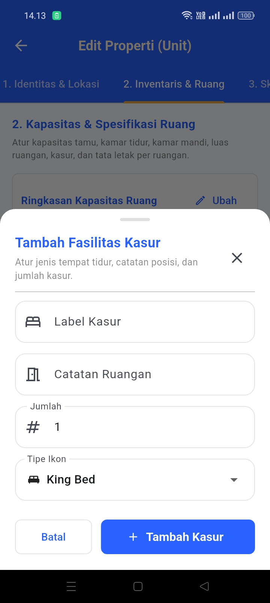
*Gambar 4.2: Modal Dialog Penambahan Varian Kasur & Spesifikasi Ranjang*

#### Penjelasan Elemen Antarmuka:
- **Kolom Label Kasur:** Keterangan penempatan kasur (contoh: *"Kamar Tidur Utama"*).
- **Kolom Catatan Ruangan:** Keterangan posisi atau kondisi khusus ranjang.
- **Kolom Jumlah:** Banyaknya kasur sejenis di dalam ruangan (contoh: `1`).
- **Dropdown Tipe Ikon Kasur:** Pilihan ukuran kasur baku: `King Bed (180x200)`, `Queen Bed (160x200)`, `Single Bed (120x200)`, `Bunk Bed (Tingkat)`.
- **Tombol "Batal" & "+ Tambah Kasur":** Menyimpan ranjang ke dalam daftar fasilitas unit.

#### Petunjuk Pengoperasian:
1. Tentukan tipe ikon kasur yang sesuai dengan ukuran fisik aslinya di unit apartemen.
2. Ketuk **+ Tambah Kasur** untuk memperbarui data ruang tidur.

---

### 4.3 Modal Tambah Grup Ruangan & Penataan Furnitur Unit

Mitra dapat merinci furnitur dan peralatan elektronik yang tersedia pada setiap ruangan unit (ruang tamu, dapur, balkon).

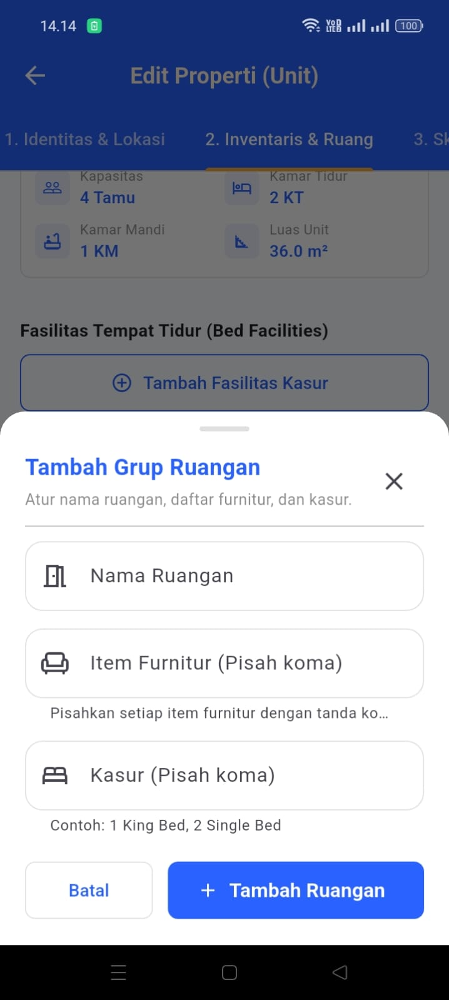
*Gambar 4.3: Modal Dialog Pengelompokan Furnitur & Inventarisasi Ruangan Unit*

#### Penjelasan Elemen Antarmuka:
- **Kolom Nama Ruangan (*):** Penamaan area (contoh: *"Ruang Keluarga"*, *"Dapur Kering"*, *"Balkon"*).
- **Kolom Item Furnitur (Pisah Koma):** Daftar peralatan dan mebel yang dipisahkan tanda koma (contoh: *"Smart TV 43 Inch, Sofa Bed, Meja Makan 4 Kursi, Kulkas 2 Pintu"*).
- **Kolom Kasur (Pisah Koma):** Daftar kasur tambahan yang ada di ruangan tersebut jika ada.
- **Tombol "Batal" & "+ Tambah Ruangan":** Menyimpan grup inventaris ruangan.

#### Petunjuk Pengoperasian:
1. Tuliskan kelengkapan elektronik penting seperti Smart TV, Dispenser, Kulkas, Microwave, atau Mesin Cuci karena menjadi pertimbangan utama penyewa apartemen jangka panjang.

---

### 4.4 Pengaturan Skema Sewa Multi-Durasi (Harian & Mingguan)

Keunggulan platform Livirooms adalah kemampuan Mitra apartemen untuk menawarkan berbagai durasi sewa secara terpadu di dalam satu unit yang sama.

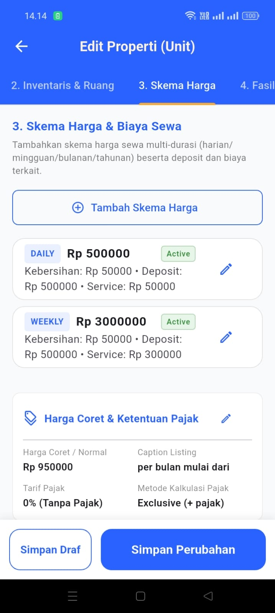
*Gambar 4.4: Formulir Properti Langkah 3 - Skema Sewa Multi-Durasi Harian & Mingguan*

#### Penjelasan Elemen Antarmuka:
- **Judul Bagian:** *"3. Skema Harga & Biaya Sewa - Tambahkan skema harga sewa multi-durasi (harian/mingguan/bulanan/tahunan) beserta deposit dan biaya terkait."*
- **Daftar Skema Harga Terdaftar:**
  - **Skema Harian (DAILY):** Tarif: `Rp 500.000` | Status: `Active` | Rincian: *Kebersihan: Rp 50.000 • Deposit: Rp 500.000 • Service: Rp 50.000*.
  - **Skema Mingguan (WEEKLY):** Tarif: `Rp 3.000.000` | Status: `Active` | Rincian: *Kebersihan: Rp 50.000 • Deposit: Rp 500.000 • Service: Rp 300.000*.
- **Informasi Ketentuan Pajak:** Harga Coret `Rp 950.000` | Tarif Pajak: `0% (Tanpa Pajak)` | Metode Kalkulasi: `Exclusive (+ pajak)`.
- **Tombol "+ Tambah Skema Harga":** Membuka dialog penambahan durasi baru (misalnya sewa bulanan).

#### Petunjuk Pengoperasian:
1. Pastikan tarif mingguan atau bulanan menawarkan diskon rasional dibandingkan akumulasi tarif harian untuk menarik minat penyewa residensial.
2. Tetapkan besaran deposit jaminan kerusakan yang memadai untuk durasi sewa yang lebih lama.

---

### 4.5 Modal Tambah Skema Harga Durasi Sewa Apartemen

Modal dialog ini digunakan saat Mitra ingin mendaftarkan durasi sewa baru pada unit apartemen.

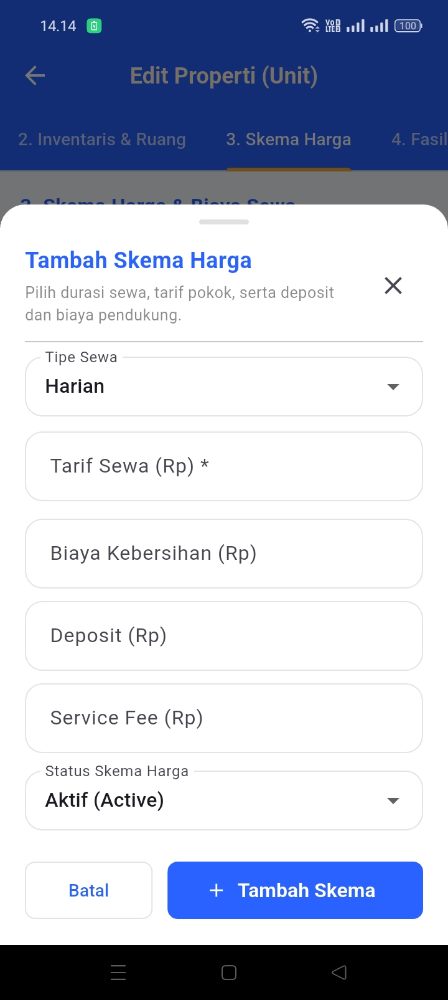
*Gambar 4.5: Modal Dialog Penambahan Durasi Sewa & Rincian Biaya Tambahan*

#### Penjelasan Elemen Antarmuka:
- **Dropdown Tipe Sewa (*):** Pilihan durasi komitmen sewa: `Harian`, `Mingguan`, `Bulanan`, `Tahunan`.
- **Kolom Tarif Sewa (Rp) (*):** Harga dasar sewa untuk durasi terpilih.
- **Kolom Biaya Kebersihan (Rp):** Biaya *cleaning service* saat tamu check-out.
- **Kolom Deposit (Rp):** Uang jaminan sewa yang dipegang selama masa sewa berlangsung.
- **Kolom Service Fee (Rp):** Biaya pemeliharaan gedung atau biaya kebersihan berkala.
- **Status Skema Harga:** Pilihan `Aktif (Active)` atau `Nonaktif`.

#### Petunjuk Pengoperasian:
1. Tentukan tipe sewa yang diinginkan.
2. Masukkan tarif dan biaya penunjang secara cermat.
3. Ketuk **+ Tambah Skema** untuk menambahkan durasi tersebut ke listing.

---

### 4.6 Pengaturan Harga Coret & Kalkulasi Pajak Exclusive

Mitra dapat mengelola tampilan promosi harga coret dan metode perpajakan unit apartemen.

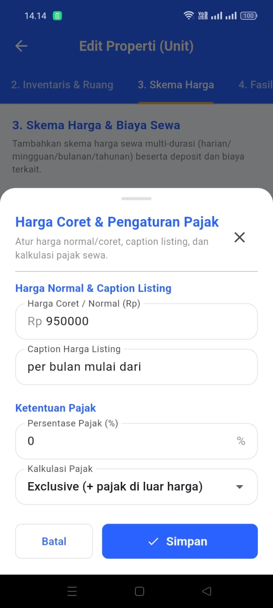
*Gambar 4.6: Modal Dialog Pengaturan Harga Normal Coret & Metode Pajak Exclusive*

#### Penjelasan Elemen Antarmuka:
- **Kolom Harga Coret / Normal (Rp):** Nilai komparasi harga pasar normal (contoh: `Rp 950000`).
- **Kolom Caption Harga Listing:** Keterangan tambahan di antarmuka tamu (contoh: *"per bulan mulai dari"*).
- **Kolom Persentase Pajak (%):** Besaran tarif pajak jika Mitra adalah badan usaha kena pajak.
- **Pilihan Metode Kalkulasi Pajak:** `Exclusive (+ pajak di luar harga)` atau `Inclusive`.

#### Petunjuk Pengoperasian:
1. Jika menyewakan unit apartemen pribadi tanpa pungutan pajak, kosongkan persentase pajak (`0%`).
2. Masukkan harga coret yang wajar untuk menonjolkan diskon sewa di mata konsumen.

---

### 4.7 Fasilitas Bersama Gedung & Spesifikasi Unit Apartemen

Langkah keempat formulir properti mengatur fasilitas kompleks menara apartemen (gedung) serta spesifikasi kondisi fisik interior unit (*specs*).

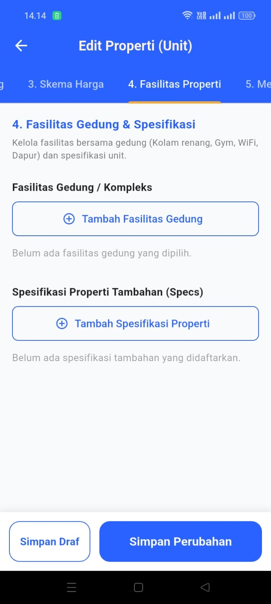
*Gambar 4.7: Formulir Properti Langkah 4 - Fasilitas Gedung Bersama & Spesifikasi Unit*

#### Penjelasan Elemen Antarmuka:
- **Seksi Fasilitas Gedung / Kompleks:** Daftar sarana umum milik menara apartemen yang berhak digunakan tamu (kolam renang, pusat kebugaran, lobi, kartu akses lift).
- **Tombol "+ Tambah Fasilitas Gedung":** Membuka dialog penambahan sarana fasilitas gedung.
- **Seksi Spesifikasi Properti Tambahan (Specs):** Kriteria interior unit (contoh: Full Furnished, Daya Listrik 2200 VA, Hadap Kolam Renang).
- **Tombol "+ Tambah Spesifikasi Properti":** Membuka dialog penambahan spesifikasi unit.

#### Petunjuk Pengoperasian:
1. Cantumkan fasilitas unggulan gedung apartemen agar penyewa merasa mendapatkan fasilitas setara hotel berbintang.
2. Periksa apakah fasilitas gedung memerlukan biaya tambahan atau gratis bagi penyewa unit Anda.

---

### 4.8 Modal Penambahan Fasilitas Gedung Bersama

Dialog penambahan fasilitas bersama gedung apartemen.

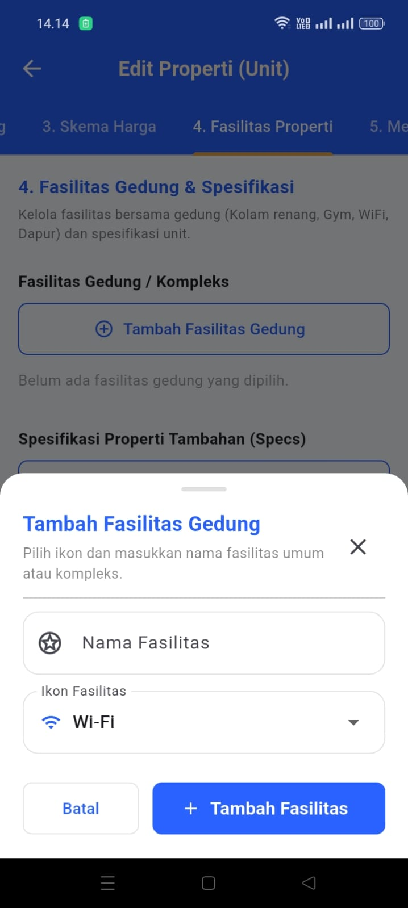
*Gambar 4.8: Modal Penambahan Fasilitas Umum Gedung Bersama Kompleks Apartemen*

#### Penjelasan Elemen Antarmuka:
- **Kolom Nama Fasilitas (*):** Nama fasilitas gedung (contoh: *"Kolam Renang Infinity Pool"*, *"Gym & Fitness Center"*, *"Wi-Fi Lobi"*).
- **Pemilih Ikon Fasilitas:** Ikon grafis representatif (`Wi-Fi`, `Pool`, `Gym`, `Security`).
- **Tombol "Batal" & "+ Tambah Fasilitas":** Mengesahkan sarana gedung ke dalam profil unit.

#### Petunjuk Pengoperasian:
1. Ketikkan nama fasilitas bersama secara jelas.
2. Pilih ikon yang tepat dan ketuk **+ Tambah Fasilitas**.

---

### 4.9 Modal Penambahan Spesifikasi Unit (Specs & Furnished)

Dialog penentuan spesifikasi fisik kondisi interior unit apartemen.

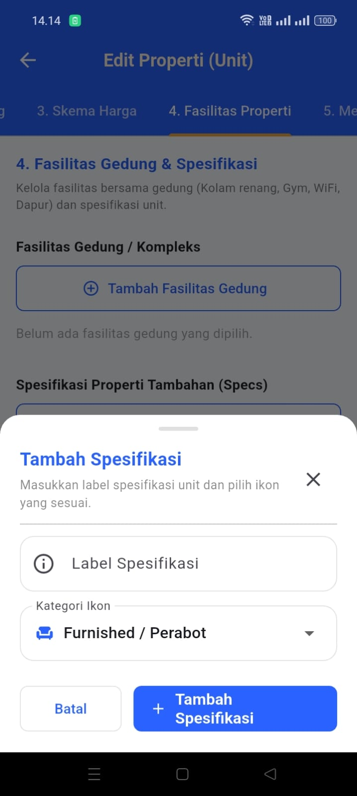
*Gambar 4.9: Modal Penambahan Spesifikasi Unit & Kondisi Perabot Interior*

#### Penjelasan Elemen Antarmuka:
- **Kolom Label Spesifikasi (*):** Teks keterangan spesifikasi (contoh: *"Fully Furnished Mewah"*, *"Lantai Tinggi Hook"*, *"Pemandangan Laut"*).
- **Dropdown Kategori Ikon:** Kategori ikon visual penjelas (contoh: `Furnished / Perabot`, `Listrik`, `Arah Hadap`).
- **Tombol "Batal" & "Tambah Spesifikasi":** Menyimpan spesifikasi unit ke dalam ringkasan listing.

#### Petunjuk Pengoperasian:
1. Sebutkan kondisi perabot (Fully Furnished, Semi Furnished, atau Unfurnished) agar calon penyewa memiliki ekspektasi yang tepat.

---

# BAB 5: MANAJEMEN KETERSEDIAAN CEPAT & PERUBAHAN TARIF (QUICK EDIT)

Platform Livirooms menghadirkan fitur **Quick Edit** pada menu kalender ketersediaan dan daftar properti, sehingga Mitra dapat mengubah tarif dan status kamar dalam hitungan detik tanpa harus membuka formulir wizard lengkap.

### 5.1 Quick Edit Ketersediaan & Multi-Durasi Unit Apartemen

Layar Quick Edit untuk apartemen unit (*Mode Unit Stay*) memungkinkan pengubahan tarif harian dan mingguan secara simultan.

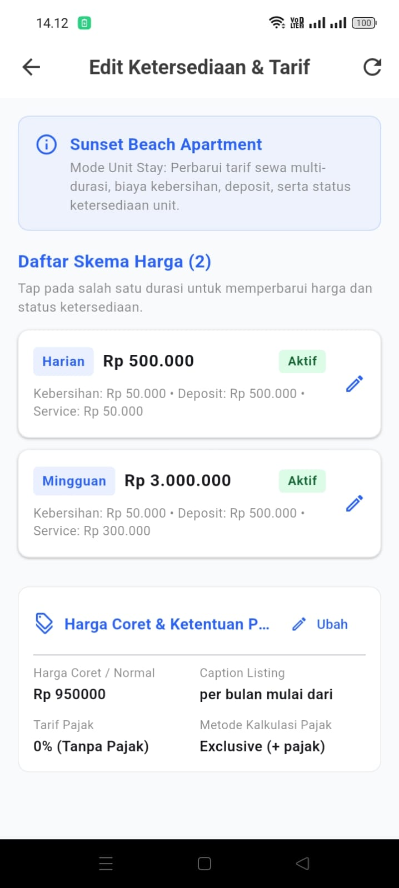
*Gambar 5.1: Layar Quick Edit Tarif Multi-Durasi & Ketersediaan Unit Apartemen*

#### Penjelasan Elemen Antarmuka:
- **Header Nama Unit:** Menampilkan nama unit akomodasi (contoh: *"Sunset Beach Apartment"*).
- **Indikator Mode:** *"Mode Unit Stay: Perbarui tarif sewa multi-durasi, biaya kebersihan, deposit, serta status ketersediaan unit."*
- **Daftar Skema Harga Interaktif:**
  - *Harian (Rp 500.000):* Status `Aktif` • Kebersihan: Rp 50.000 • Deposit: Rp 500.000.
  - *Mingguan (Rp 3.000.000):* Status `Aktif` • Kebersihan: Rp 50.000 • Deposit: Rp 500.000.
- **Panel Ketentuan Pajak & Harga Coret:** Ringkasan harga coret normal dan kalkulasi pajak saat ini beserta tombol *Ubah*.

#### Petunjuk Pengoperasian:
1. Ketuk kartu skema harga yang ingin diubah untuk membuka modal pengeditan angka tarif secara cepat.
2. Perubahan tarif akan segera berlaku pada sistem pencarian tamu seketika setelah disimpan.

---

### 5.2 Quick Edit Kuota Allotment Stok & Status Kamar Hotel

Layar Quick Edit untuk akomodasi hotel menghadirkan pemantauan kuota allotment dan status kamar terjual habis (*Sold Out*).

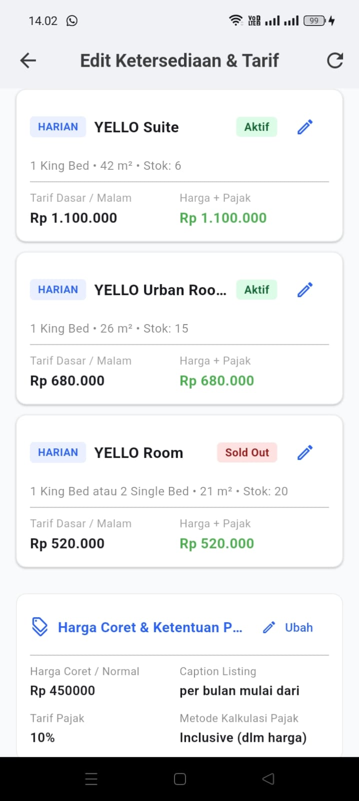
*Gambar 5.2: Layar Quick Edit Kuota Allotment Stok & Status Kamar Terjual Habis (Sold Out)*

#### Penjelasan Elemen Antarmuka:
- **Daftar Tipe Kamar & Allotment Harian:**
  - **YELLO Suite:** *1 King Bed • 42 m² • Stok: 6* | Status: `Aktif` | Tarif: `Rp 1.100.000`.
  - **YELLO Urban Room:** *1 King Bed • 26 m² • Stok: 15* | Status: `Aktif` | Tarif: `Rp 680.000`.
  - **YELLO Room:** *1 King Bed atau 2 Single Bed • 21 m² • Stok: 20* | Status: `Sold Out` (Badge Abu-abu) | Tarif: `Rp 520.000`.
- **Panel Pengaturan Pajak Hotel:** Tarif pajak `10% Inclusive`.

#### Petunjuk Pengoperasian:
1. Apabila kamar tipe tertentu terisi penuh oleh tamu offline (walk-in), Mitra dapat segera mengubah status kamar menjadi **Sold Out** untuk mencegah overbooking di platform online.
2. Pantau sisa kuota allotment stok secara berkala di musim liburan (*high season*).

---

### 5.3 Modal Pembaruan Cepat Tarif Pokok & Biaya Tambahan

Modal penyuntingan tarif cepat di layar ketersediaan.

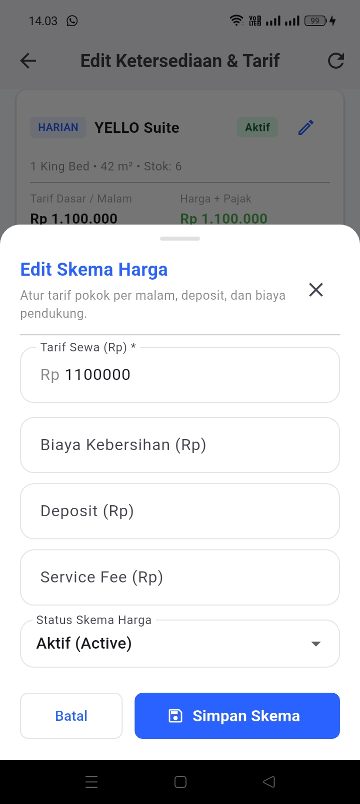
*Gambar 5.3: Modal Cepat Pembaruan Tarif Pokok Kamar & Biaya Pendukung*

#### Penjelasan Elemen Antarmuka:
- **Kolom Tarif Sewa (Rp) (*):** Nilai sewa baru (contoh: `1100000`).
- **Kolom Biaya Tambahan:** Biaya kebersihan, deposit jaminan, dan service fee.
- **Status Skema Harga:** Sakelar status `Aktif (Active)` atau dinonaktifkan.
- **Tombol "Batal" & "Simpan Skema":** Menyimpan pembaruan tarif ke server secara instan.

#### Petunjuk Pengoperasian:
1. Ubah nominal tarif sewa dan ketuk **Simpan Skema**. Seluruh pembaruan langsung disinkronkan ke mesin reservasi tamu.

---

### 5.4 Modal Penyesuaian Cepat Harga Coret & Ketentuan Pajak

Modal penyuntingan cepat harga normal promosi dan persentase pajak akomodasi hotel.

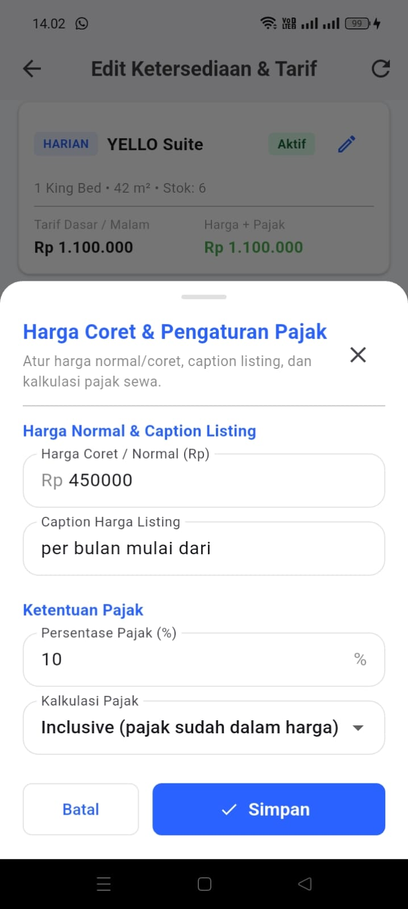
*Gambar 5.4: Modal Cepat Penyesuaian Persentase Pajak Inclusive & Harga Coret*

#### Penjelasan Elemen Antarmuka:
- **Kolom Harga Coret / Normal (Rp):** Patokan harga normal (contoh: `450000`).
- **Kolom Caption Listing:** Keterangan pelengkap kartu hotel.
- **Kolom Persentase Pajak (%):** Persentase pajak hotel (contoh: `10%`).
- **Dropdown Kalkulasi Pajak:** Pilihan `Inclusive (pajak sudah dalam harga)`.
- **Tombol "Batal" & "Simpan":** Tombol konfirmasi penerapan aturan pajak.

#### Petunjuk Pengoperasian:
1. Pastikan kalkulasi pajak tetap disetel ke **Inclusive** jika tidak ada perubahan regulasi pajak daerah.

---

# BAB 6: MANAJEMEN RESERVASI & SIKLUS PESANAN (ORDER MANAGEMENT)

Modul **Manajemen Order** (`order_management_screen.dart`) adalah pusat penanganan alur reservasi tamu, mulai dari pemesanan masuk hingga proses check-out dan pembatalan transaksi.

### 6.1 Memantau Order Baru Masuk (Tab Baru)

Tab pertama menampilkan reservasi tamu yang baru saja masuk dan memerlukan perhatian operasional Mitra.

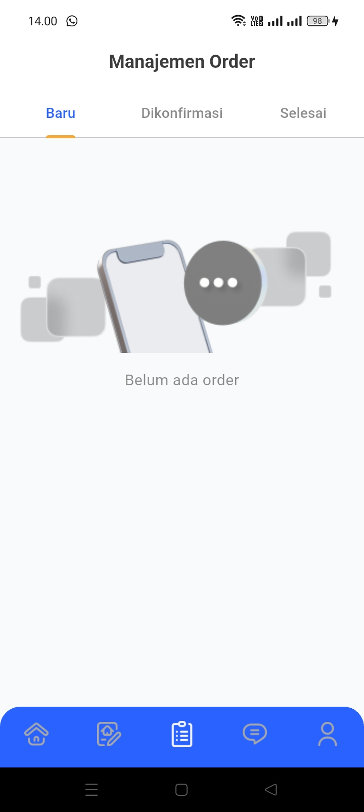
*Gambar 6.1: Layar Manajemen Order - Tab "Baru" (Kondisi Belum Ada Order Masuk)*

#### Penjelasan Elemen Antarmuka:
- **Navigasi 3 Tab Order:**
  - **Baru:** Order yang baru dibayar tamu dan menunggu konfirmasi atau persiapan kamar.
  - **Dikonfirmasi:** Reservasi yang telah dikonfirmasi dan tamu yang sedang dalam masa inap (*Sedang Menginap*).
  - **Selesai / Dibatalkan:** Riwayat pesanan masa lalu.
- **Area Status Kosong (Empty State):** Teks notifikasi *"Belum ada order"* apabila belum terdapat transaksi baru pada periode pengamatan.

#### Petunjuk Pengoperasian:
1. Pastikan notifikasi aplikasi di ponsel Mitra dalam keadaan aktif agar Anda segera mengetahui bila terdapat pesanan baru masuk.

---

### 6.2 Memantau Tamu Menginap & Reservasi Dikonfirmasi (Tab Dikonfirmasi)

Tab Dikonfirmasi menghadirkan daftar tamu yang siap tiba (*confirmed booking*) maupun tamu yang sedang menghuni kamar saat ini (*in-house guest*).

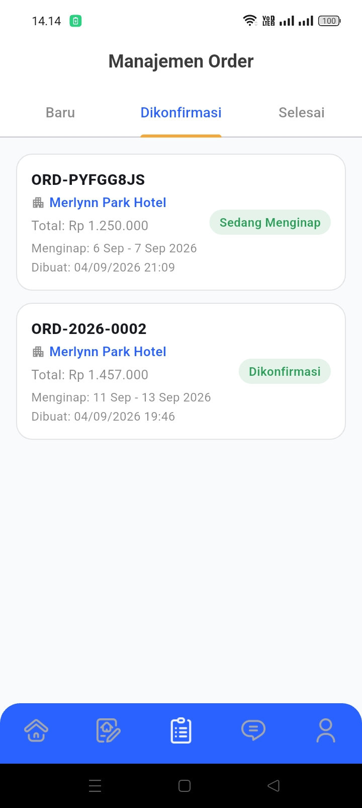
*Gambar 6.2: Layar Manajemen Order - Tab "Dikonfirmasi" dengan Daftar Tamu Menginap*

#### Penjelasan Elemen Antarmuka:
- **Kartu Order Tamu Menginap (ORD-PYFGG8JS):**
  - *Properti:* Merlynn Park Hotel
  - *Total Biaya:* Rp 1.250.000
  - *Periode Menginap:* 6 Sep - 7 Sep 2026
  - *Waktu Dibuat:* 04/09/2026
  - *Status Chip:* `Sedang Menginap` (Badge oranye aktif).
- **Kartu Order Dikonfirmasi Mendatang (ORD-2026-0002):**
  - *Properti:* Merlynn Park Hotel
  - *Total Biaya:* Rp 1.457.000
  - *Periode Menginap:* 11 Sep - 13 Sep 2026
  - *Waktu Dibuat:* 04/09/2026 19:46
  - *Status Chip:* `Dikonfirmasi` (Badge hijau).

#### Petunjuk Pengoperasian:
1. Ketuk kartu pesanan bertanda `Sedang Menginap` saat tamu hendak menyelesaikan masa inap (check-out).
2. Periksa kartu pesanan `Dikonfirmasi` untuk mempersiapkan kunci dan kebersihan kamar sebelum jadwal check-in tamu tiba.

---

### 6.3 Meninjau Riwayat Order Dibatalkan & Selesai (Tab Dibatalkan)

Tab ini menyimpan arsip lengkap reservasi yang dibatalkan oleh tamu atau sistem beserta riwayat transaksi yang telah rampung.

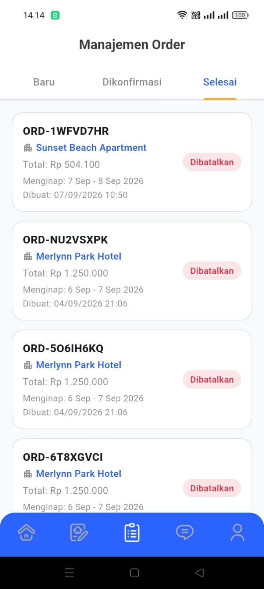
*Gambar 6.3: Layar Manajemen Order - Tab "Dibatalkan" & Catatan Audit Transaksi*

#### Penjelasan Elemen Antarmuka:
- **Daftar Pesanan Dibatalkan:**
  - *ORD-IWFVD7HR:* Sunset Beach Apartment • Total: Rp 504.100 • 7 Sep - 8 Sep 2026 • Status: `Dibatalkan` (Merah).
  - *ORD-NU2VSXPK:* Merlynn Park Hotel • Total: Rp 1.250.000 • 6 Sep - 7 Sep 2026 • Status: `Dibatalkan`.
  - *ORD-5061H6KQ:* Merlynn Park Hotel • Total: Rp 1.250.000 • Status: `Dibatalkan`.
  - *ORD-6T8XGVCl:* Merlynn Park Hotel • Total: Rp 1.250.000 • Status: `Dibatalkan`.

#### Petunjuk Pengoperasian:
1. Saat pesanan berstatus dibatalkan, inventaris kuota kamar atau ketersediaan unit apartemen akan otomatis dipulihkan (*restored*) oleh server Livirooms agar dapat dipesan kembali oleh tamu lain.

---

### 6.4 Rincian Order Tamu Sedang Menginap & Fitur Geser Check-out

Halaman **Detail Order** (`order_detail_screen.dart`) menyajikan siklus lengkap pesanan dengan pelacak status (*status tracker*) dan kendali pelepasan tamu.

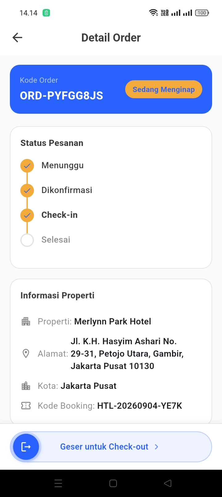
*Gambar 6.4: Layar Detail Order Aktif - Pelacak Status Pesanan & Slider "Geser untuk Check-out"*

#### Penjelasan Elemen Antarmuka:
- **Header Kode Order:** Menampilkan kode pesanan sistem (contoh: `ORD-PYFGG8JS`) dan status `Sedang Menginap`.
- **Indikator Pelacak Status Alur (Status Stepper):** Garis tahapan pesanan:
  - `Menunggu` -> `Dikonfirmasi` -> `Check-in` (Sedang Aktif) -> `Selesai`.
- **Informasi Properti & Alamat:** Nama akomodasi (*Merlynn Park Hotel*), alamat jalan lengkap, kota (*Jakarta Pusat*), serta nomor referensi reservasi tamu (*Kode Booking: HTL-20260904-YE7K*).
- **Slider Aksi "Geser untuk Check-out >":** Tombol geser interaktif horizontal untuk memfinalisasi kepulangan tamu dan melepaskan status kamar menjadi selesai secara aman (mencegah ketidaksengajaan tertekan).

#### Petunjuk Pengoperasian:
1. Saat tamu menyerahkan kunci di meja resepsionis atau mengonfirmasi check-out mandiri, lakukan pemeriksaan kondisi kamar dan deposit jaminan.
2. Geser tombol **Geser untuk Check-out >** dari kiri ke ujung kanan. Sistem akan menandai pesanan sebagai `Selesai` dan mencairkan saldo pendapatan sewa ke dompet Mitra.

---

### 6.5 Rincian Order Transaksi Dibatalkan & Status Pembayaran

Menampilkan riwayat data pembatalan pesanan untuk keperluan audit dan rekonsiliasi.

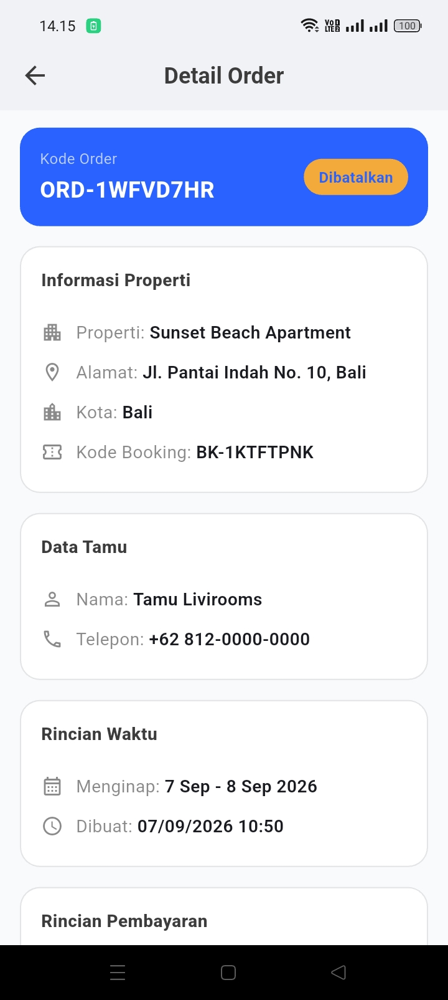
*Gambar 6.5: Layar Detail Order Dibatalkan - Rincian Data Tamu & Informasi Pembayaran*

#### Penjelasan Elemen Antarmuka:
- **Header Status:** Kode order `ORD-IWFVD7HR` dengan label peringatan merah `Dibatalkan`.
- **Informasi Properti & Booking:** Nama akomodasi (*Sunset Beach Apartment*), alamat di Bali, dan kode reservasi (*BK-IKTFTPNK*).
- **Data Tamu Pemesan:** Nama tamu (*Tamu Livirooms*), nomor kontak telepon (*+62 812-0000-0000*).
- **Rincian Waktu:** Tanggal menginap (*7 Sep - 8 Sep 2026*) serta cap waktu pembuatan transaksi (*07/09/2026 10:50*).
- **Seksi Rincian Pembayaran:** Rincian pengembalian dana (*refund status*) sesuai kebijakan pembatalan properti.

#### Petunjuk Pengoperasian:
1. Hubungi tamu via telepon atau WhatsApp jika pembatalan memerlukan verifikasi alasan pembatalan atau konfirmasi pengembalian dana jaminan.

---

# BAB 7: KOMUNIKASI & LAYANAN PELANGGAN (KOTAK MASUK & CHAT)

Aplikasi Mitra Livirooms dilengkapi sistem pesan instan terintegrasi (`chat_room_screen.dart`) yang mengaitkan setiap percakapan dengan nomor reservasi aktif tamu.

### 7.1 Membaca Kotak Masuk Pesan Terkait Nomor Reservasi

Daftar pesan masuk menampilkan percakapan aktif dari calon tamu atau tamu yang sedang menginap.

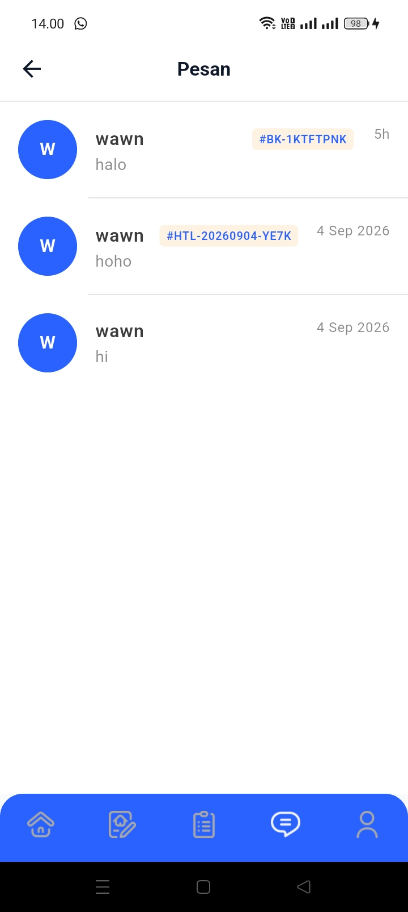
*Gambar 7.1: Kotak Masuk Pesan Mitra - Percakapan Terkait Nomor Kode Booking Tamu*

#### Penjelasan Elemen Antarmuka:
- **Header Modul:** Judul *"Pesan"* dengan filter percakapan.
- **Item Percakapan Tamu:**
  - *Nama Tamu:* `wawn`
  - *Pratinjau Pesan Terakhir:* *"halo"*, *"hoho"*, *"hi"*
  - *Tag Referensi Kode Booking:* `#BK-IKTFTPNK` (Pemesanan Apartemen) dan `#HTL-20260904-YE7K` (Pemesanan Hotel).
  - *Tanggal Percakapan:* `4 Sep 2026`
- **Indikator Pesan Baru:** Tanda titik biru penanda pesan yang belum terbaca oleh staf Mitra.

#### Petunjuk Pengoperasian:
1. Ketuk pada salah satu baris pesan tamu untuk membuka ruang percakapan langsung.
2. Perhatikan tag `#HTL-...` atau `#BK-...` untuk segera mengetahui unit properti yang dibicarakan tamu.

---

### 7.2 Berinteraksi Langsung di Ruang Chat dengan Tamu Properti

Ruang percakapan interaktif memungkinkan Mitra memberikan instruksi akses kunci, panduan arah jalan, maupun menjawab pertanyaan fasilitas.

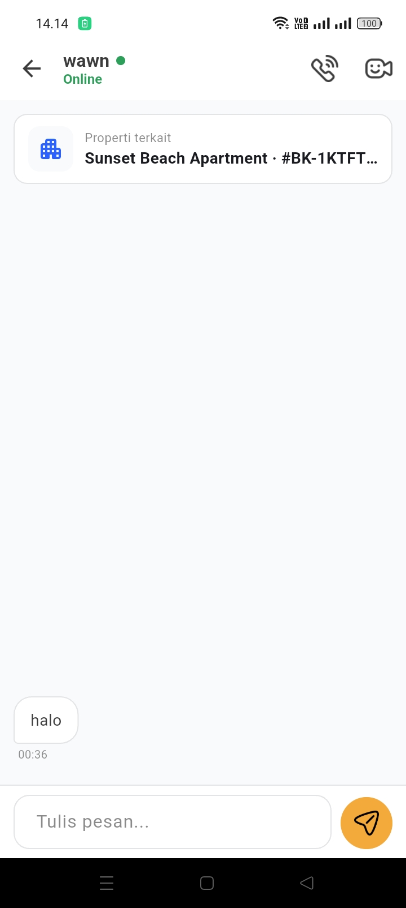
*Gambar 7.2: Ruang Chat Interaktif Mitra - Percakapan Langsung Terkait Unit Properti*

#### Penjelasan Elemen Antarmuka:
- **Header Percakapan:** Nama tamu (*wawn*), status kehadiran (*Online*), serta tautan properti terkait (*Sunset Beach Apartment • #BK-IKTF...*).
- **Area Balon Percakapan:** Menampilkan pesan masuk tamu (balon abu-abu di sisi kiri) dan balasan Mitra (balon biru di sisi kanan) beserta indikator jam pengiriman (*00:36*).
- **Kolom Input Teks ("Tulis pesan..."):** Kolom pengetikan pesan balasan.
- **Tombol Kirim:** Ikon panah biru untuk mengirim pesan seketika ke ponsel tamu.

#### Petunjuk Pengoperasian:
1. Balas pesan tamu sesegera mungkin karena kecepatan respon (*response rate*) mempengaruhi skor reputasi Mitra di platform Livirooms.
2. Gunakan ruang chat ini untuk mengirimkan kode sandi pintu (*smart lock*) atau panduan check-in mandiri.

---

# BAB 8: SALDO DOMPET MITRA & PENARIKAN DANA (WALLET & PAYOUTS)

Modul **Saldo & Penarikan** (`wallet_screen.dart`) memberikan transparansi finansial menyeluruh atas penghasilan sewa yang siap ditarik maupun saldo yang masih dalam masa penjaminan menginap (*escrow*).

### 8.1 Memeriksa Saldo Tersedia & Saldo Tertahan

Mitra dapat memantau saldo likuid yang siap ditransfer ke rekening bank terdaftar.

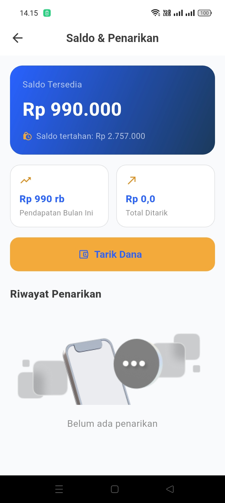
*Gambar 8.1: Layar Dompet Mitra - Saldo Tersedia, Saldo Tertahan & Tombol Tarik Dana*

#### Penjelasan Elemen Antarmuka:
- **Kartu Saldo Tersedia (Rp 990.000):** Saldo bersih dari pemesanan yang telah berstatus `Selesai` (tamu telah check-out) dan siap ditarik ke rekening bank Mitra.
- **Informasi Saldo Tertahan (Rp 2.757.000):** Dana pesanan tamu yang saat ini masih dalam masa menginap (*in-house*). Dana ini diamankan dalam sistem penjaminan Livirooms dan akan otomatis berpindah ke Saldo Tersedia setelah tamu check-out.
- **Metrik Pendapatan Bulan Ini (Rp 990 rb):** Akumulasi pendapatan sewa bersih bulan berjalan.
- **Metrik Total Ditarik:** Rekapitulasi historis penarikan dana yang pernah dilakukan Mitra.
- **Tombol "Tarik Dana" (@ Tarik Dana):** Tombol aksi utama untuk mengajukan transfer pencairan dana ke rekening bank Mitra.
- **Seksi Riwayat Penarikan:** Daftar riwayat transfer penarikan dana masa lalu beserta status mutasinya (*Empty State: Belum ada penarikan*).

#### Petunjuk Pengoperasian:
1. Pastikan nomor rekening bank Mitra telah diisi dan diverifikasi di menu Profil sebelum menekan tombol Tarik Dana.
2. Ketuk tombol **Tarik Dana**, tentukan nominal pencairan yang diinginkan, lalu konfirmasi permohonan penarikan.

---

# BAB 9: PROFIL AKUN MITRA, VERIFIKASI & ARSITEKTUR SISTEM

Modul profil akun (`mitra_profile_screen.dart`) mengelola identitas pemilik, reputasi layanan, serta integrasi beralih peran (*role switching*).

### 9.1 Informasi Profil Mitra, Reputasi & Response Rate

Layar profil menghadirkan kartu reputasi profesional Mitra di hadapan ekosistem Livirooms.

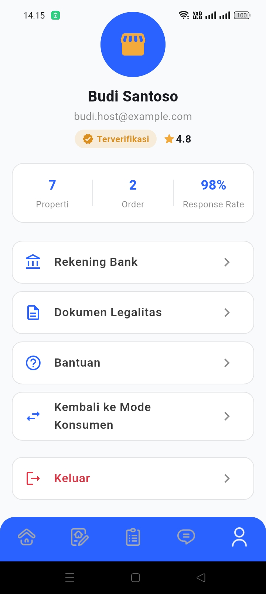
*Gambar 9.1: Layar Profil Akun Mitra - Statistik Kinerja, Reputasi & Menu Pengaturan*

#### Penjelasan Elemen Antarmuka:
- **Kartu Identitas Mitra:** Nama lengkap Mitra (*Budi Santoso*), alamat surel resmi (*budi.host@example.com*), serta lencana hijau `Terverifikasi`.
- **Matriks Reputasi 3 Kolom:**
  - *7 Properti:* Jumlah properti/hotel yang dikelola di bawah akun ini.
  - *2 Order:* Frekuensi pemesanan bulan berjalan.
  - *Rating 4.8:* Skor kepuasan tamu dari skala 5.0.
  - *Response Rate:* Persentase kecepatan dan keaktifan membalas pertanyaan tamu.
- **Menu Pengaturan Akun:**
  - *Rekening Bank:* Pengaturan nomor rekening bank tujuan pencairan dana sewa.
  - *Dokumen Legalitas:* Unggah KTP, NPWP, dan berkas sertifikasi kepemilikan/pengelolaan properti.
  - *Bantuan:* Pusat bantuan layanan pelanggan Mitra Livirooms.

#### Petunjuk Pengoperasian:
1. Lengkapi berkas di menu **Dokumen Legalitas** untuk mendapatkan lencana akun terverifikasi penuh dan batas penarikan dana yang lebih tinggi.

---

### 9.2 Akses Menu Cepat & Beralih ke Mode Konsumen

Mitra Livirooms dapat dengan mudah beralih menjadi konsumen biasa untuk memesan kamar di tempat lain tanpa perlu membuat akun baru.

*Gambar 9.2: Profil Mitra - Fitur Pindah Cepat ke Mode Konsumen & Tombol Keluar*

#### Penjelasan Elemen Antarmuka:
- **Menu "Kembali ke Mode Konsumen":** Tombol praktis untuk berpindah ke antarmuka aplikasi tamu biasa (*Consumer Mode*) dengan akun yang sama.
- **Menu "Keluar":** Tombol berwarna merah untuk keluar (*logout*) dari sesi aplikasi seluler secara aman.

#### Petunjuk Pengoperasian:
1. Ketuk menu **Kembali ke Mode Konsumen** bila Anda ingin mencari atau memesan akomodasi milik mitra lain untuk perjalanan pribadi Anda.
2. Gunakan tombol **Keluar** bila ponsel Anda digunakan bersama oleh staf lain guna menjaga kerahasiaan data operasional.

---

### 9.3 Standar Keamanan & Otorisasi Akun Mitra

Aplikasi Livirooms Mitra menerapkan mekanisme keamanan berlapis (*end-to-end tokenized authentication*) menggunakan Laravel Sanctum untuk melindungi rekening dan properti Anda dari akses tidak sah.

*Gambar 9.3: Lencana Standar Keamanan Kriptografis & Otorisasi Akun Mitra Livirooms*

#### Penjelasan Keamanan Sistem:
- **Enkripsi Sesi Token Sanctum:** Setiap pertukaran data antara aplikasi Flutter dan server backend dilindungi oleh token sesi kriptografis terenkripsi.
- **Pemisahan Otorisasi Hak Akses (Spatie Permission):** Akun Mitra memiliki pembatasan ketat (*role isolation*); Mitra hanya memiliki wewenang untuk membaca dan mengubah unit properti milik sendiri.
- **Proteksi Penarikan Dana:** Seluruh instruksi penarikan dana mewajibkan konfirmasi sandi dan verifikasi rekening terdaftar.

---

### 9.4 Arsitektur Cerdas & Alur Data Kontekstual Sistem

Aplikasi Livirooms dirancang mengikuti prinsip rekayasa konteks modern (*Modern Context Engineering Architecture*) guna memastikan respon data yang cepat, hemat bandwidth, dan terhindar dari galat sinkronisasi.

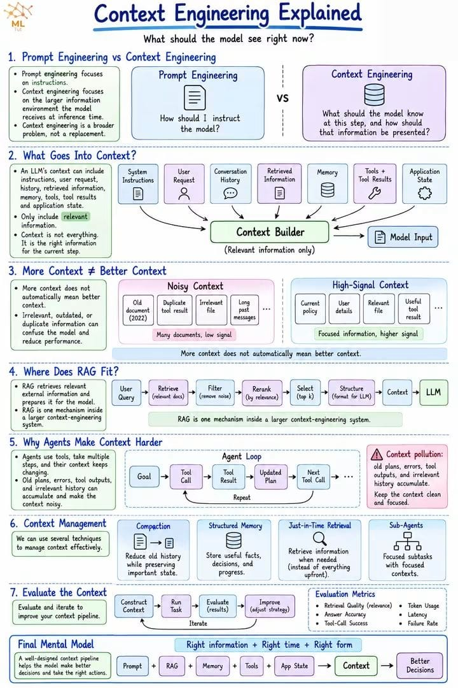
*Gambar 9.4: Arsitektur Rekayasa Konteks Cerdas (Context Engineering) Platform Livirooms*

#### Prinsip Arsitektur Konteks Cerdas:
1. **High-Signal Context Delivery:** Aplikasi seluler Mitra hanya meminta data yang relevan dengan status operasional aktif saat itu, sehingga pemuatan halaman berlangsung di bawah 1 detik bahkan pada jaringan seluler 3G/4G.
2. **Dual-Model Availability Pipeline:** Sistem secara cerdas memisahkan pipa ketersediaan unit sewa apartemen harian (*unit availability*) dengan alokasi kamar hotel (*room allotment*), mencegah tabrakan data (*race condition*) antar pemesanan tamu simultan.
3. **Automated State Synchronization:** Setiap perubahan yang dilakukan Mitra melalui fitur Quick Edit langsung disiarkan ke mesin pencarian konsumen secara instan melalui integrasi webhook dan API state machine terpusat.

---

## RINGKASAN PRAKTIK TERBAIK OPERASIONAL MITRA

Untuk memaksimalkan pendapatan dan kepuasan tamu di platform Livirooms, perhatikan daftar periksa harian berikut:
- [x] **Pagi Hari (08:00 - 10:00):** Buka menu *Order* tab *Sedang Menginap* untuk mengonfirmasi tamu yang dijadwalkan check-out hari ini.
- [x] **Siang Hari (12:00 - 14:00):** Bersihkan dan periksa kondisi kamar bersama staf tata graha, kemudian verifikasi ketersediaan kunci kamar bagi tamu baru yang akan datang.
- [x] **Sore Hari (14:00 - 18:00):** Sambut kedatangan tamu check-in, arahkan panduan unit lewat fitur *Chat*, dan bantu proses verifikasi identitas bila diperlukan.
- [x] **Malam Hari (20:00 - 22:00):** Buka menu *Quick Edit* untuk menyesuaikan sisa kuota kamar hotel (*allotment*) atau menawarkan promo potongan harga kilat (*Flash Sale*) bagi kamar yang belum terisi.
